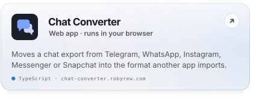
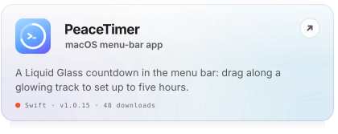
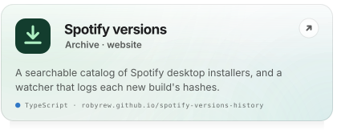
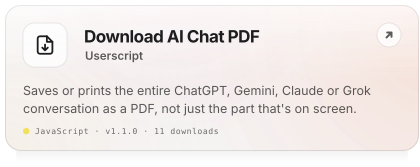
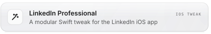
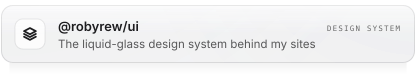
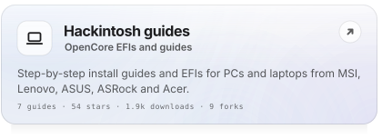
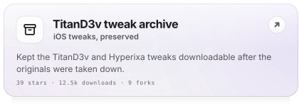
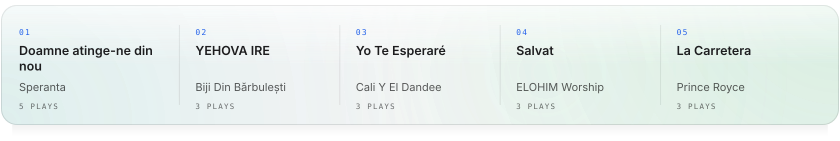

<!-- Generated by .github/profile/build.py from profile.toml. Edit that file, not this one. -->

<a href="https://cosmincalin.es" title="More about me on cosmincalin.es"><picture><source media="(max-width: 600px)" srcset="https://raw.githubusercontent.com/RobyRew/RobyRew/main/img/m/hero-me.svg"><source media="(prefers-color-scheme: dark)" srcset="https://raw.githubusercontent.com/RobyRew/RobyRew/main/img/dark/hero-me.svg"></picture></a><a href="https://robyrew.github.io/RobyRew/go/play/" title="Play what&#x27;s on the deck"><picture><source media="(max-width: 600px)" srcset="https://robyrew.github.io/RobyRew/img/m/hero-deck.svg"><source media="(prefers-color-scheme: dark)" srcset="https://robyrew.github.io/RobyRew/img/dark/hero-deck.svg"></picture></a>
<a href="https://github.com/RobyRew?tab=repositories&amp;sort=stargazers" title="My repositories, most starred first"><picture><source media="(max-width: 600px)" srcset="https://raw.githubusercontent.com/RobyRew/RobyRew/main/img/m/stats-numbers.svg"><source media="(prefers-color-scheme: dark)" srcset="https://raw.githubusercontent.com/RobyRew/RobyRew/main/img/dark/stats-numbers.svg"></picture></a>
<a href="https://github.com/RobyRew?tab=repositories" title="All 45 repos"><picture><source media="(max-width: 600px)" srcset="https://raw.githubusercontent.com/RobyRew/RobyRew/main/img/m/work-head.svg"><source media="(prefers-color-scheme: dark)" srcset="https://raw.githubusercontent.com/RobyRew/RobyRew/main/img/dark/work-head.svg"></picture></a>
<a href="https://github.com/RobyRew/TopPresenter" title="Open TopPresenter on GitHub"><picture><source media="(max-width: 600px)" srcset="https://raw.githubusercontent.com/RobyRew/RobyRew/main/img/m/work-1-toppresenter.svg"><source media="(prefers-color-scheme: dark)" srcset="https://raw.githubusercontent.com/RobyRew/RobyRew/main/img/dark/work-1-toppresenter.svg"></picture></a>
<a href="https://github.com/RobyRew/chat-converter" title="Open Chat Converter on GitHub"><picture><source media="(max-width: 600px)" srcset="https://raw.githubusercontent.com/RobyRew/RobyRew/main/img/m/work-2-chat-converter.svg"><source media="(prefers-color-scheme: dark)" srcset="https://raw.githubusercontent.com/RobyRew/RobyRew/main/img/dark/work-2-chat-converter.svg"></picture></a><a href="https://github.com/RobyRew/mapswitch" title="Open MapSwitch on GitHub"><picture><source media="(max-width: 600px)" srcset="https://raw.githubusercontent.com/RobyRew/RobyRew/main/img/m/work-2-mapswitch.svg"><source media="(prefers-color-scheme: dark)" srcset="https://raw.githubusercontent.com/RobyRew/RobyRew/main/img/dark/work-2-mapswitch.svg"></picture></a>
<a href="https://github.com/RobyRew/pacetimer" title="Open PeaceTimer on GitHub"><picture><source media="(max-width: 600px)" srcset="https://raw.githubusercontent.com/RobyRew/RobyRew/main/img/m/work-3-pacetimer.svg"><source media="(prefers-color-scheme: dark)" srcset="https://raw.githubusercontent.com/RobyRew/RobyRew/main/img/dark/work-3-pacetimer.svg"></picture></a><a href="https://github.com/RobyRew/striker" title="Open Striker on GitHub"><picture><source media="(max-width: 600px)" srcset="https://raw.githubusercontent.com/RobyRew/RobyRew/main/img/m/work-3-striker.svg"><source media="(prefers-color-scheme: dark)" srcset="https://raw.githubusercontent.com/RobyRew/RobyRew/main/img/dark/work-3-striker.svg"></picture></a>
<a href="https://github.com/RobyRew/spotify-versions-history" title="Open Spotify versions on GitHub"><picture><source media="(max-width: 600px)" srcset="https://raw.githubusercontent.com/RobyRew/RobyRew/main/img/m/work-4-spotify-versions-history.svg"><source media="(prefers-color-scheme: dark)" srcset="https://raw.githubusercontent.com/RobyRew/RobyRew/main/img/dark/work-4-spotify-versions-history.svg"></picture></a><a href="https://github.com/RobyRew/Download-AI-Chat-PDF" title="Open Download AI Chat PDF on GitHub"><picture><source media="(max-width: 600px)" srcset="https://raw.githubusercontent.com/RobyRew/RobyRew/main/img/m/work-4-download-ai-chat-pdf.svg"><source media="(prefers-color-scheme: dark)" srcset="https://raw.githubusercontent.com/RobyRew/RobyRew/main/img/dark/work-4-download-ai-chat-pdf.svg"></picture></a>
<a href="#more" title="More projects"><picture><source media="(max-width: 600px)" srcset="https://raw.githubusercontent.com/RobyRew/RobyRew/main/img/m/more-head.svg"><source media="(prefers-color-scheme: dark)" srcset="https://raw.githubusercontent.com/RobyRew/RobyRew/main/img/dark/more-head.svg"></picture></a>
<a href="https://github.com/RobyRew/Doorline" title="Open Doorline on GitHub"><picture><source media="(max-width: 600px)" srcset="https://raw.githubusercontent.com/RobyRew/RobyRew/main/img/m/more-1-doorline.svg"><source media="(prefers-color-scheme: dark)" srcset="https://raw.githubusercontent.com/RobyRew/RobyRew/main/img/dark/more-1-doorline.svg"></picture></a><a href="https://github.com/RobyRew/chatforge" title="Open ChatForge on GitHub"><picture><source media="(max-width: 600px)" srcset="https://raw.githubusercontent.com/RobyRew/RobyRew/main/img/m/more-1-chatforge.svg"><source media="(prefers-color-scheme: dark)" srcset="https://raw.githubusercontent.com/RobyRew/RobyRew/main/img/dark/more-1-chatforge.svg"></picture></a>
<a href="https://github.com/RobyRew/calendar-event-generator" title="Open Calendar Event Generator on GitHub"><picture><source media="(max-width: 600px)" srcset="https://raw.githubusercontent.com/RobyRew/RobyRew/main/img/m/more-2-calendar-event-generator.svg"><source media="(prefers-color-scheme: dark)" srcset="https://raw.githubusercontent.com/RobyRew/RobyRew/main/img/dark/more-2-calendar-event-generator.svg"></picture></a><a href="https://github.com/RobyRew/powerpoint-extractor" title="Open PowerPoint Extractor on GitHub"><picture><source media="(max-width: 600px)" srcset="https://raw.githubusercontent.com/RobyRew/RobyRew/main/img/m/more-2-powerpoint-extractor.svg"><source media="(prefers-color-scheme: dark)" srcset="https://raw.githubusercontent.com/RobyRew/RobyRew/main/img/dark/more-2-powerpoint-extractor.svg"></picture></a>
<a href="https://github.com/RobyRew/linkedin-pro-ios" title="Open LinkedIn Professional on GitHub"><picture><source media="(max-width: 600px)" srcset="https://raw.githubusercontent.com/RobyRew/RobyRew/main/img/m/more-3-linkedin-pro-ios.svg"><source media="(prefers-color-scheme: dark)" srcset="https://raw.githubusercontent.com/RobyRew/RobyRew/main/img/dark/more-3-linkedin-pro-ios.svg"></picture></a><a href="https://github.com/RobyRew/split-stream" title="Open SplitStream on GitHub"><picture><source media="(max-width: 600px)" srcset="https://raw.githubusercontent.com/RobyRew/RobyRew/main/img/m/more-3-split-stream.svg"><source media="(prefers-color-scheme: dark)" srcset="https://raw.githubusercontent.com/RobyRew/RobyRew/main/img/dark/more-3-split-stream.svg"></picture></a>
<a href="https://github.com/RobyRew/retro-phone-tools" title="Open Retro Phone Tools on GitHub"><picture><source media="(max-width: 600px)" srcset="https://raw.githubusercontent.com/RobyRew/RobyRew/main/img/m/more-4-retro-phone-tools.svg"><source media="(prefers-color-scheme: dark)" srcset="https://raw.githubusercontent.com/RobyRew/RobyRew/main/img/dark/more-4-retro-phone-tools.svg"></picture></a><a href="https://github.com/RobyRew/robyrew-id" title="Open RobyRew ID on GitHub"><picture><source media="(max-width: 600px)" srcset="https://raw.githubusercontent.com/RobyRew/RobyRew/main/img/m/more-4-robyrew-id.svg"><source media="(prefers-color-scheme: dark)" srcset="https://raw.githubusercontent.com/RobyRew/RobyRew/main/img/dark/more-4-robyrew-id.svg"></picture></a>
<a href="https://github.com/RobyRew/ui" title="Open @robyrew/ui on GitHub"><picture><source media="(max-width: 600px)" srcset="https://raw.githubusercontent.com/RobyRew/RobyRew/main/img/m/more-5-ui.svg"><source media="(prefers-color-scheme: dark)" srcset="https://raw.githubusercontent.com/RobyRew/RobyRew/main/img/dark/more-5-ui.svg"></picture></a><a href="https://github.com/RobyRew?tab=repositories&amp;sort=updated" title="All my repositories, latest push first"><picture><source media="(max-width: 600px)" srcset="https://raw.githubusercontent.com/RobyRew/RobyRew/main/img/m/more-5-all.svg"><source media="(prefers-color-scheme: dark)" srcset="https://raw.githubusercontent.com/RobyRew/RobyRew/main/img/dark/more-5-all.svg"></picture></a>
<a href="https://github.com/RobyRew?tab=repositories&amp;type=archived" title="Archived repos"><picture><source media="(max-width: 600px)" srcset="https://raw.githubusercontent.com/RobyRew/RobyRew/main/img/m/archive-head.svg"><source media="(prefers-color-scheme: dark)" srcset="https://raw.githubusercontent.com/RobyRew/RobyRew/main/img/dark/archive-head.svg"></picture></a>
<a href="https://github.com/RobyRew?tab=repositories&amp;q=Hackintosh" title="My Hackintosh guides"><picture><source media="(max-width: 600px)" srcset="https://raw.githubusercontent.com/RobyRew/RobyRew/main/img/m/archive-1-1.svg"><source media="(prefers-color-scheme: dark)" srcset="https://raw.githubusercontent.com/RobyRew/RobyRew/main/img/dark/archive-1-1.svg"></picture></a><a href="https://github.com/RobyRew/TitanD3v-and-Hyperixa-Tweaks-Free" title="Open TitanD3v tweak archive"><picture><source media="(max-width: 600px)" srcset="https://raw.githubusercontent.com/RobyRew/RobyRew/main/img/m/archive-1-2.svg"><source media="(prefers-color-scheme: dark)" srcset="https://raw.githubusercontent.com/RobyRew/RobyRew/main/img/dark/archive-1-2.svg"></picture></a>
<a href="https://www.last.fm/user/RobyRew" title="284 scrobbles"><picture><source media="(max-width: 600px)" srcset="https://raw.githubusercontent.com/RobyRew/RobyRew/main/img/m/music-head.svg"><source media="(prefers-color-scheme: dark)" srcset="https://raw.githubusercontent.com/RobyRew/RobyRew/main/img/dark/music-head.svg"></picture></a>
<a href="https://www.last.fm/user/RobyRew" title="Everything I listen to"><picture><source media="(max-width: 600px)" srcset="https://raw.githubusercontent.com/RobyRew/RobyRew/main/img/m/rotation-tracks.svg"><source media="(prefers-color-scheme: dark)" srcset="https://raw.githubusercontent.com/RobyRew/RobyRew/main/img/dark/rotation-tracks.svg"></picture></a>
<a href="https://cosmincalin.es" title="Website: cosmincalin.es"><picture><source media="(max-width: 600px)" srcset="https://raw.githubusercontent.com/RobyRew/RobyRew/main/img/m/contact-website.svg"><source media="(prefers-color-scheme: dark)" srcset="https://raw.githubusercontent.com/RobyRew/RobyRew/main/img/dark/contact-website.svg"></picture></a><a href="https://www.linkedin.com/in/cosmincaliin" title="LinkedIn: in/cosmincaliin"><picture><source media="(max-width: 600px)" srcset="https://raw.githubusercontent.com/RobyRew/RobyRew/main/img/m/contact-linkedin.svg"><source media="(prefers-color-scheme: dark)" srcset="https://raw.githubusercontent.com/RobyRew/RobyRew/main/img/dark/contact-linkedin.svg"></picture></a><a href="https://t.me/RobyRew" title="Telegram: @RobyRew"><picture><source media="(max-width: 600px)" srcset="https://raw.githubusercontent.com/RobyRew/RobyRew/main/img/m/contact-telegram.svg"><source media="(prefers-color-scheme: dark)" srcset="https://raw.githubusercontent.com/RobyRew/RobyRew/main/img/dark/contact-telegram.svg"></picture></a>
<a href="#top" title="Back to the top"><picture><source media="(max-width: 600px)" srcset="https://raw.githubusercontent.com/RobyRew/RobyRew/main/img/m/footer-end.svg"><source media="(prefers-color-scheme: dark)" srcset="https://raw.githubusercontent.com/RobyRew/RobyRew/main/img/dark/footer-end.svg"></picture></a>

