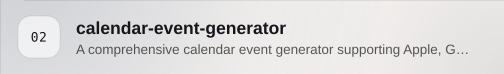
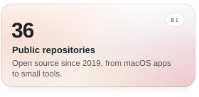
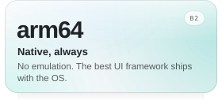
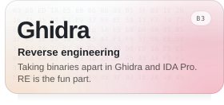
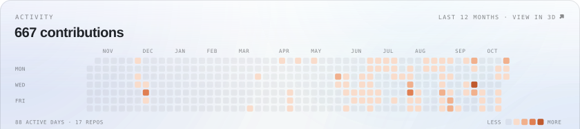
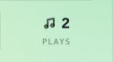
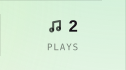

<!-- Generated by .github/profile/build.py from profile.toml. Edit that file, not this one. -->
<a name="top"></a>
<div align="center">
<a href="https://robyrew.com" title="Visit robyrew.com"><picture><source media="(prefers-color-scheme: dark) and (max-width: 600px)" srcset="img/dark-m/hero-me.svg"><source media="(max-width: 600px)" srcset="img/light-m/hero-me.svg"><source media="(prefers-color-scheme: dark)" srcset="img/dark/hero-me.svg"></picture></a><a href="https://robyrew.github.io/RobyRew/go/play/" title="Play it on Spotify"><picture><source media="(prefers-color-scheme: dark) and (max-width: 600px)" srcset="https://robyrew.github.io/RobyRew/img/dark-m/hero-deck.svg"><source media="(max-width: 600px)" srcset="https://robyrew.github.io/RobyRew/img/light-m/hero-deck.svg"><source media="(prefers-color-scheme: dark)" srcset="https://robyrew.github.io/RobyRew/img/dark/hero-deck.svg"></picture></a>
<a href="https://robyrew.com" title="Visit robyrew.com"><picture><source media="(prefers-color-scheme: dark) and (max-width: 600px)" srcset="img/dark-m/hero-song-me.svg"><source media="(max-width: 600px)" srcset="img/light-m/hero-song-me.svg"><source media="(prefers-color-scheme: dark)" srcset="img/dark/hero-song-me.svg"></picture></a><a href="https://robyrew.github.io/RobyRew/go/song/" title="The song on my record player"><picture><source media="(prefers-color-scheme: dark) and (max-width: 600px)" srcset="https://robyrew.github.io/RobyRew/img/dark-m/hero-song-song.svg"><source media="(max-width: 600px)" srcset="https://robyrew.github.io/RobyRew/img/light-m/hero-song-song.svg"><source media="(prefers-color-scheme: dark)" srcset="https://robyrew.github.io/RobyRew/img/dark/hero-song-song.svg"></picture></a>
<a href="https://robyrew.com" title="Visit robyrew.com"><picture><source media="(prefers-color-scheme: dark) and (max-width: 600px)" srcset="img/dark-m/hero-artist-me.svg"><source media="(max-width: 600px)" srcset="img/light-m/hero-artist-me.svg"><source media="(prefers-color-scheme: dark)" srcset="img/dark/hero-artist-me.svg"></picture></a><a href="https://robyrew.github.io/RobyRew/go/artist/" title="The artist"><picture><source media="(prefers-color-scheme: dark) and (max-width: 600px)" srcset="https://robyrew.github.io/RobyRew/img/dark-m/hero-artist-artist.svg"><source media="(max-width: 600px)" srcset="https://robyrew.github.io/RobyRew/img/light-m/hero-artist-artist.svg"><source media="(prefers-color-scheme: dark)" srcset="https://robyrew.github.io/RobyRew/img/dark/hero-artist-artist.svg"></picture></a>
<a href="https://robyrew.com" title="Visit robyrew.com"><picture><source media="(prefers-color-scheme: dark) and (max-width: 600px)" srcset="img/dark-m/hero-context-me.svg"><source media="(max-width: 600px)" srcset="img/light-m/hero-context-me.svg"><source media="(prefers-color-scheme: dark)" srcset="img/dark/hero-context-me.svg"></picture></a><a href="https://robyrew.github.io/RobyRew/go/context/" title="The album or playlist"><picture><source media="(prefers-color-scheme: dark) and (max-width: 600px)" srcset="https://robyrew.github.io/RobyRew/img/dark-m/hero-context-context.svg"><source media="(max-width: 600px)" srcset="https://robyrew.github.io/RobyRew/img/light-m/hero-context-context.svg"><source media="(prefers-color-scheme: dark)" srcset="https://robyrew.github.io/RobyRew/img/dark/hero-context-context.svg"></picture></a>
<a href="https://robyrew.com" title="Visit robyrew.com"><picture><source media="(prefers-color-scheme: dark) and (max-width: 600px)" srcset="img/dark-m/hero-user-me.svg"><source media="(max-width: 600px)" srcset="img/light-m/hero-user-me.svg"><source media="(prefers-color-scheme: dark)" srcset="img/dark/hero-user-me.svg"></picture></a><a href="https://robyrew.github.io/RobyRew/go/user/" title="My listening profile"><picture><source media="(prefers-color-scheme: dark) and (max-width: 600px)" srcset="https://robyrew.github.io/RobyRew/img/dark-m/hero-user-user.svg"><source media="(max-width: 600px)" srcset="https://robyrew.github.io/RobyRew/img/light-m/hero-user-user.svg"><source media="(prefers-color-scheme: dark)" srcset="https://robyrew.github.io/RobyRew/img/dark/hero-user-user.svg"></picture></a>
<a href="https://robyrew.com" title="Open robyrew.com"><picture><source media="(prefers-color-scheme: dark) and (max-width: 600px)" srcset="img/dark-m/links-1.svg"><source media="(max-width: 600px)" srcset="img/light-m/links-1.svg"><source media="(prefers-color-scheme: dark)" srcset="img/dark/links-1.svg"></picture></a><a href="https://t.me/RobyRew" title="Open @RobyRew on Telegram"><picture><source media="(prefers-color-scheme: dark) and (max-width: 600px)" srcset="img/dark-m/links-2.svg"><source media="(max-width: 600px)" srcset="img/light-m/links-2.svg"><source media="(prefers-color-scheme: dark)" srcset="img/dark/links-2.svg"></picture></a>
<a href="#work" title="Jump to Work"><picture><source media="(prefers-color-scheme: dark) and (max-width: 600px)" srcset="img/dark-m/nav-work.svg"><source media="(max-width: 600px)" srcset="img/light-m/nav-work.svg"><source media="(prefers-color-scheme: dark)" srcset="img/dark/nav-work.svg"></picture></a><a href="#charts" title="Jump to Charts"><picture><source media="(prefers-color-scheme: dark) and (max-width: 600px)" srcset="img/dark-m/nav-charts.svg"><source media="(max-width: 600px)" srcset="img/light-m/nav-charts.svg"><source media="(prefers-color-scheme: dark)" srcset="img/dark/nav-charts.svg"></picture></a><a href="#music" title="Jump to Music"><picture><source media="(prefers-color-scheme: dark) and (max-width: 600px)" srcset="img/dark-m/nav-music.svg"><source media="(max-width: 600px)" srcset="img/light-m/nav-music.svg"><source media="(prefers-color-scheme: dark)" srcset="img/dark/nav-music.svg"></picture></a><a href="#credits" title="Jump to Credits"><picture><source media="(prefers-color-scheme: dark) and (max-width: 600px)" srcset="img/dark-m/nav-credits.svg"><source media="(max-width: 600px)" srcset="img/light-m/nav-credits.svg"><source media="(prefers-color-scheme: dark)" srcset="img/dark/nav-credits.svg"></picture></a>
<a name="work"></a><a href="#work" title="Selected work"><picture><source media="(prefers-color-scheme: dark) and (max-width: 600px)" srcset="img/dark-m/side-a-title.svg"><source media="(max-width: 600px)" srcset="img/light-m/side-a-title.svg"><source media="(prefers-color-scheme: dark)" srcset="img/dark/side-a-title.svg"></picture></a><a href="https://github.com/RobyRew?tab=repositories" title="All 36 repos"><picture><source media="(prefers-color-scheme: dark) and (max-width: 600px)" srcset="img/dark-m/side-a-side.svg"><source media="(max-width: 600px)" srcset="img/light-m/side-a-side.svg"><source media="(prefers-color-scheme: dark)" srcset="img/dark/side-a-side.svg"></picture></a>
<a href="https://github.com/RobyRew/TopPresenter" title="Open TopPresenter on GitHub"><picture><source media="(prefers-color-scheme: dark) and (max-width: 600px)" srcset="img/dark-m/work-1-1.svg"><source media="(max-width: 600px)" srcset="img/light-m/work-1-1.svg"><source media="(prefers-color-scheme: dark)" srcset="img/dark/work-1-1.svg"></picture></a>
<a href="https://github.com/RobyRew/TopPresenter/stargazers" title="Who starred TopPresenter"><picture><source media="(prefers-color-scheme: dark) and (max-width: 600px)" srcset="img/dark-m/work-1-meta-stars.svg"><source media="(max-width: 600px)" srcset="img/light-m/work-1-meta-stars.svg"><source media="(prefers-color-scheme: dark)" srcset="img/dark/work-1-meta-stars.svg"></picture></a><a href="https://github.com/RobyRew/TopPresenter/releases" title="All TopPresenter releases"><picture><source media="(prefers-color-scheme: dark) and (max-width: 600px)" srcset="img/dark-m/work-1-meta-downloads.svg"><source media="(max-width: 600px)" srcset="img/light-m/work-1-meta-downloads.svg"><source media="(prefers-color-scheme: dark)" srcset="img/dark/work-1-meta-downloads.svg"></picture></a><a href="https://github.com/RobyRew/TopPresenter/releases/latest" title="Latest TopPresenter release"><picture><source media="(prefers-color-scheme: dark) and (max-width: 600px)" srcset="img/dark-m/work-1-meta-latest.svg"><source media="(max-width: 600px)" srcset="img/light-m/work-1-meta-latest.svg"><source media="(prefers-color-scheme: dark)" srcset="img/dark/work-1-meta-latest.svg"></picture></a><a href="https://github.com/RobyRew?tab=repositories&amp;language=swift" title="My other Swift projects"><picture><source media="(prefers-color-scheme: dark) and (max-width: 600px)" srcset="img/dark-m/work-1-meta-language.svg"><source media="(max-width: 600px)" srcset="img/light-m/work-1-meta-language.svg"><source media="(prefers-color-scheme: dark)" srcset="img/dark/work-1-meta-language.svg"></picture></a>
<a href="https://github.com/RobyRew/mapswitch" title="Open mapswitch on GitHub"><picture><source media="(prefers-color-scheme: dark) and (max-width: 600px)" srcset="img/dark-m/work-2-1.svg"><source media="(max-width: 600px)" srcset="img/light-m/work-2-1.svg"><source media="(prefers-color-scheme: dark)" srcset="img/dark/work-2-1.svg"></picture></a><a href="https://github.com/RobyRew/chatforge" title="Open chatforge on GitHub"><picture><source media="(prefers-color-scheme: dark) and (max-width: 600px)" srcset="img/dark-m/work-2-2.svg"><source media="(max-width: 600px)" srcset="img/light-m/work-2-2.svg"><source media="(prefers-color-scheme: dark)" srcset="img/dark/work-2-2.svg"></picture></a>
<a href="https://github.com/RobyRew/mapswitch/stargazers" title="Who starred mapswitch"><picture><source media="(prefers-color-scheme: dark) and (max-width: 600px)" srcset="img/dark-m/work-2-meta-stars.svg"><source media="(max-width: 600px)" srcset="img/light-m/work-2-meta-stars.svg"><source media="(prefers-color-scheme: dark)" srcset="img/dark/work-2-meta-stars.svg"></picture></a><a href="https://github.com/RobyRew?tab=repositories&amp;language=typescript" title="My other TypeScript projects"><picture><source media="(prefers-color-scheme: dark) and (max-width: 600px)" srcset="img/dark-m/work-2-meta-language.svg"><source media="(max-width: 600px)" srcset="img/light-m/work-2-meta-language.svg"><source media="(prefers-color-scheme: dark)" srcset="img/dark/work-2-meta-language.svg"></picture></a><a href="https://github.com/RobyRew?tab=repositories&amp;language=typescript" title="My other TypeScript projects"><picture><source media="(prefers-color-scheme: dark) and (max-width: 600px)" srcset="img/dark-m/work-2-meta-language-3.svg"><source media="(max-width: 600px)" srcset="img/light-m/work-2-meta-language-3.svg"><source media="(prefers-color-scheme: dark)" srcset="img/dark/work-2-meta-language-3.svg"></picture></a><a href="https://github.com/RobyRew/chatforge" title="Browse the chatforge source"><picture><source media="(prefers-color-scheme: dark) and (max-width: 600px)" srcset="img/dark-m/work-2-meta-source.svg"><source media="(max-width: 600px)" srcset="img/light-m/work-2-meta-source.svg"><source media="(prefers-color-scheme: dark)" srcset="img/dark/work-2-meta-source.svg"></picture></a>
<a href="https://github.com/RobyRew/Download-AI-Chat-PDF" title="Open Download-AI-Chat-PDF on GitHub"><picture><source media="(prefers-color-scheme: dark) and (max-width: 600px)" srcset="img/dark-m/work-3-1.svg"><source media="(max-width: 600px)" srcset="img/light-m/work-3-1.svg"><source media="(prefers-color-scheme: dark)" srcset="img/dark/work-3-1.svg"></picture></a><a href="https://github.com/RobyRew/spotify-versions-history" title="Open spotify-versions-history on GitHub"><picture><source media="(prefers-color-scheme: dark) and (max-width: 600px)" srcset="img/dark-m/work-3-2.svg"><source media="(max-width: 600px)" srcset="img/light-m/work-3-2.svg"><source media="(prefers-color-scheme: dark)" srcset="img/dark/work-3-2.svg"></picture></a>
<a href="https://github.com/RobyRew/Download-AI-Chat-PDF/releases" title="All Download-AI-Chat-PDF releases"><picture><source media="(prefers-color-scheme: dark) and (max-width: 600px)" srcset="img/dark-m/work-3-meta-downloads.svg"><source media="(max-width: 600px)" srcset="img/light-m/work-3-meta-downloads.svg"><source media="(prefers-color-scheme: dark)" srcset="img/dark/work-3-meta-downloads.svg"></picture></a><a href="https://github.com/RobyRew/Download-AI-Chat-PDF/releases/latest" title="Latest Download-AI-Chat-PDF release"><picture><source media="(prefers-color-scheme: dark) and (max-width: 600px)" srcset="img/dark-m/work-3-meta-latest.svg"><source media="(max-width: 600px)" srcset="img/light-m/work-3-meta-latest.svg"><source media="(prefers-color-scheme: dark)" srcset="img/dark/work-3-meta-latest.svg"></picture></a><a href="https://github.com/RobyRew/spotify-versions-history/stargazers" title="Who starred spotify-versions-history"><picture><source media="(prefers-color-scheme: dark) and (max-width: 600px)" srcset="img/dark-m/work-3-meta-stars.svg"><source media="(max-width: 600px)" srcset="img/light-m/work-3-meta-stars.svg"><source media="(prefers-color-scheme: dark)" srcset="img/dark/work-3-meta-stars.svg"></picture></a><a href="https://github.com/RobyRew?tab=repositories&amp;language=javascript" title="My other JavaScript projects"><picture><source media="(prefers-color-scheme: dark) and (max-width: 600px)" srcset="img/dark-m/work-3-meta-language.svg"><source media="(max-width: 600px)" srcset="img/light-m/work-3-meta-language.svg"><source media="(prefers-color-scheme: dark)" srcset="img/dark/work-3-meta-language.svg"></picture></a>
<a href="#work" title="Fresh from the studio"><picture><source media="(prefers-color-scheme: dark) and (max-width: 600px)" srcset="img/dark-m/b-sides-title.svg"><source media="(max-width: 600px)" srcset="img/light-m/b-sides-title.svg"><source media="(prefers-color-scheme: dark)" srcset="img/dark/b-sides-title.svg"></picture></a><a href="https://github.com/RobyRew?tab=repositories&amp;sort=updated" title="Latest pushes"><picture><source media="(prefers-color-scheme: dark) and (max-width: 600px)" srcset="img/dark-m/b-sides-side.svg"><source media="(max-width: 600px)" srcset="img/light-m/b-sides-side.svg"><source media="(prefers-color-scheme: dark)" srcset="img/dark/b-sides-side.svg"></picture></a>
<a href="https://github.com/RobyRew/Doorline" title="Open Doorline on GitHub"><picture><source media="(prefers-color-scheme: dark) and (max-width: 600px)" srcset="img/dark-m/bside-1-repo.svg"><source media="(max-width: 600px)" srcset="img/light-m/bside-1-repo.svg"><source media="(prefers-color-scheme: dark)" srcset="img/dark/bside-1-repo.svg"></picture></a><a href="https://github.com/RobyRew/Doorline/stargazers" title="Who starred Doorline"><picture><source media="(prefers-color-scheme: dark) and (max-width: 600px)" srcset="img/dark-m/bside-1-stars.svg"><source media="(max-width: 600px)" srcset="img/light-m/bside-1-stars.svg"><source media="(prefers-color-scheme: dark)" srcset="img/dark/bside-1-stars.svg"></picture></a><a href="https://github.com/RobyRew/Doorline/commits" title="Latest commits in Doorline"><picture><source media="(prefers-color-scheme: dark) and (max-width: 600px)" srcset="img/dark-m/bside-1-updated.svg"><source media="(max-width: 600px)" srcset="img/light-m/bside-1-updated.svg"><source media="(prefers-color-scheme: dark)" srcset="img/dark/bside-1-updated.svg"></picture></a>
<a href="https://github.com/RobyRew/calendar-event-generator" title="Open calendar-event-generator on GitHub"><picture><source media="(prefers-color-scheme: dark) and (max-width: 600px)" srcset="img/dark-m/bside-2-repo.svg"><source media="(max-width: 600px)" srcset="img/light-m/bside-2-repo.svg"><source media="(prefers-color-scheme: dark)" srcset="img/dark/bside-2-repo.svg"></picture></a><a href="https://github.com/RobyRew/calendar-event-generator/stargazers" title="Who starred calendar-event-generator"><picture><source media="(prefers-color-scheme: dark) and (max-width: 600px)" srcset="img/dark-m/bside-2-stars.svg"><source media="(max-width: 600px)" srcset="img/light-m/bside-2-stars.svg"><source media="(prefers-color-scheme: dark)" srcset="img/dark/bside-2-stars.svg"></picture></a><a href="https://github.com/RobyRew/calendar-event-generator/commits" title="Latest commits in calendar-event-generator"><picture><source media="(prefers-color-scheme: dark) and (max-width: 600px)" srcset="img/dark-m/bside-2-updated.svg"><source media="(max-width: 600px)" srcset="img/light-m/bside-2-updated.svg"><source media="(prefers-color-scheme: dark)" srcset="img/dark/bside-2-updated.svg"></picture></a>
<a href="https://github.com/RobyRew/portfolio" title="Open portfolio on GitHub"><picture><source media="(prefers-color-scheme: dark) and (max-width: 600px)" srcset="img/dark-m/bside-3-repo.svg"><source media="(max-width: 600px)" srcset="img/light-m/bside-3-repo.svg"><source media="(prefers-color-scheme: dark)" srcset="img/dark/bside-3-repo.svg"></picture></a><a href="https://github.com/RobyRew/portfolio/stargazers" title="Who starred portfolio"><picture><source media="(prefers-color-scheme: dark) and (max-width: 600px)" srcset="img/dark-m/bside-3-stars.svg"><source media="(max-width: 600px)" srcset="img/light-m/bside-3-stars.svg"><source media="(prefers-color-scheme: dark)" srcset="img/dark/bside-3-stars.svg"></picture></a><a href="https://github.com/RobyRew/portfolio/commits" title="Latest commits in portfolio"><picture><source media="(prefers-color-scheme: dark) and (max-width: 600px)" srcset="img/dark-m/bside-3-updated.svg"><source media="(max-width: 600px)" srcset="img/light-m/bside-3-updated.svg"><source media="(prefers-color-scheme: dark)" srcset="img/dark/bside-3-updated.svg"></picture></a>
<a href="https://github.com/RobyRew/powerpoint-extractor" title="Open powerpoint-extractor on GitHub"><picture><source media="(prefers-color-scheme: dark) and (max-width: 600px)" srcset="img/dark-m/bside-4-repo.svg"><source media="(max-width: 600px)" srcset="img/light-m/bside-4-repo.svg"><source media="(prefers-color-scheme: dark)" srcset="img/dark/bside-4-repo.svg"></picture></a><a href="https://github.com/RobyRew/powerpoint-extractor/stargazers" title="Who starred powerpoint-extractor"><picture><source media="(prefers-color-scheme: dark) and (max-width: 600px)" srcset="img/dark-m/bside-4-stars.svg"><source media="(max-width: 600px)" srcset="img/light-m/bside-4-stars.svg"><source media="(prefers-color-scheme: dark)" srcset="img/dark/bside-4-stars.svg"></picture></a><a href="https://github.com/RobyRew/powerpoint-extractor/commits" title="Latest commits in powerpoint-extractor"><picture><source media="(prefers-color-scheme: dark) and (max-width: 600px)" srcset="img/dark-m/bside-4-updated.svg"><source media="(max-width: 600px)" srcset="img/light-m/bside-4-updated.svg"><source media="(prefers-color-scheme: dark)" srcset="img/dark/bside-4-updated.svg"></picture></a>
<a href="#work" title="Highlights"><picture><source media="(prefers-color-scheme: dark) and (max-width: 600px)" srcset="img/dark-m/side-b-title.svg"><source media="(max-width: 600px)" srcset="img/light-m/side-b-title.svg"><source media="(prefers-color-scheme: dark)" srcset="img/dark/side-b-title.svg"></picture></a><a href="#work" title="03 tracks"><picture><source media="(prefers-color-scheme: dark) and (max-width: 600px)" srcset="img/dark-m/side-b-side.svg"><source media="(max-width: 600px)" srcset="img/light-m/side-b-side.svg"><source media="(prefers-color-scheme: dark)" srcset="img/dark/side-b-side.svg"></picture></a>
<a href="https://github.com/RobyRew?tab=repositories" title="All my repositories"><picture><source media="(prefers-color-scheme: dark) and (max-width: 600px)" srcset="img/dark-m/highlights-1.svg"><source media="(max-width: 600px)" srcset="img/light-m/highlights-1.svg"><source media="(prefers-color-scheme: dark)" srcset="img/dark/highlights-1.svg"></picture></a><a href="https://github.com/RobyRew?tab=repositories&amp;language=swift" title="My Swift repositories"><picture><source media="(prefers-color-scheme: dark) and (max-width: 600px)" srcset="img/dark-m/highlights-2.svg"><source media="(max-width: 600px)" srcset="img/light-m/highlights-2.svg"><source media="(prefers-color-scheme: dark)" srcset="img/dark/highlights-2.svg"></picture></a><a href="https://ghidra-sre.org" title="Ghidra, the reverse engineering suite I use"><picture><source media="(prefers-color-scheme: dark) and (max-width: 600px)" srcset="img/dark-m/highlights-3.svg"><source media="(max-width: 600px)" srcset="img/light-m/highlights-3.svg"><source media="(prefers-color-scheme: dark)" srcset="img/dark/highlights-3.svg"></picture></a>
<a name="charts"></a><a href="#charts" title="Activity &amp; popularity"><picture><source media="(prefers-color-scheme: dark) and (max-width: 600px)" srcset="img/dark-m/charts-title.svg"><source media="(max-width: 600px)" srcset="img/light-m/charts-title.svg"><source media="(prefers-color-scheme: dark)" srcset="img/dark/charts-title.svg"></picture></a><a href="https://github.com/RobyRew?tab=overview" title="Updated daily"><picture><source media="(prefers-color-scheme: dark) and (max-width: 600px)" srcset="img/dark-m/charts-side.svg"><source media="(max-width: 600px)" srcset="img/light-m/charts-side.svg"><source media="(prefers-color-scheme: dark)" srcset="img/dark/charts-side.svg"></picture></a>
<a href="https://github.com/RobyRew?tab=overview" title="My contribution graph on GitHub"><picture><source media="(prefers-color-scheme: dark) and (max-width: 600px)" srcset="img/dark-m/activity-1.svg"><source media="(max-width: 600px)" srcset="img/light-m/activity-1.svg"><source media="(prefers-color-scheme: dark)" srcset="img/dark/activity-1.svg"></picture></a>
<a href="https://github.com/search?q=author%3ARobyRew%20committer-date%3A%3E2025-10-20&amp;type=commits" title="My commits this year"><picture><source media="(prefers-color-scheme: dark) and (max-width: 600px)" srcset="img/dark-m/activity-1-commits.svg"><source media="(max-width: 600px)" srcset="img/light-m/activity-1-commits.svg"><source media="(prefers-color-scheme: dark)" srcset="img/dark/activity-1-commits.svg"></picture></a><a href="https://github.com/search?q=author%3ARobyRew%20type%3Apr%20created%3A%3E2025-10-20&amp;type=pullrequests" title="My pull requests this year"><picture><source media="(prefers-color-scheme: dark) and (max-width: 600px)" srcset="img/dark-m/activity-1-prs.svg"><source media="(max-width: 600px)" srcset="img/light-m/activity-1-prs.svg"><source media="(prefers-color-scheme: dark)" srcset="img/dark/activity-1-prs.svg"></picture></a><a href="https://github.com/search?q=author%3ARobyRew%20type%3Aissue%20created%3A%3E2025-10-20&amp;type=issues" title="Issues I opened this year"><picture><source media="(prefers-color-scheme: dark) and (max-width: 600px)" srcset="img/dark-m/activity-1-issues.svg"><source media="(max-width: 600px)" srcset="img/light-m/activity-1-issues.svg"><source media="(prefers-color-scheme: dark)" srcset="img/dark/activity-1-issues.svg"></picture></a><a href="https://github.com/search?q=reviewed-by%3ARobyRew%20type%3Apr%20created%3A%3E2025-10-20&amp;type=pullrequests" title="Pull requests I reviewed"><picture><source media="(prefers-color-scheme: dark) and (max-width: 600px)" srcset="img/dark-m/activity-1-reviews.svg"><source media="(max-width: 600px)" srcset="img/light-m/activity-1-reviews.svg"><source media="(prefers-color-scheme: dark)" srcset="img/dark/activity-1-reviews.svg"></picture></a>
<a href="https://github.com/RobyRew?tab=overview" title="Days in a row with a contribution"><picture><source media="(prefers-color-scheme: dark) and (max-width: 600px)" srcset="img/dark-m/activity-2-streak.svg"><source media="(max-width: 600px)" srcset="img/light-m/activity-2-streak.svg"><source media="(prefers-color-scheme: dark)" srcset="img/dark/activity-2-streak.svg"></picture></a><a href="https://github.com/RobyRew?tab=overview" title="Longest run this year"><picture><source media="(prefers-color-scheme: dark) and (max-width: 600px)" srcset="img/dark-m/activity-2-longest.svg"><source media="(max-width: 600px)" srcset="img/light-m/activity-2-longest.svg"><source media="(prefers-color-scheme: dark)" srcset="img/dark/activity-2-longest.svg"></picture></a><a href="https://github.com/RobyRew?tab=overview" title="Days with at least one contribution"><picture><source media="(prefers-color-scheme: dark) and (max-width: 600px)" srcset="img/dark-m/activity-2-active.svg"><source media="(max-width: 600px)" srcset="img/light-m/activity-2-active.svg"><source media="(prefers-color-scheme: dark)" srcset="img/dark/activity-2-active.svg"></picture></a><a href="https://github.com/RobyRew?tab=overview&amp;from=2026-09-23&amp;to=2026-09-23" title="My busiest day this year"><picture><source media="(prefers-color-scheme: dark) and (max-width: 600px)" srcset="img/dark-m/activity-2-best.svg"><source media="(max-width: 600px)" srcset="img/light-m/activity-2-best.svg"><source media="(prefers-color-scheme: dark)" srcset="img/dark/activity-2-best.svg"></picture></a>
<a href="#charts" title="My year in 3D: drag it to spin"><picture><source media="(prefers-color-scheme: dark) and (max-width: 600px)" srcset="img/dark-m/skyline-1.svg"><source media="(max-width: 600px)" srcset="img/light-m/skyline-1.svg"><source media="(prefers-color-scheme: dark)" srcset="img/dark/skyline-1.svg"></picture></a>
</div>

```stl
solid contributions
facet normal 0 0 1
outer loop
vertex -6 -6 0
vertex 534 -6 0
vertex 534 74 0
endloop
endfacet
facet normal 0 0 1
outer loop
vertex -6 -6 0
vertex 534 74 0
vertex -6 74 0
endloop
endfacet
facet normal 0 -1 0
outer loop
vertex -6 -6 -4
vertex 534 -6 -4
vertex 534 -6 0
endloop
endfacet
facet normal 0 -1 0
outer loop
vertex -6 -6 -4
vertex 534 -6 0
vertex -6 -6 0
endloop
endfacet
facet normal 1 0 0
outer loop
vertex 534 -6 -4
vertex 534 74 -4
vertex 534 74 0
endloop
endfacet
facet normal 1 0 0
outer loop
vertex 534 -6 -4
vertex 534 74 0
vertex 534 -6 0
endloop
endfacet
facet normal 0 1 0
outer loop
vertex 534 74 -4
vertex -6 74 -4
vertex -6 74 0
endloop
endfacet
facet normal 0 1 0
outer loop
vertex 534 74 -4
vertex -6 74 0
vertex 534 74 0
endloop
endfacet
facet normal -1 0 0
outer loop
vertex -6 74 -4
vertex -6 -6 -4
vertex -6 -6 0
endloop
endfacet
facet normal -1 0 0
outer loop
vertex -6 74 -4
vertex -6 -6 0
vertex -6 74 0
endloop
endfacet
facet normal 0 0 -1
outer loop
vertex -6 -6 -4
vertex -6 74 -4
vertex 534 74 -4
endloop
endfacet
facet normal 0 0 -1
outer loop
vertex -6 -6 -4
vertex 534 74 -4
vertex 534 -6 -4
endloop
endfacet
facet normal 0 0 1
outer loop
vertex 60 60 45
vertex 68 60 45
vertex 68 68 45
endloop
endfacet
facet normal 0 0 1
outer loop
vertex 60 60 45
vertex 68 68 45
vertex 60 68 45
endloop
endfacet
facet normal 0 -1 0
outer loop
vertex 60 60 0
vertex 68 60 0
vertex 68 60 45
endloop
endfacet
facet normal 0 -1 0
outer loop
vertex 60 60 0
vertex 68 60 45
vertex 60 60 45
endloop
endfacet
facet normal 1 0 0
outer loop
vertex 68 60 0
vertex 68 68 0
vertex 68 68 45
endloop
endfacet
facet normal 1 0 0
outer loop
vertex 68 60 0
vertex 68 68 45
vertex 68 60 45
endloop
endfacet
facet normal 0 1 0
outer loop
vertex 68 68 0
vertex 60 68 0
vertex 60 68 45
endloop
endfacet
facet normal 0 1 0
outer loop
vertex 68 68 0
vertex 60 68 45
vertex 68 68 45
endloop
endfacet
facet normal -1 0 0
outer loop
vertex 60 68 0
vertex 60 60 0
vertex 60 60 45
endloop
endfacet
facet normal -1 0 0
outer loop
vertex 60 68 0
vertex 60 60 45
vertex 60 68 45
endloop
endfacet
facet normal 0 0 1
outer loop
vertex 60 40 17
vertex 68 40 17
vertex 68 48 17
endloop
endfacet
facet normal 0 0 1
outer loop
vertex 60 40 17
vertex 68 48 17
vertex 60 48 17
endloop
endfacet
facet normal 0 -1 0
outer loop
vertex 60 40 0
vertex 68 40 0
vertex 68 40 17
endloop
endfacet
facet normal 0 -1 0
outer loop
vertex 60 40 0
vertex 68 40 17
vertex 60 40 17
endloop
endfacet
facet normal 1 0 0
outer loop
vertex 68 40 0
vertex 68 48 0
vertex 68 48 17
endloop
endfacet
facet normal 1 0 0
outer loop
vertex 68 40 0
vertex 68 48 17
vertex 68 40 17
endloop
endfacet
facet normal 0 1 0
outer loop
vertex 68 48 0
vertex 60 48 0
vertex 60 48 17
endloop
endfacet
facet normal 0 1 0
outer loop
vertex 68 48 0
vertex 60 48 17
vertex 68 48 17
endloop
endfacet
facet normal -1 0 0
outer loop
vertex 60 48 0
vertex 60 40 0
vertex 60 40 17
endloop
endfacet
facet normal -1 0 0
outer loop
vertex 60 48 0
vertex 60 40 17
vertex 60 48 17
endloop
endfacet
facet normal 0 0 1
outer loop
vertex 60 30 17
vertex 68 30 17
vertex 68 38 17
endloop
endfacet
facet normal 0 0 1
outer loop
vertex 60 30 17
vertex 68 38 17
vertex 60 38 17
endloop
endfacet
facet normal 0 -1 0
outer loop
vertex 60 30 0
vertex 68 30 0
vertex 68 30 17
endloop
endfacet
facet normal 0 -1 0
outer loop
vertex 60 30 0
vertex 68 30 17
vertex 60 30 17
endloop
endfacet
facet normal 1 0 0
outer loop
vertex 68 30 0
vertex 68 38 0
vertex 68 38 17
endloop
endfacet
facet normal 1 0 0
outer loop
vertex 68 30 0
vertex 68 38 17
vertex 68 30 17
endloop
endfacet
facet normal 0 1 0
outer loop
vertex 68 38 0
vertex 60 38 0
vertex 60 38 17
endloop
endfacet
facet normal 0 1 0
outer loop
vertex 68 38 0
vertex 60 38 17
vertex 68 38 17
endloop
endfacet
facet normal -1 0 0
outer loop
vertex 60 38 0
vertex 60 30 0
vertex 60 30 17
endloop
endfacet
facet normal -1 0 0
outer loop
vertex 60 38 0
vertex 60 30 17
vertex 60 38 17
endloop
endfacet
facet normal 0 0 1
outer loop
vertex 70 30 29
vertex 78 30 29
vertex 78 38 29
endloop
endfacet
facet normal 0 0 1
outer loop
vertex 70 30 29
vertex 78 38 29
vertex 70 38 29
endloop
endfacet
facet normal 0 -1 0
outer loop
vertex 70 30 0
vertex 78 30 0
vertex 78 30 29
endloop
endfacet
facet normal 0 -1 0
outer loop
vertex 70 30 0
vertex 78 30 29
vertex 70 30 29
endloop
endfacet
facet normal 1 0 0
outer loop
vertex 78 30 0
vertex 78 38 0
vertex 78 38 29
endloop
endfacet
facet normal 1 0 0
outer loop
vertex 78 30 0
vertex 78 38 29
vertex 78 30 29
endloop
endfacet
facet normal 0 1 0
outer loop
vertex 78 38 0
vertex 70 38 0
vertex 70 38 29
endloop
endfacet
facet normal 0 1 0
outer loop
vertex 78 38 0
vertex 70 38 29
vertex 78 38 29
endloop
endfacet
facet normal -1 0 0
outer loop
vertex 70 38 0
vertex 70 30 0
vertex 70 30 29
endloop
endfacet
facet normal -1 0 0
outer loop
vertex 70 38 0
vertex 70 30 29
vertex 70 38 29
endloop
endfacet
facet normal 0 0 1
outer loop
vertex 70 20 83
vertex 78 20 83
vertex 78 28 83
endloop
endfacet
facet normal 0 0 1
outer loop
vertex 70 20 83
vertex 78 28 83
vertex 70 28 83
endloop
endfacet
facet normal 0 -1 0
outer loop
vertex 70 20 0
vertex 78 20 0
vertex 78 20 83
endloop
endfacet
facet normal 0 -1 0
outer loop
vertex 70 20 0
vertex 78 20 83
vertex 70 20 83
endloop
endfacet
facet normal 1 0 0
outer loop
vertex 78 20 0
vertex 78 28 0
vertex 78 28 83
endloop
endfacet
facet normal 1 0 0
outer loop
vertex 78 20 0
vertex 78 28 83
vertex 78 20 83
endloop
endfacet
facet normal 0 1 0
outer loop
vertex 78 28 0
vertex 70 28 0
vertex 70 28 83
endloop
endfacet
facet normal 0 1 0
outer loop
vertex 78 28 0
vertex 70 28 83
vertex 78 28 83
endloop
endfacet
facet normal -1 0 0
outer loop
vertex 70 28 0
vertex 70 20 0
vertex 70 20 83
endloop
endfacet
facet normal -1 0 0
outer loop
vertex 70 28 0
vertex 70 20 83
vertex 70 28 83
endloop
endfacet
facet normal 0 0 1
outer loop
vertex 70 10 32
vertex 78 10 32
vertex 78 18 32
endloop
endfacet
facet normal 0 0 1
outer loop
vertex 70 10 32
vertex 78 18 32
vertex 70 18 32
endloop
endfacet
facet normal 0 -1 0
outer loop
vertex 70 10 0
vertex 78 10 0
vertex 78 10 32
endloop
endfacet
facet normal 0 -1 0
outer loop
vertex 70 10 0
vertex 78 10 32
vertex 70 10 32
endloop
endfacet
facet normal 1 0 0
outer loop
vertex 78 10 0
vertex 78 18 0
vertex 78 18 32
endloop
endfacet
facet normal 1 0 0
outer loop
vertex 78 10 0
vertex 78 18 32
vertex 78 10 32
endloop
endfacet
facet normal 0 1 0
outer loop
vertex 78 18 0
vertex 70 18 0
vertex 70 18 32
endloop
endfacet
facet normal 0 1 0
outer loop
vertex 78 18 0
vertex 70 18 32
vertex 78 18 32
endloop
endfacet
facet normal -1 0 0
outer loop
vertex 70 18 0
vertex 70 10 0
vertex 70 10 32
endloop
endfacet
facet normal -1 0 0
outer loop
vertex 70 18 0
vertex 70 10 32
vertex 70 18 32
endloop
endfacet
facet normal 0 0 1
outer loop
vertex 200 0 17
vertex 208 0 17
vertex 208 8 17
endloop
endfacet
facet normal 0 0 1
outer loop
vertex 200 0 17
vertex 208 8 17
vertex 200 8 17
endloop
endfacet
facet normal 0 -1 0
outer loop
vertex 200 0 0
vertex 208 0 0
vertex 208 0 17
endloop
endfacet
facet normal 0 -1 0
outer loop
vertex 200 0 0
vertex 208 0 17
vertex 200 0 17
endloop
endfacet
facet normal 1 0 0
outer loop
vertex 208 0 0
vertex 208 8 0
vertex 208 8 17
endloop
endfacet
facet normal 1 0 0
outer loop
vertex 208 0 0
vertex 208 8 17
vertex 208 0 17
endloop
endfacet
facet normal 0 1 0
outer loop
vertex 208 8 0
vertex 200 8 0
vertex 200 8 17
endloop
endfacet
facet normal 0 1 0
outer loop
vertex 208 8 0
vertex 200 8 17
vertex 208 8 17
endloop
endfacet
facet normal -1 0 0
outer loop
vertex 200 8 0
vertex 200 0 0
vertex 200 0 17
endloop
endfacet
facet normal -1 0 0
outer loop
vertex 200 8 0
vertex 200 0 17
vertex 200 8 17
endloop
endfacet
facet normal 0 0 1
outer loop
vertex 210 40 21
vertex 218 40 21
vertex 218 48 21
endloop
endfacet
facet normal 0 0 1
outer loop
vertex 210 40 21
vertex 218 48 21
vertex 210 48 21
endloop
endfacet
facet normal 0 -1 0
outer loop
vertex 210 40 0
vertex 218 40 0
vertex 218 40 21
endloop
endfacet
facet normal 0 -1 0
outer loop
vertex 210 40 0
vertex 218 40 21
vertex 210 40 21
endloop
endfacet
facet normal 1 0 0
outer loop
vertex 218 40 0
vertex 218 48 0
vertex 218 48 21
endloop
endfacet
facet normal 1 0 0
outer loop
vertex 218 40 0
vertex 218 48 21
vertex 218 40 21
endloop
endfacet
facet normal 0 1 0
outer loop
vertex 218 48 0
vertex 210 48 0
vertex 210 48 21
endloop
endfacet
facet normal 0 1 0
outer loop
vertex 218 48 0
vertex 210 48 21
vertex 218 48 21
endloop
endfacet
facet normal -1 0 0
outer loop
vertex 210 48 0
vertex 210 40 0
vertex 210 40 21
endloop
endfacet
facet normal -1 0 0
outer loop
vertex 210 48 0
vertex 210 40 21
vertex 210 48 21
endloop
endfacet
facet normal 0 0 1
outer loop
vertex 240 60 21
vertex 248 60 21
vertex 248 68 21
endloop
endfacet
facet normal 0 0 1
outer loop
vertex 240 60 21
vertex 248 68 21
vertex 240 68 21
endloop
endfacet
facet normal 0 -1 0
outer loop
vertex 240 60 0
vertex 248 60 0
vertex 248 60 21
endloop
endfacet
facet normal 0 -1 0
outer loop
vertex 240 60 0
vertex 248 60 21
vertex 240 60 21
endloop
endfacet
facet normal 1 0 0
outer loop
vertex 248 60 0
vertex 248 68 0
vertex 248 68 21
endloop
endfacet
facet normal 1 0 0
outer loop
vertex 248 60 0
vertex 248 68 21
vertex 248 60 21
endloop
endfacet
facet normal 0 1 0
outer loop
vertex 248 68 0
vertex 240 68 0
vertex 240 68 21
endloop
endfacet
facet normal 0 1 0
outer loop
vertex 248 68 0
vertex 240 68 21
vertex 248 68 21
endloop
endfacet
facet normal -1 0 0
outer loop
vertex 240 68 0
vertex 240 60 0
vertex 240 60 21
endloop
endfacet
facet normal -1 0 0
outer loop
vertex 240 68 0
vertex 240 60 21
vertex 240 68 21
endloop
endfacet
facet normal 0 0 1
outer loop
vertex 250 20 32
vertex 258 20 32
vertex 258 28 32
endloop
endfacet
facet normal 0 0 1
outer loop
vertex 250 20 32
vertex 258 28 32
vertex 250 28 32
endloop
endfacet
facet normal 0 -1 0
outer loop
vertex 250 20 0
vertex 258 20 0
vertex 258 20 32
endloop
endfacet
facet normal 0 -1 0
outer loop
vertex 250 20 0
vertex 258 20 32
vertex 250 20 32
endloop
endfacet
facet normal 1 0 0
outer loop
vertex 258 20 0
vertex 258 28 0
vertex 258 28 32
endloop
endfacet
facet normal 1 0 0
outer loop
vertex 258 20 0
vertex 258 28 32
vertex 258 20 32
endloop
endfacet
facet normal 0 1 0
outer loop
vertex 258 28 0
vertex 250 28 0
vertex 250 28 32
endloop
endfacet
facet normal 0 1 0
outer loop
vertex 258 28 0
vertex 250 28 32
vertex 258 28 32
endloop
endfacet
facet normal -1 0 0
outer loop
vertex 250 28 0
vertex 250 20 0
vertex 250 20 32
endloop
endfacet
facet normal -1 0 0
outer loop
vertex 250 28 0
vertex 250 20 32
vertex 250 28 32
endloop
endfacet
facet normal 0 0 1
outer loop
vertex 250 10 25
vertex 258 10 25
vertex 258 18 25
endloop
endfacet
facet normal 0 0 1
outer loop
vertex 250 10 25
vertex 258 18 25
vertex 250 18 25
endloop
endfacet
facet normal 0 -1 0
outer loop
vertex 250 10 0
vertex 258 10 0
vertex 258 10 25
endloop
endfacet
facet normal 0 -1 0
outer loop
vertex 250 10 0
vertex 258 10 25
vertex 250 10 25
endloop
endfacet
facet normal 1 0 0
outer loop
vertex 258 10 0
vertex 258 18 0
vertex 258 18 25
endloop
endfacet
facet normal 1 0 0
outer loop
vertex 258 10 0
vertex 258 18 25
vertex 258 10 25
endloop
endfacet
facet normal 0 1 0
outer loop
vertex 258 18 0
vertex 250 18 0
vertex 250 18 25
endloop
endfacet
facet normal 0 1 0
outer loop
vertex 258 18 0
vertex 250 18 25
vertex 258 18 25
endloop
endfacet
facet normal -1 0 0
outer loop
vertex 250 18 0
vertex 250 10 0
vertex 250 10 25
endloop
endfacet
facet normal -1 0 0
outer loop
vertex 250 18 0
vertex 250 10 25
vertex 250 18 25
endloop
endfacet
facet normal 0 0 1
outer loop
vertex 250 0 17
vertex 258 0 17
vertex 258 8 17
endloop
endfacet
facet normal 0 0 1
outer loop
vertex 250 0 17
vertex 258 8 17
vertex 250 8 17
endloop
endfacet
facet normal 0 -1 0
outer loop
vertex 250 0 0
vertex 258 0 0
vertex 258 0 17
endloop
endfacet
facet normal 0 -1 0
outer loop
vertex 250 0 0
vertex 258 0 17
vertex 250 0 17
endloop
endfacet
facet normal 1 0 0
outer loop
vertex 258 0 0
vertex 258 8 0
vertex 258 8 17
endloop
endfacet
facet normal 1 0 0
outer loop
vertex 258 0 0
vertex 258 8 17
vertex 258 0 17
endloop
endfacet
facet normal 0 1 0
outer loop
vertex 258 8 0
vertex 250 8 0
vertex 250 8 17
endloop
endfacet
facet normal 0 1 0
outer loop
vertex 258 8 0
vertex 250 8 17
vertex 258 8 17
endloop
endfacet
facet normal -1 0 0
outer loop
vertex 250 8 0
vertex 250 0 0
vertex 250 0 17
endloop
endfacet
facet normal -1 0 0
outer loop
vertex 250 8 0
vertex 250 0 17
vertex 250 8 17
endloop
endfacet
facet normal 0 0 1
outer loop
vertex 260 60 34
vertex 268 60 34
vertex 268 68 34
endloop
endfacet
facet normal 0 0 1
outer loop
vertex 260 60 34
vertex 268 68 34
vertex 260 68 34
endloop
endfacet
facet normal 0 -1 0
outer loop
vertex 260 60 0
vertex 268 60 0
vertex 268 60 34
endloop
endfacet
facet normal 0 -1 0
outer loop
vertex 260 60 0
vertex 268 60 34
vertex 260 60 34
endloop
endfacet
facet normal 1 0 0
outer loop
vertex 268 60 0
vertex 268 68 0
vertex 268 68 34
endloop
endfacet
facet normal 1 0 0
outer loop
vertex 268 60 0
vertex 268 68 34
vertex 268 60 34
endloop
endfacet
facet normal 0 1 0
outer loop
vertex 268 68 0
vertex 260 68 0
vertex 260 68 34
endloop
endfacet
facet normal 0 1 0
outer loop
vertex 268 68 0
vertex 260 68 34
vertex 268 68 34
endloop
endfacet
facet normal -1 0 0
outer loop
vertex 260 68 0
vertex 260 60 0
vertex 260 60 34
endloop
endfacet
facet normal -1 0 0
outer loop
vertex 260 68 0
vertex 260 60 34
vertex 260 68 34
endloop
endfacet
facet normal 0 0 1
outer loop
vertex 280 60 47
vertex 288 60 47
vertex 288 68 47
endloop
endfacet
facet normal 0 0 1
outer loop
vertex 280 60 47
vertex 288 68 47
vertex 280 68 47
endloop
endfacet
facet normal 0 -1 0
outer loop
vertex 280 60 0
vertex 288 60 0
vertex 288 60 47
endloop
endfacet
facet normal 0 -1 0
outer loop
vertex 280 60 0
vertex 288 60 47
vertex 280 60 47
endloop
endfacet
facet normal 1 0 0
outer loop
vertex 288 60 0
vertex 288 68 0
vertex 288 68 47
endloop
endfacet
facet normal 1 0 0
outer loop
vertex 288 60 0
vertex 288 68 47
vertex 288 60 47
endloop
endfacet
facet normal 0 1 0
outer loop
vertex 288 68 0
vertex 280 68 0
vertex 280 68 47
endloop
endfacet
facet normal 0 1 0
outer loop
vertex 288 68 0
vertex 280 68 47
vertex 288 68 47
endloop
endfacet
facet normal -1 0 0
outer loop
vertex 280 68 0
vertex 280 60 0
vertex 280 60 47
endloop
endfacet
facet normal -1 0 0
outer loop
vertex 280 68 0
vertex 280 60 47
vertex 280 68 47
endloop
endfacet
facet normal 0 0 1
outer loop
vertex 310 40 65
vertex 318 40 65
vertex 318 48 65
endloop
endfacet
facet normal 0 0 1
outer loop
vertex 310 40 65
vertex 318 48 65
vertex 310 48 65
endloop
endfacet
facet normal 0 -1 0
outer loop
vertex 310 40 0
vertex 318 40 0
vertex 318 40 65
endloop
endfacet
facet normal 0 -1 0
outer loop
vertex 310 40 0
vertex 318 40 65
vertex 310 40 65
endloop
endfacet
facet normal 1 0 0
outer loop
vertex 318 40 0
vertex 318 48 0
vertex 318 48 65
endloop
endfacet
facet normal 1 0 0
outer loop
vertex 318 40 0
vertex 318 48 65
vertex 318 40 65
endloop
endfacet
facet normal 0 1 0
outer loop
vertex 318 48 0
vertex 310 48 0
vertex 310 48 65
endloop
endfacet
facet normal 0 1 0
outer loop
vertex 318 48 0
vertex 310 48 65
vertex 318 48 65
endloop
endfacet
facet normal -1 0 0
outer loop
vertex 310 48 0
vertex 310 40 0
vertex 310 40 65
endloop
endfacet
facet normal -1 0 0
outer loop
vertex 310 48 0
vertex 310 40 65
vertex 310 48 65
endloop
endfacet
facet normal 0 0 1
outer loop
vertex 310 30 25
vertex 318 30 25
vertex 318 38 25
endloop
endfacet
facet normal 0 0 1
outer loop
vertex 310 30 25
vertex 318 38 25
vertex 310 38 25
endloop
endfacet
facet normal 0 -1 0
outer loop
vertex 310 30 0
vertex 318 30 0
vertex 318 30 25
endloop
endfacet
facet normal 0 -1 0
outer loop
vertex 310 30 0
vertex 318 30 25
vertex 310 30 25
endloop
endfacet
facet normal 1 0 0
outer loop
vertex 318 30 0
vertex 318 38 0
vertex 318 38 25
endloop
endfacet
facet normal 1 0 0
outer loop
vertex 318 30 0
vertex 318 38 25
vertex 318 30 25
endloop
endfacet
facet normal 0 1 0
outer loop
vertex 318 38 0
vertex 310 38 0
vertex 310 38 25
endloop
endfacet
facet normal 0 1 0
outer loop
vertex 318 38 0
vertex 310 38 25
vertex 318 38 25
endloop
endfacet
facet normal -1 0 0
outer loop
vertex 310 38 0
vertex 310 30 0
vertex 310 30 25
endloop
endfacet
facet normal -1 0 0
outer loop
vertex 310 38 0
vertex 310 30 25
vertex 310 38 25
endloop
endfacet
facet normal 0 0 1
outer loop
vertex 320 40 39
vertex 328 40 39
vertex 328 48 39
endloop
endfacet
facet normal 0 0 1
outer loop
vertex 320 40 39
vertex 328 48 39
vertex 320 48 39
endloop
endfacet
facet normal 0 -1 0
outer loop
vertex 320 40 0
vertex 328 40 0
vertex 328 40 39
endloop
endfacet
facet normal 0 -1 0
outer loop
vertex 320 40 0
vertex 328 40 39
vertex 320 40 39
endloop
endfacet
facet normal 1 0 0
outer loop
vertex 328 40 0
vertex 328 48 0
vertex 328 48 39
endloop
endfacet
facet normal 1 0 0
outer loop
vertex 328 40 0
vertex 328 48 39
vertex 328 40 39
endloop
endfacet
facet normal 0 1 0
outer loop
vertex 328 48 0
vertex 320 48 0
vertex 320 48 39
endloop
endfacet
facet normal 0 1 0
outer loop
vertex 328 48 0
vertex 320 48 39
vertex 328 48 39
endloop
endfacet
facet normal -1 0 0
outer loop
vertex 320 48 0
vertex 320 40 0
vertex 320 40 39
endloop
endfacet
facet normal -1 0 0
outer loop
vertex 320 48 0
vertex 320 40 39
vertex 320 48 39
endloop
endfacet
facet normal 0 0 1
outer loop
vertex 320 30 41
vertex 328 30 41
vertex 328 38 41
endloop
endfacet
facet normal 0 0 1
outer loop
vertex 320 30 41
vertex 328 38 41
vertex 320 38 41
endloop
endfacet
facet normal 0 -1 0
outer loop
vertex 320 30 0
vertex 328 30 0
vertex 328 30 41
endloop
endfacet
facet normal 0 -1 0
outer loop
vertex 320 30 0
vertex 328 30 41
vertex 320 30 41
endloop
endfacet
facet normal 1 0 0
outer loop
vertex 328 30 0
vertex 328 38 0
vertex 328 38 41
endloop
endfacet
facet normal 1 0 0
outer loop
vertex 328 30 0
vertex 328 38 41
vertex 328 30 41
endloop
endfacet
facet normal 0 1 0
outer loop
vertex 328 38 0
vertex 320 38 0
vertex 320 38 41
endloop
endfacet
facet normal 0 1 0
outer loop
vertex 328 38 0
vertex 320 38 41
vertex 328 38 41
endloop
endfacet
facet normal -1 0 0
outer loop
vertex 320 38 0
vertex 320 30 0
vertex 320 30 41
endloop
endfacet
facet normal -1 0 0
outer loop
vertex 320 38 0
vertex 320 30 41
vertex 320 38 41
endloop
endfacet
facet normal 0 0 1
outer loop
vertex 320 20 51
vertex 328 20 51
vertex 328 28 51
endloop
endfacet
facet normal 0 0 1
outer loop
vertex 320 20 51
vertex 328 28 51
vertex 320 28 51
endloop
endfacet
facet normal 0 -1 0
outer loop
vertex 320 20 0
vertex 328 20 0
vertex 328 20 51
endloop
endfacet
facet normal 0 -1 0
outer loop
vertex 320 20 0
vertex 328 20 51
vertex 320 20 51
endloop
endfacet
facet normal 1 0 0
outer loop
vertex 328 20 0
vertex 328 28 0
vertex 328 28 51
endloop
endfacet
facet normal 1 0 0
outer loop
vertex 328 20 0
vertex 328 28 51
vertex 328 20 51
endloop
endfacet
facet normal 0 1 0
outer loop
vertex 328 28 0
vertex 320 28 0
vertex 320 28 51
endloop
endfacet
facet normal 0 1 0
outer loop
vertex 328 28 0
vertex 320 28 51
vertex 328 28 51
endloop
endfacet
facet normal -1 0 0
outer loop
vertex 320 28 0
vertex 320 20 0
vertex 320 20 51
endloop
endfacet
facet normal -1 0 0
outer loop
vertex 320 28 0
vertex 320 20 51
vertex 320 28 51
endloop
endfacet
facet normal 0 0 1
outer loop
vertex 320 0 21
vertex 328 0 21
vertex 328 8 21
endloop
endfacet
facet normal 0 0 1
outer loop
vertex 320 0 21
vertex 328 8 21
vertex 320 8 21
endloop
endfacet
facet normal 0 -1 0
outer loop
vertex 320 0 0
vertex 328 0 0
vertex 328 0 21
endloop
endfacet
facet normal 0 -1 0
outer loop
vertex 320 0 0
vertex 328 0 21
vertex 320 0 21
endloop
endfacet
facet normal 1 0 0
outer loop
vertex 328 0 0
vertex 328 8 0
vertex 328 8 21
endloop
endfacet
facet normal 1 0 0
outer loop
vertex 328 0 0
vertex 328 8 21
vertex 328 0 21
endloop
endfacet
facet normal 0 1 0
outer loop
vertex 328 8 0
vertex 320 8 0
vertex 320 8 21
endloop
endfacet
facet normal 0 1 0
outer loop
vertex 328 8 0
vertex 320 8 21
vertex 328 8 21
endloop
endfacet
facet normal -1 0 0
outer loop
vertex 320 8 0
vertex 320 0 0
vertex 320 0 21
endloop
endfacet
facet normal -1 0 0
outer loop
vertex 320 8 0
vertex 320 0 21
vertex 320 8 21
endloop
endfacet
facet normal 0 0 1
outer loop
vertex 330 20 25
vertex 338 20 25
vertex 338 28 25
endloop
endfacet
facet normal 0 0 1
outer loop
vertex 330 20 25
vertex 338 28 25
vertex 330 28 25
endloop
endfacet
facet normal 0 -1 0
outer loop
vertex 330 20 0
vertex 338 20 0
vertex 338 20 25
endloop
endfacet
facet normal 0 -1 0
outer loop
vertex 330 20 0
vertex 338 20 25
vertex 330 20 25
endloop
endfacet
facet normal 1 0 0
outer loop
vertex 338 20 0
vertex 338 28 0
vertex 338 28 25
endloop
endfacet
facet normal 1 0 0
outer loop
vertex 338 20 0
vertex 338 28 25
vertex 338 20 25
endloop
endfacet
facet normal 0 1 0
outer loop
vertex 338 28 0
vertex 330 28 0
vertex 330 28 25
endloop
endfacet
facet normal 0 1 0
outer loop
vertex 338 28 0
vertex 330 28 25
vertex 338 28 25
endloop
endfacet
facet normal -1 0 0
outer loop
vertex 330 28 0
vertex 330 20 0
vertex 330 20 25
endloop
endfacet
facet normal -1 0 0
outer loop
vertex 330 28 0
vertex 330 20 25
vertex 330 28 25
endloop
endfacet
facet normal 0 0 1
outer loop
vertex 330 10 21
vertex 338 10 21
vertex 338 18 21
endloop
endfacet
facet normal 0 0 1
outer loop
vertex 330 10 21
vertex 338 18 21
vertex 330 18 21
endloop
endfacet
facet normal 0 -1 0
outer loop
vertex 330 10 0
vertex 338 10 0
vertex 338 10 21
endloop
endfacet
facet normal 0 -1 0
outer loop
vertex 330 10 0
vertex 338 10 21
vertex 330 10 21
endloop
endfacet
facet normal 1 0 0
outer loop
vertex 338 10 0
vertex 338 18 0
vertex 338 18 21
endloop
endfacet
facet normal 1 0 0
outer loop
vertex 338 10 0
vertex 338 18 21
vertex 338 10 21
endloop
endfacet
facet normal 0 1 0
outer loop
vertex 338 18 0
vertex 330 18 0
vertex 330 18 21
endloop
endfacet
facet normal 0 1 0
outer loop
vertex 338 18 0
vertex 330 18 21
vertex 338 18 21
endloop
endfacet
facet normal -1 0 0
outer loop
vertex 330 18 0
vertex 330 10 0
vertex 330 10 21
endloop
endfacet
facet normal -1 0 0
outer loop
vertex 330 18 0
vertex 330 10 21
vertex 330 18 21
endloop
endfacet
facet normal 0 0 1
outer loop
vertex 340 40 21
vertex 348 40 21
vertex 348 48 21
endloop
endfacet
facet normal 0 0 1
outer loop
vertex 340 40 21
vertex 348 48 21
vertex 340 48 21
endloop
endfacet
facet normal 0 -1 0
outer loop
vertex 340 40 0
vertex 348 40 0
vertex 348 40 21
endloop
endfacet
facet normal 0 -1 0
outer loop
vertex 340 40 0
vertex 348 40 21
vertex 340 40 21
endloop
endfacet
facet normal 1 0 0
outer loop
vertex 348 40 0
vertex 348 48 0
vertex 348 48 21
endloop
endfacet
facet normal 1 0 0
outer loop
vertex 348 40 0
vertex 348 48 21
vertex 348 40 21
endloop
endfacet
facet normal 0 1 0
outer loop
vertex 348 48 0
vertex 340 48 0
vertex 340 48 21
endloop
endfacet
facet normal 0 1 0
outer loop
vertex 348 48 0
vertex 340 48 21
vertex 348 48 21
endloop
endfacet
facet normal -1 0 0
outer loop
vertex 340 48 0
vertex 340 40 0
vertex 340 40 21
endloop
endfacet
facet normal -1 0 0
outer loop
vertex 340 48 0
vertex 340 40 21
vertex 340 48 21
endloop
endfacet
facet normal 0 0 1
outer loop
vertex 340 30 32
vertex 348 30 32
vertex 348 38 32
endloop
endfacet
facet normal 0 0 1
outer loop
vertex 340 30 32
vertex 348 38 32
vertex 340 38 32
endloop
endfacet
facet normal 0 -1 0
outer loop
vertex 340 30 0
vertex 348 30 0
vertex 348 30 32
endloop
endfacet
facet normal 0 -1 0
outer loop
vertex 340 30 0
vertex 348 30 32
vertex 340 30 32
endloop
endfacet
facet normal 1 0 0
outer loop
vertex 348 30 0
vertex 348 38 0
vertex 348 38 32
endloop
endfacet
facet normal 1 0 0
outer loop
vertex 348 30 0
vertex 348 38 32
vertex 348 30 32
endloop
endfacet
facet normal 0 1 0
outer loop
vertex 348 38 0
vertex 340 38 0
vertex 340 38 32
endloop
endfacet
facet normal 0 1 0
outer loop
vertex 348 38 0
vertex 340 38 32
vertex 348 38 32
endloop
endfacet
facet normal -1 0 0
outer loop
vertex 340 38 0
vertex 340 30 0
vertex 340 30 32
endloop
endfacet
facet normal -1 0 0
outer loop
vertex 340 38 0
vertex 340 30 32
vertex 340 38 32
endloop
endfacet
facet normal 0 0 1
outer loop
vertex 340 20 21
vertex 348 20 21
vertex 348 28 21
endloop
endfacet
facet normal 0 0 1
outer loop
vertex 340 20 21
vertex 348 28 21
vertex 340 28 21
endloop
endfacet
facet normal 0 -1 0
outer loop
vertex 340 20 0
vertex 348 20 0
vertex 348 20 21
endloop
endfacet
facet normal 0 -1 0
outer loop
vertex 340 20 0
vertex 348 20 21
vertex 340 20 21
endloop
endfacet
facet normal 1 0 0
outer loop
vertex 348 20 0
vertex 348 28 0
vertex 348 28 21
endloop
endfacet
facet normal 1 0 0
outer loop
vertex 348 20 0
vertex 348 28 21
vertex 348 20 21
endloop
endfacet
facet normal 0 1 0
outer loop
vertex 348 28 0
vertex 340 28 0
vertex 340 28 21
endloop
endfacet
facet normal 0 1 0
outer loop
vertex 348 28 0
vertex 340 28 21
vertex 348 28 21
endloop
endfacet
facet normal -1 0 0
outer loop
vertex 340 28 0
vertex 340 20 0
vertex 340 20 21
endloop
endfacet
facet normal -1 0 0
outer loop
vertex 340 28 0
vertex 340 20 21
vertex 340 28 21
endloop
endfacet
facet normal 0 0 1
outer loop
vertex 340 10 21
vertex 348 10 21
vertex 348 18 21
endloop
endfacet
facet normal 0 0 1
outer loop
vertex 340 10 21
vertex 348 18 21
vertex 340 18 21
endloop
endfacet
facet normal 0 -1 0
outer loop
vertex 340 10 0
vertex 348 10 0
vertex 348 10 21
endloop
endfacet
facet normal 0 -1 0
outer loop
vertex 340 10 0
vertex 348 10 21
vertex 340 10 21
endloop
endfacet
facet normal 1 0 0
outer loop
vertex 348 10 0
vertex 348 18 0
vertex 348 18 21
endloop
endfacet
facet normal 1 0 0
outer loop
vertex 348 10 0
vertex 348 18 21
vertex 348 10 21
endloop
endfacet
facet normal 0 1 0
outer loop
vertex 348 18 0
vertex 340 18 0
vertex 340 18 21
endloop
endfacet
facet normal 0 1 0
outer loop
vertex 348 18 0
vertex 340 18 21
vertex 348 18 21
endloop
endfacet
facet normal -1 0 0
outer loop
vertex 340 18 0
vertex 340 10 0
vertex 340 10 21
endloop
endfacet
facet normal -1 0 0
outer loop
vertex 340 18 0
vertex 340 10 21
vertex 340 18 21
endloop
endfacet
facet normal 0 0 1
outer loop
vertex 350 60 17
vertex 358 60 17
vertex 358 68 17
endloop
endfacet
facet normal 0 0 1
outer loop
vertex 350 60 17
vertex 358 68 17
vertex 350 68 17
endloop
endfacet
facet normal 0 -1 0
outer loop
vertex 350 60 0
vertex 358 60 0
vertex 358 60 17
endloop
endfacet
facet normal 0 -1 0
outer loop
vertex 350 60 0
vertex 358 60 17
vertex 350 60 17
endloop
endfacet
facet normal 1 0 0
outer loop
vertex 358 60 0
vertex 358 68 0
vertex 358 68 17
endloop
endfacet
facet normal 1 0 0
outer loop
vertex 358 60 0
vertex 358 68 17
vertex 358 60 17
endloop
endfacet
facet normal 0 1 0
outer loop
vertex 358 68 0
vertex 350 68 0
vertex 350 68 17
endloop
endfacet
facet normal 0 1 0
outer loop
vertex 358 68 0
vertex 350 68 17
vertex 358 68 17
endloop
endfacet
facet normal -1 0 0
outer loop
vertex 350 68 0
vertex 350 60 0
vertex 350 60 17
endloop
endfacet
facet normal -1 0 0
outer loop
vertex 350 68 0
vertex 350 60 17
vertex 350 68 17
endloop
endfacet
facet normal 0 0 1
outer loop
vertex 350 50 37
vertex 358 50 37
vertex 358 58 37
endloop
endfacet
facet normal 0 0 1
outer loop
vertex 350 50 37
vertex 358 58 37
vertex 350 58 37
endloop
endfacet
facet normal 0 -1 0
outer loop
vertex 350 50 0
vertex 358 50 0
vertex 358 50 37
endloop
endfacet
facet normal 0 -1 0
outer loop
vertex 350 50 0
vertex 358 50 37
vertex 350 50 37
endloop
endfacet
facet normal 1 0 0
outer loop
vertex 358 50 0
vertex 358 58 0
vertex 358 58 37
endloop
endfacet
facet normal 1 0 0
outer loop
vertex 358 50 0
vertex 358 58 37
vertex 358 50 37
endloop
endfacet
facet normal 0 1 0
outer loop
vertex 358 58 0
vertex 350 58 0
vertex 350 58 37
endloop
endfacet
facet normal 0 1 0
outer loop
vertex 358 58 0
vertex 350 58 37
vertex 358 58 37
endloop
endfacet
facet normal -1 0 0
outer loop
vertex 350 58 0
vertex 350 50 0
vertex 350 50 37
endloop
endfacet
facet normal -1 0 0
outer loop
vertex 350 58 0
vertex 350 50 37
vertex 350 58 37
endloop
endfacet
facet normal 0 0 1
outer loop
vertex 350 40 17
vertex 358 40 17
vertex 358 48 17
endloop
endfacet
facet normal 0 0 1
outer loop
vertex 350 40 17
vertex 358 48 17
vertex 350 48 17
endloop
endfacet
facet normal 0 -1 0
outer loop
vertex 350 40 0
vertex 358 40 0
vertex 358 40 17
endloop
endfacet
facet normal 0 -1 0
outer loop
vertex 350 40 0
vertex 358 40 17
vertex 350 40 17
endloop
endfacet
facet normal 1 0 0
outer loop
vertex 358 40 0
vertex 358 48 0
vertex 358 48 17
endloop
endfacet
facet normal 1 0 0
outer loop
vertex 358 40 0
vertex 358 48 17
vertex 358 40 17
endloop
endfacet
facet normal 0 1 0
outer loop
vertex 358 48 0
vertex 350 48 0
vertex 350 48 17
endloop
endfacet
facet normal 0 1 0
outer loop
vertex 358 48 0
vertex 350 48 17
vertex 358 48 17
endloop
endfacet
facet normal -1 0 0
outer loop
vertex 350 48 0
vertex 350 40 0
vertex 350 40 17
endloop
endfacet
facet normal -1 0 0
outer loop
vertex 350 48 0
vertex 350 40 17
vertex 350 48 17
endloop
endfacet
facet normal 0 0 1
outer loop
vertex 350 30 21
vertex 358 30 21
vertex 358 38 21
endloop
endfacet
facet normal 0 0 1
outer loop
vertex 350 30 21
vertex 358 38 21
vertex 350 38 21
endloop
endfacet
facet normal 0 -1 0
outer loop
vertex 350 30 0
vertex 358 30 0
vertex 358 30 21
endloop
endfacet
facet normal 0 -1 0
outer loop
vertex 350 30 0
vertex 358 30 21
vertex 350 30 21
endloop
endfacet
facet normal 1 0 0
outer loop
vertex 358 30 0
vertex 358 38 0
vertex 358 38 21
endloop
endfacet
facet normal 1 0 0
outer loop
vertex 358 30 0
vertex 358 38 21
vertex 358 30 21
endloop
endfacet
facet normal 0 1 0
outer loop
vertex 358 38 0
vertex 350 38 0
vertex 350 38 21
endloop
endfacet
facet normal 0 1 0
outer loop
vertex 358 38 0
vertex 350 38 21
vertex 358 38 21
endloop
endfacet
facet normal -1 0 0
outer loop
vertex 350 38 0
vertex 350 30 0
vertex 350 30 21
endloop
endfacet
facet normal -1 0 0
outer loop
vertex 350 38 0
vertex 350 30 21
vertex 350 38 21
endloop
endfacet
facet normal 0 0 1
outer loop
vertex 350 20 17
vertex 358 20 17
vertex 358 28 17
endloop
endfacet
facet normal 0 0 1
outer loop
vertex 350 20 17
vertex 358 28 17
vertex 350 28 17
endloop
endfacet
facet normal 0 -1 0
outer loop
vertex 350 20 0
vertex 358 20 0
vertex 358 20 17
endloop
endfacet
facet normal 0 -1 0
outer loop
vertex 350 20 0
vertex 358 20 17
vertex 350 20 17
endloop
endfacet
facet normal 1 0 0
outer loop
vertex 358 20 0
vertex 358 28 0
vertex 358 28 17
endloop
endfacet
facet normal 1 0 0
outer loop
vertex 358 20 0
vertex 358 28 17
vertex 358 20 17
endloop
endfacet
facet normal 0 1 0
outer loop
vertex 358 28 0
vertex 350 28 0
vertex 350 28 17
endloop
endfacet
facet normal 0 1 0
outer loop
vertex 358 28 0
vertex 350 28 17
vertex 358 28 17
endloop
endfacet
facet normal -1 0 0
outer loop
vertex 350 28 0
vertex 350 20 0
vertex 350 20 17
endloop
endfacet
facet normal -1 0 0
outer loop
vertex 350 28 0
vertex 350 20 17
vertex 350 28 17
endloop
endfacet
facet normal 0 0 1
outer loop
vertex 350 10 34
vertex 358 10 34
vertex 358 18 34
endloop
endfacet
facet normal 0 0 1
outer loop
vertex 350 10 34
vertex 358 18 34
vertex 350 18 34
endloop
endfacet
facet normal 0 -1 0
outer loop
vertex 350 10 0
vertex 358 10 0
vertex 358 10 34
endloop
endfacet
facet normal 0 -1 0
outer loop
vertex 350 10 0
vertex 358 10 34
vertex 350 10 34
endloop
endfacet
facet normal 1 0 0
outer loop
vertex 358 10 0
vertex 358 18 0
vertex 358 18 34
endloop
endfacet
facet normal 1 0 0
outer loop
vertex 358 10 0
vertex 358 18 34
vertex 358 10 34
endloop
endfacet
facet normal 0 1 0
outer loop
vertex 358 18 0
vertex 350 18 0
vertex 350 18 34
endloop
endfacet
facet normal 0 1 0
outer loop
vertex 358 18 0
vertex 350 18 34
vertex 358 18 34
endloop
endfacet
facet normal -1 0 0
outer loop
vertex 350 18 0
vertex 350 10 0
vertex 350 10 34
endloop
endfacet
facet normal -1 0 0
outer loop
vertex 350 18 0
vertex 350 10 34
vertex 350 18 34
endloop
endfacet
facet normal 0 0 1
outer loop
vertex 350 0 49
vertex 358 0 49
vertex 358 8 49
endloop
endfacet
facet normal 0 0 1
outer loop
vertex 350 0 49
vertex 358 8 49
vertex 350 8 49
endloop
endfacet
facet normal 0 -1 0
outer loop
vertex 350 0 0
vertex 358 0 0
vertex 358 0 49
endloop
endfacet
facet normal 0 -1 0
outer loop
vertex 350 0 0
vertex 358 0 49
vertex 350 0 49
endloop
endfacet
facet normal 1 0 0
outer loop
vertex 358 0 0
vertex 358 8 0
vertex 358 8 49
endloop
endfacet
facet normal 1 0 0
outer loop
vertex 358 0 0
vertex 358 8 49
vertex 358 0 49
endloop
endfacet
facet normal 0 1 0
outer loop
vertex 358 8 0
vertex 350 8 0
vertex 350 8 49
endloop
endfacet
facet normal 0 1 0
outer loop
vertex 358 8 0
vertex 350 8 49
vertex 358 8 49
endloop
endfacet
facet normal -1 0 0
outer loop
vertex 350 8 0
vertex 350 0 0
vertex 350 0 49
endloop
endfacet
facet normal -1 0 0
outer loop
vertex 350 8 0
vertex 350 0 49
vertex 350 8 49
endloop
endfacet
facet normal 0 0 1
outer loop
vertex 360 60 37
vertex 368 60 37
vertex 368 68 37
endloop
endfacet
facet normal 0 0 1
outer loop
vertex 360 60 37
vertex 368 68 37
vertex 360 68 37
endloop
endfacet
facet normal 0 -1 0
outer loop
vertex 360 60 0
vertex 368 60 0
vertex 368 60 37
endloop
endfacet
facet normal 0 -1 0
outer loop
vertex 360 60 0
vertex 368 60 37
vertex 360 60 37
endloop
endfacet
facet normal 1 0 0
outer loop
vertex 368 60 0
vertex 368 68 0
vertex 368 68 37
endloop
endfacet
facet normal 1 0 0
outer loop
vertex 368 60 0
vertex 368 68 37
vertex 368 60 37
endloop
endfacet
facet normal 0 1 0
outer loop
vertex 368 68 0
vertex 360 68 0
vertex 360 68 37
endloop
endfacet
facet normal 0 1 0
outer loop
vertex 368 68 0
vertex 360 68 37
vertex 368 68 37
endloop
endfacet
facet normal -1 0 0
outer loop
vertex 360 68 0
vertex 360 60 0
vertex 360 60 37
endloop
endfacet
facet normal -1 0 0
outer loop
vertex 360 68 0
vertex 360 60 37
vertex 360 68 37
endloop
endfacet
facet normal 0 0 1
outer loop
vertex 360 50 21
vertex 368 50 21
vertex 368 58 21
endloop
endfacet
facet normal 0 0 1
outer loop
vertex 360 50 21
vertex 368 58 21
vertex 360 58 21
endloop
endfacet
facet normal 0 -1 0
outer loop
vertex 360 50 0
vertex 368 50 0
vertex 368 50 21
endloop
endfacet
facet normal 0 -1 0
outer loop
vertex 360 50 0
vertex 368 50 21
vertex 360 50 21
endloop
endfacet
facet normal 1 0 0
outer loop
vertex 368 50 0
vertex 368 58 0
vertex 368 58 21
endloop
endfacet
facet normal 1 0 0
outer loop
vertex 368 50 0
vertex 368 58 21
vertex 368 50 21
endloop
endfacet
facet normal 0 1 0
outer loop
vertex 368 58 0
vertex 360 58 0
vertex 360 58 21
endloop
endfacet
facet normal 0 1 0
outer loop
vertex 368 58 0
vertex 360 58 21
vertex 368 58 21
endloop
endfacet
facet normal -1 0 0
outer loop
vertex 360 58 0
vertex 360 50 0
vertex 360 50 21
endloop
endfacet
facet normal -1 0 0
outer loop
vertex 360 58 0
vertex 360 50 21
vertex 360 58 21
endloop
endfacet
facet normal 0 0 1
outer loop
vertex 360 20 21
vertex 368 20 21
vertex 368 28 21
endloop
endfacet
facet normal 0 0 1
outer loop
vertex 360 20 21
vertex 368 28 21
vertex 360 28 21
endloop
endfacet
facet normal 0 -1 0
outer loop
vertex 360 20 0
vertex 368 20 0
vertex 368 20 21
endloop
endfacet
facet normal 0 -1 0
outer loop
vertex 360 20 0
vertex 368 20 21
vertex 360 20 21
endloop
endfacet
facet normal 1 0 0
outer loop
vertex 368 20 0
vertex 368 28 0
vertex 368 28 21
endloop
endfacet
facet normal 1 0 0
outer loop
vertex 368 20 0
vertex 368 28 21
vertex 368 20 21
endloop
endfacet
facet normal 0 1 0
outer loop
vertex 368 28 0
vertex 360 28 0
vertex 360 28 21
endloop
endfacet
facet normal 0 1 0
outer loop
vertex 368 28 0
vertex 360 28 21
vertex 368 28 21
endloop
endfacet
facet normal -1 0 0
outer loop
vertex 360 28 0
vertex 360 20 0
vertex 360 20 21
endloop
endfacet
facet normal -1 0 0
outer loop
vertex 360 28 0
vertex 360 20 21
vertex 360 28 21
endloop
endfacet
facet normal 0 0 1
outer loop
vertex 360 10 32
vertex 368 10 32
vertex 368 18 32
endloop
endfacet
facet normal 0 0 1
outer loop
vertex 360 10 32
vertex 368 18 32
vertex 360 18 32
endloop
endfacet
facet normal 0 -1 0
outer loop
vertex 360 10 0
vertex 368 10 0
vertex 368 10 32
endloop
endfacet
facet normal 0 -1 0
outer loop
vertex 360 10 0
vertex 368 10 32
vertex 360 10 32
endloop
endfacet
facet normal 1 0 0
outer loop
vertex 368 10 0
vertex 368 18 0
vertex 368 18 32
endloop
endfacet
facet normal 1 0 0
outer loop
vertex 368 10 0
vertex 368 18 32
vertex 368 10 32
endloop
endfacet
facet normal 0 1 0
outer loop
vertex 368 18 0
vertex 360 18 0
vertex 360 18 32
endloop
endfacet
facet normal 0 1 0
outer loop
vertex 368 18 0
vertex 360 18 32
vertex 368 18 32
endloop
endfacet
facet normal -1 0 0
outer loop
vertex 360 18 0
vertex 360 10 0
vertex 360 10 32
endloop
endfacet
facet normal -1 0 0
outer loop
vertex 360 18 0
vertex 360 10 32
vertex 360 18 32
endloop
endfacet
facet normal 0 0 1
outer loop
vertex 370 60 17
vertex 378 60 17
vertex 378 68 17
endloop
endfacet
facet normal 0 0 1
outer loop
vertex 370 60 17
vertex 378 68 17
vertex 370 68 17
endloop
endfacet
facet normal 0 -1 0
outer loop
vertex 370 60 0
vertex 378 60 0
vertex 378 60 17
endloop
endfacet
facet normal 0 -1 0
outer loop
vertex 370 60 0
vertex 378 60 17
vertex 370 60 17
endloop
endfacet
facet normal 1 0 0
outer loop
vertex 378 60 0
vertex 378 68 0
vertex 378 68 17
endloop
endfacet
facet normal 1 0 0
outer loop
vertex 378 60 0
vertex 378 68 17
vertex 378 60 17
endloop
endfacet
facet normal 0 1 0
outer loop
vertex 378 68 0
vertex 370 68 0
vertex 370 68 17
endloop
endfacet
facet normal 0 1 0
outer loop
vertex 378 68 0
vertex 370 68 17
vertex 378 68 17
endloop
endfacet
facet normal -1 0 0
outer loop
vertex 370 68 0
vertex 370 60 0
vertex 370 60 17
endloop
endfacet
facet normal -1 0 0
outer loop
vertex 370 68 0
vertex 370 60 17
vertex 370 68 17
endloop
endfacet
facet normal 0 0 1
outer loop
vertex 370 50 29
vertex 378 50 29
vertex 378 58 29
endloop
endfacet
facet normal 0 0 1
outer loop
vertex 370 50 29
vertex 378 58 29
vertex 370 58 29
endloop
endfacet
facet normal 0 -1 0
outer loop
vertex 370 50 0
vertex 378 50 0
vertex 378 50 29
endloop
endfacet
facet normal 0 -1 0
outer loop
vertex 370 50 0
vertex 378 50 29
vertex 370 50 29
endloop
endfacet
facet normal 1 0 0
outer loop
vertex 378 50 0
vertex 378 58 0
vertex 378 58 29
endloop
endfacet
facet normal 1 0 0
outer loop
vertex 378 50 0
vertex 378 58 29
vertex 378 50 29
endloop
endfacet
facet normal 0 1 0
outer loop
vertex 378 58 0
vertex 370 58 0
vertex 370 58 29
endloop
endfacet
facet normal 0 1 0
outer loop
vertex 378 58 0
vertex 370 58 29
vertex 378 58 29
endloop
endfacet
facet normal -1 0 0
outer loop
vertex 370 58 0
vertex 370 50 0
vertex 370 50 29
endloop
endfacet
facet normal -1 0 0
outer loop
vertex 370 58 0
vertex 370 50 29
vertex 370 58 29
endloop
endfacet
facet normal 0 0 1
outer loop
vertex 380 60 29
vertex 388 60 29
vertex 388 68 29
endloop
endfacet
facet normal 0 0 1
outer loop
vertex 380 60 29
vertex 388 68 29
vertex 380 68 29
endloop
endfacet
facet normal 0 -1 0
outer loop
vertex 380 60 0
vertex 388 60 0
vertex 388 60 29
endloop
endfacet
facet normal 0 -1 0
outer loop
vertex 380 60 0
vertex 388 60 29
vertex 380 60 29
endloop
endfacet
facet normal 1 0 0
outer loop
vertex 388 60 0
vertex 388 68 0
vertex 388 68 29
endloop
endfacet
facet normal 1 0 0
outer loop
vertex 388 60 0
vertex 388 68 29
vertex 388 60 29
endloop
endfacet
facet normal 0 1 0
outer loop
vertex 388 68 0
vertex 380 68 0
vertex 380 68 29
endloop
endfacet
facet normal 0 1 0
outer loop
vertex 388 68 0
vertex 380 68 29
vertex 388 68 29
endloop
endfacet
facet normal -1 0 0
outer loop
vertex 380 68 0
vertex 380 60 0
vertex 380 60 29
endloop
endfacet
facet normal -1 0 0
outer loop
vertex 380 68 0
vertex 380 60 29
vertex 380 68 29
endloop
endfacet
facet normal 0 0 1
outer loop
vertex 380 50 29
vertex 388 50 29
vertex 388 58 29
endloop
endfacet
facet normal 0 0 1
outer loop
vertex 380 50 29
vertex 388 58 29
vertex 380 58 29
endloop
endfacet
facet normal 0 -1 0
outer loop
vertex 380 50 0
vertex 388 50 0
vertex 388 50 29
endloop
endfacet
facet normal 0 -1 0
outer loop
vertex 380 50 0
vertex 388 50 29
vertex 380 50 29
endloop
endfacet
facet normal 1 0 0
outer loop
vertex 388 50 0
vertex 388 58 0
vertex 388 58 29
endloop
endfacet
facet normal 1 0 0
outer loop
vertex 388 50 0
vertex 388 58 29
vertex 388 50 29
endloop
endfacet
facet normal 0 1 0
outer loop
vertex 388 58 0
vertex 380 58 0
vertex 380 58 29
endloop
endfacet
facet normal 0 1 0
outer loop
vertex 388 58 0
vertex 380 58 29
vertex 388 58 29
endloop
endfacet
facet normal -1 0 0
outer loop
vertex 380 58 0
vertex 380 50 0
vertex 380 50 29
endloop
endfacet
facet normal -1 0 0
outer loop
vertex 380 58 0
vertex 380 50 29
vertex 380 58 29
endloop
endfacet
facet normal 0 0 1
outer loop
vertex 380 40 39
vertex 388 40 39
vertex 388 48 39
endloop
endfacet
facet normal 0 0 1
outer loop
vertex 380 40 39
vertex 388 48 39
vertex 380 48 39
endloop
endfacet
facet normal 0 -1 0
outer loop
vertex 380 40 0
vertex 388 40 0
vertex 388 40 39
endloop
endfacet
facet normal 0 -1 0
outer loop
vertex 380 40 0
vertex 388 40 39
vertex 380 40 39
endloop
endfacet
facet normal 1 0 0
outer loop
vertex 388 40 0
vertex 388 48 0
vertex 388 48 39
endloop
endfacet
facet normal 1 0 0
outer loop
vertex 388 40 0
vertex 388 48 39
vertex 388 40 39
endloop
endfacet
facet normal 0 1 0
outer loop
vertex 388 48 0
vertex 380 48 0
vertex 380 48 39
endloop
endfacet
facet normal 0 1 0
outer loop
vertex 388 48 0
vertex 380 48 39
vertex 388 48 39
endloop
endfacet
facet normal -1 0 0
outer loop
vertex 380 48 0
vertex 380 40 0
vertex 380 40 39
endloop
endfacet
facet normal -1 0 0
outer loop
vertex 380 48 0
vertex 380 40 39
vertex 380 48 39
endloop
endfacet
facet normal 0 0 1
outer loop
vertex 380 10 17
vertex 388 10 17
vertex 388 18 17
endloop
endfacet
facet normal 0 0 1
outer loop
vertex 380 10 17
vertex 388 18 17
vertex 380 18 17
endloop
endfacet
facet normal 0 -1 0
outer loop
vertex 380 10 0
vertex 388 10 0
vertex 388 10 17
endloop
endfacet
facet normal 0 -1 0
outer loop
vertex 380 10 0
vertex 388 10 17
vertex 380 10 17
endloop
endfacet
facet normal 1 0 0
outer loop
vertex 388 10 0
vertex 388 18 0
vertex 388 18 17
endloop
endfacet
facet normal 1 0 0
outer loop
vertex 388 10 0
vertex 388 18 17
vertex 388 10 17
endloop
endfacet
facet normal 0 1 0
outer loop
vertex 388 18 0
vertex 380 18 0
vertex 380 18 17
endloop
endfacet
facet normal 0 1 0
outer loop
vertex 388 18 0
vertex 380 18 17
vertex 388 18 17
endloop
endfacet
facet normal -1 0 0
outer loop
vertex 380 18 0
vertex 380 10 0
vertex 380 10 17
endloop
endfacet
facet normal -1 0 0
outer loop
vertex 380 18 0
vertex 380 10 17
vertex 380 18 17
endloop
endfacet
facet normal 0 0 1
outer loop
vertex 390 40 21
vertex 398 40 21
vertex 398 48 21
endloop
endfacet
facet normal 0 0 1
outer loop
vertex 390 40 21
vertex 398 48 21
vertex 390 48 21
endloop
endfacet
facet normal 0 -1 0
outer loop
vertex 390 40 0
vertex 398 40 0
vertex 398 40 21
endloop
endfacet
facet normal 0 -1 0
outer loop
vertex 390 40 0
vertex 398 40 21
vertex 390 40 21
endloop
endfacet
facet normal 1 0 0
outer loop
vertex 398 40 0
vertex 398 48 0
vertex 398 48 21
endloop
endfacet
facet normal 1 0 0
outer loop
vertex 398 40 0
vertex 398 48 21
vertex 398 40 21
endloop
endfacet
facet normal 0 1 0
outer loop
vertex 398 48 0
vertex 390 48 0
vertex 390 48 21
endloop
endfacet
facet normal 0 1 0
outer loop
vertex 398 48 0
vertex 390 48 21
vertex 398 48 21
endloop
endfacet
facet normal -1 0 0
outer loop
vertex 390 48 0
vertex 390 40 0
vertex 390 40 21
endloop
endfacet
facet normal -1 0 0
outer loop
vertex 390 48 0
vertex 390 40 21
vertex 390 48 21
endloop
endfacet
facet normal 0 0 1
outer loop
vertex 400 50 17
vertex 408 50 17
vertex 408 58 17
endloop
endfacet
facet normal 0 0 1
outer loop
vertex 400 50 17
vertex 408 58 17
vertex 400 58 17
endloop
endfacet
facet normal 0 -1 0
outer loop
vertex 400 50 0
vertex 408 50 0
vertex 408 50 17
endloop
endfacet
facet normal 0 -1 0
outer loop
vertex 400 50 0
vertex 408 50 17
vertex 400 50 17
endloop
endfacet
facet normal 1 0 0
outer loop
vertex 408 50 0
vertex 408 58 0
vertex 408 58 17
endloop
endfacet
facet normal 1 0 0
outer loop
vertex 408 50 0
vertex 408 58 17
vertex 408 50 17
endloop
endfacet
facet normal 0 1 0
outer loop
vertex 408 58 0
vertex 400 58 0
vertex 400 58 17
endloop
endfacet
facet normal 0 1 0
outer loop
vertex 408 58 0
vertex 400 58 17
vertex 408 58 17
endloop
endfacet
facet normal -1 0 0
outer loop
vertex 400 58 0
vertex 400 50 0
vertex 400 50 17
endloop
endfacet
facet normal -1 0 0
outer loop
vertex 400 58 0
vertex 400 50 17
vertex 400 58 17
endloop
endfacet
facet normal 0 0 1
outer loop
vertex 400 40 43
vertex 408 40 43
vertex 408 48 43
endloop
endfacet
facet normal 0 0 1
outer loop
vertex 400 40 43
vertex 408 48 43
vertex 400 48 43
endloop
endfacet
facet normal 0 -1 0
outer loop
vertex 400 40 0
vertex 408 40 0
vertex 408 40 43
endloop
endfacet
facet normal 0 -1 0
outer loop
vertex 400 40 0
vertex 408 40 43
vertex 400 40 43
endloop
endfacet
facet normal 1 0 0
outer loop
vertex 408 40 0
vertex 408 48 0
vertex 408 48 43
endloop
endfacet
facet normal 1 0 0
outer loop
vertex 408 40 0
vertex 408 48 43
vertex 408 40 43
endloop
endfacet
facet normal 0 1 0
outer loop
vertex 408 48 0
vertex 400 48 0
vertex 400 48 43
endloop
endfacet
facet normal 0 1 0
outer loop
vertex 408 48 0
vertex 400 48 43
vertex 408 48 43
endloop
endfacet
facet normal -1 0 0
outer loop
vertex 400 48 0
vertex 400 40 0
vertex 400 40 43
endloop
endfacet
facet normal -1 0 0
outer loop
vertex 400 48 0
vertex 400 40 43
vertex 400 48 43
endloop
endfacet
facet normal 0 0 1
outer loop
vertex 400 30 73
vertex 408 30 73
vertex 408 38 73
endloop
endfacet
facet normal 0 0 1
outer loop
vertex 400 30 73
vertex 408 38 73
vertex 400 38 73
endloop
endfacet
facet normal 0 -1 0
outer loop
vertex 400 30 0
vertex 408 30 0
vertex 408 30 73
endloop
endfacet
facet normal 0 -1 0
outer loop
vertex 400 30 0
vertex 408 30 73
vertex 400 30 73
endloop
endfacet
facet normal 1 0 0
outer loop
vertex 408 30 0
vertex 408 38 0
vertex 408 38 73
endloop
endfacet
facet normal 1 0 0
outer loop
vertex 408 30 0
vertex 408 38 73
vertex 408 30 73
endloop
endfacet
facet normal 0 1 0
outer loop
vertex 408 38 0
vertex 400 38 0
vertex 400 38 73
endloop
endfacet
facet normal 0 1 0
outer loop
vertex 408 38 0
vertex 400 38 73
vertex 408 38 73
endloop
endfacet
facet normal -1 0 0
outer loop
vertex 400 38 0
vertex 400 30 0
vertex 400 30 73
endloop
endfacet
facet normal -1 0 0
outer loop
vertex 400 38 0
vertex 400 30 73
vertex 400 38 73
endloop
endfacet
facet normal 0 0 1
outer loop
vertex 400 20 79
vertex 408 20 79
vertex 408 28 79
endloop
endfacet
facet normal 0 0 1
outer loop
vertex 400 20 79
vertex 408 28 79
vertex 400 28 79
endloop
endfacet
facet normal 0 -1 0
outer loop
vertex 400 20 0
vertex 408 20 0
vertex 408 20 79
endloop
endfacet
facet normal 0 -1 0
outer loop
vertex 400 20 0
vertex 408 20 79
vertex 400 20 79
endloop
endfacet
facet normal 1 0 0
outer loop
vertex 408 20 0
vertex 408 28 0
vertex 408 28 79
endloop
endfacet
facet normal 1 0 0
outer loop
vertex 408 20 0
vertex 408 28 79
vertex 408 20 79
endloop
endfacet
facet normal 0 1 0
outer loop
vertex 408 28 0
vertex 400 28 0
vertex 400 28 79
endloop
endfacet
facet normal 0 1 0
outer loop
vertex 408 28 0
vertex 400 28 79
vertex 408 28 79
endloop
endfacet
facet normal -1 0 0
outer loop
vertex 400 28 0
vertex 400 20 0
vertex 400 20 79
endloop
endfacet
facet normal -1 0 0
outer loop
vertex 400 28 0
vertex 400 20 79
vertex 400 28 79
endloop
endfacet
facet normal 0 0 1
outer loop
vertex 400 10 17
vertex 408 10 17
vertex 408 18 17
endloop
endfacet
facet normal 0 0 1
outer loop
vertex 400 10 17
vertex 408 18 17
vertex 400 18 17
endloop
endfacet
facet normal 0 -1 0
outer loop
vertex 400 10 0
vertex 408 10 0
vertex 408 10 17
endloop
endfacet
facet normal 0 -1 0
outer loop
vertex 400 10 0
vertex 408 10 17
vertex 400 10 17
endloop
endfacet
facet normal 1 0 0
outer loop
vertex 408 10 0
vertex 408 18 0
vertex 408 18 17
endloop
endfacet
facet normal 1 0 0
outer loop
vertex 408 10 0
vertex 408 18 17
vertex 408 10 17
endloop
endfacet
facet normal 0 1 0
outer loop
vertex 408 18 0
vertex 400 18 0
vertex 400 18 17
endloop
endfacet
facet normal 0 1 0
outer loop
vertex 408 18 0
vertex 400 18 17
vertex 408 18 17
endloop
endfacet
facet normal -1 0 0
outer loop
vertex 400 18 0
vertex 400 10 0
vertex 400 10 17
endloop
endfacet
facet normal -1 0 0
outer loop
vertex 400 18 0
vertex 400 10 17
vertex 400 18 17
endloop
endfacet
facet normal 0 0 1
outer loop
vertex 400 0 37
vertex 408 0 37
vertex 408 8 37
endloop
endfacet
facet normal 0 0 1
outer loop
vertex 400 0 37
vertex 408 8 37
vertex 400 8 37
endloop
endfacet
facet normal 0 -1 0
outer loop
vertex 400 0 0
vertex 408 0 0
vertex 408 0 37
endloop
endfacet
facet normal 0 -1 0
outer loop
vertex 400 0 0
vertex 408 0 37
vertex 400 0 37
endloop
endfacet
facet normal 1 0 0
outer loop
vertex 408 0 0
vertex 408 8 0
vertex 408 8 37
endloop
endfacet
facet normal 1 0 0
outer loop
vertex 408 0 0
vertex 408 8 37
vertex 408 0 37
endloop
endfacet
facet normal 0 1 0
outer loop
vertex 408 8 0
vertex 400 8 0
vertex 400 8 37
endloop
endfacet
facet normal 0 1 0
outer loop
vertex 408 8 0
vertex 400 8 37
vertex 408 8 37
endloop
endfacet
facet normal -1 0 0
outer loop
vertex 400 8 0
vertex 400 0 0
vertex 400 0 37
endloop
endfacet
facet normal -1 0 0
outer loop
vertex 400 8 0
vertex 400 0 37
vertex 400 8 37
endloop
endfacet
facet normal 0 0 1
outer loop
vertex 410 20 32
vertex 418 20 32
vertex 418 28 32
endloop
endfacet
facet normal 0 0 1
outer loop
vertex 410 20 32
vertex 418 28 32
vertex 410 28 32
endloop
endfacet
facet normal 0 -1 0
outer loop
vertex 410 20 0
vertex 418 20 0
vertex 418 20 32
endloop
endfacet
facet normal 0 -1 0
outer loop
vertex 410 20 0
vertex 418 20 32
vertex 410 20 32
endloop
endfacet
facet normal 1 0 0
outer loop
vertex 418 20 0
vertex 418 28 0
vertex 418 28 32
endloop
endfacet
facet normal 1 0 0
outer loop
vertex 418 20 0
vertex 418 28 32
vertex 418 20 32
endloop
endfacet
facet normal 0 1 0
outer loop
vertex 418 28 0
vertex 410 28 0
vertex 410 28 32
endloop
endfacet
facet normal 0 1 0
outer loop
vertex 418 28 0
vertex 410 28 32
vertex 418 28 32
endloop
endfacet
facet normal -1 0 0
outer loop
vertex 410 28 0
vertex 410 20 0
vertex 410 20 32
endloop
endfacet
facet normal -1 0 0
outer loop
vertex 410 28 0
vertex 410 20 32
vertex 410 28 32
endloop
endfacet
facet normal 0 0 1
outer loop
vertex 410 10 25
vertex 418 10 25
vertex 418 18 25
endloop
endfacet
facet normal 0 0 1
outer loop
vertex 410 10 25
vertex 418 18 25
vertex 410 18 25
endloop
endfacet
facet normal 0 -1 0
outer loop
vertex 410 10 0
vertex 418 10 0
vertex 418 10 25
endloop
endfacet
facet normal 0 -1 0
outer loop
vertex 410 10 0
vertex 418 10 25
vertex 410 10 25
endloop
endfacet
facet normal 1 0 0
outer loop
vertex 418 10 0
vertex 418 18 0
vertex 418 18 25
endloop
endfacet
facet normal 1 0 0
outer loop
vertex 418 10 0
vertex 418 18 25
vertex 418 10 25
endloop
endfacet
facet normal 0 1 0
outer loop
vertex 418 18 0
vertex 410 18 0
vertex 410 18 25
endloop
endfacet
facet normal 0 1 0
outer loop
vertex 418 18 0
vertex 410 18 25
vertex 418 18 25
endloop
endfacet
facet normal -1 0 0
outer loop
vertex 410 18 0
vertex 410 10 0
vertex 410 10 25
endloop
endfacet
facet normal -1 0 0
outer loop
vertex 410 18 0
vertex 410 10 25
vertex 410 18 25
endloop
endfacet
facet normal 0 0 1
outer loop
vertex 410 0 41
vertex 418 0 41
vertex 418 8 41
endloop
endfacet
facet normal 0 0 1
outer loop
vertex 410 0 41
vertex 418 8 41
vertex 410 8 41
endloop
endfacet
facet normal 0 -1 0
outer loop
vertex 410 0 0
vertex 418 0 0
vertex 418 0 41
endloop
endfacet
facet normal 0 -1 0
outer loop
vertex 410 0 0
vertex 418 0 41
vertex 410 0 41
endloop
endfacet
facet normal 1 0 0
outer loop
vertex 418 0 0
vertex 418 8 0
vertex 418 8 41
endloop
endfacet
facet normal 1 0 0
outer loop
vertex 418 0 0
vertex 418 8 41
vertex 418 0 41
endloop
endfacet
facet normal 0 1 0
outer loop
vertex 418 8 0
vertex 410 8 0
vertex 410 8 41
endloop
endfacet
facet normal 0 1 0
outer loop
vertex 418 8 0
vertex 410 8 41
vertex 418 8 41
endloop
endfacet
facet normal -1 0 0
outer loop
vertex 410 8 0
vertex 410 0 0
vertex 410 0 41
endloop
endfacet
facet normal -1 0 0
outer loop
vertex 410 8 0
vertex 410 0 41
vertex 410 8 41
endloop
endfacet
facet normal 0 0 1
outer loop
vertex 420 60 32
vertex 428 60 32
vertex 428 68 32
endloop
endfacet
facet normal 0 0 1
outer loop
vertex 420 60 32
vertex 428 68 32
vertex 420 68 32
endloop
endfacet
facet normal 0 -1 0
outer loop
vertex 420 60 0
vertex 428 60 0
vertex 428 60 32
endloop
endfacet
facet normal 0 -1 0
outer loop
vertex 420 60 0
vertex 428 60 32
vertex 420 60 32
endloop
endfacet
facet normal 1 0 0
outer loop
vertex 428 60 0
vertex 428 68 0
vertex 428 68 32
endloop
endfacet
facet normal 1 0 0
outer loop
vertex 428 60 0
vertex 428 68 32
vertex 428 60 32
endloop
endfacet
facet normal 0 1 0
outer loop
vertex 428 68 0
vertex 420 68 0
vertex 420 68 32
endloop
endfacet
facet normal 0 1 0
outer loop
vertex 428 68 0
vertex 420 68 32
vertex 428 68 32
endloop
endfacet
facet normal -1 0 0
outer loop
vertex 420 68 0
vertex 420 60 0
vertex 420 60 32
endloop
endfacet
facet normal -1 0 0
outer loop
vertex 420 68 0
vertex 420 60 32
vertex 420 68 32
endloop
endfacet
facet normal 0 0 1
outer loop
vertex 420 50 17
vertex 428 50 17
vertex 428 58 17
endloop
endfacet
facet normal 0 0 1
outer loop
vertex 420 50 17
vertex 428 58 17
vertex 420 58 17
endloop
endfacet
facet normal 0 -1 0
outer loop
vertex 420 50 0
vertex 428 50 0
vertex 428 50 17
endloop
endfacet
facet normal 0 -1 0
outer loop
vertex 420 50 0
vertex 428 50 17
vertex 420 50 17
endloop
endfacet
facet normal 1 0 0
outer loop
vertex 428 50 0
vertex 428 58 0
vertex 428 58 17
endloop
endfacet
facet normal 1 0 0
outer loop
vertex 428 50 0
vertex 428 58 17
vertex 428 50 17
endloop
endfacet
facet normal 0 1 0
outer loop
vertex 428 58 0
vertex 420 58 0
vertex 420 58 17
endloop
endfacet
facet normal 0 1 0
outer loop
vertex 428 58 0
vertex 420 58 17
vertex 428 58 17
endloop
endfacet
facet normal -1 0 0
outer loop
vertex 420 58 0
vertex 420 50 0
vertex 420 50 17
endloop
endfacet
facet normal -1 0 0
outer loop
vertex 420 58 0
vertex 420 50 17
vertex 420 58 17
endloop
endfacet
facet normal 0 0 1
outer loop
vertex 430 60 34
vertex 438 60 34
vertex 438 68 34
endloop
endfacet
facet normal 0 0 1
outer loop
vertex 430 60 34
vertex 438 68 34
vertex 430 68 34
endloop
endfacet
facet normal 0 -1 0
outer loop
vertex 430 60 0
vertex 438 60 0
vertex 438 60 34
endloop
endfacet
facet normal 0 -1 0
outer loop
vertex 430 60 0
vertex 438 60 34
vertex 430 60 34
endloop
endfacet
facet normal 1 0 0
outer loop
vertex 438 60 0
vertex 438 68 0
vertex 438 68 34
endloop
endfacet
facet normal 1 0 0
outer loop
vertex 438 60 0
vertex 438 68 34
vertex 438 60 34
endloop
endfacet
facet normal 0 1 0
outer loop
vertex 438 68 0
vertex 430 68 0
vertex 430 68 34
endloop
endfacet
facet normal 0 1 0
outer loop
vertex 438 68 0
vertex 430 68 34
vertex 438 68 34
endloop
endfacet
facet normal -1 0 0
outer loop
vertex 430 68 0
vertex 430 60 0
vertex 430 60 34
endloop
endfacet
facet normal -1 0 0
outer loop
vertex 430 68 0
vertex 430 60 34
vertex 430 68 34
endloop
endfacet
facet normal 0 0 1
outer loop
vertex 430 50 37
vertex 438 50 37
vertex 438 58 37
endloop
endfacet
facet normal 0 0 1
outer loop
vertex 430 50 37
vertex 438 58 37
vertex 430 58 37
endloop
endfacet
facet normal 0 -1 0
outer loop
vertex 430 50 0
vertex 438 50 0
vertex 438 50 37
endloop
endfacet
facet normal 0 -1 0
outer loop
vertex 430 50 0
vertex 438 50 37
vertex 430 50 37
endloop
endfacet
facet normal 1 0 0
outer loop
vertex 438 50 0
vertex 438 58 0
vertex 438 58 37
endloop
endfacet
facet normal 1 0 0
outer loop
vertex 438 50 0
vertex 438 58 37
vertex 438 50 37
endloop
endfacet
facet normal 0 1 0
outer loop
vertex 438 58 0
vertex 430 58 0
vertex 430 58 37
endloop
endfacet
facet normal 0 1 0
outer loop
vertex 438 58 0
vertex 430 58 37
vertex 438 58 37
endloop
endfacet
facet normal -1 0 0
outer loop
vertex 430 58 0
vertex 430 50 0
vertex 430 50 37
endloop
endfacet
facet normal -1 0 0
outer loop
vertex 430 58 0
vertex 430 50 37
vertex 430 58 37
endloop
endfacet
facet normal 0 0 1
outer loop
vertex 440 60 21
vertex 448 60 21
vertex 448 68 21
endloop
endfacet
facet normal 0 0 1
outer loop
vertex 440 60 21
vertex 448 68 21
vertex 440 68 21
endloop
endfacet
facet normal 0 -1 0
outer loop
vertex 440 60 0
vertex 448 60 0
vertex 448 60 21
endloop
endfacet
facet normal 0 -1 0
outer loop
vertex 440 60 0
vertex 448 60 21
vertex 440 60 21
endloop
endfacet
facet normal 1 0 0
outer loop
vertex 448 60 0
vertex 448 68 0
vertex 448 68 21
endloop
endfacet
facet normal 1 0 0
outer loop
vertex 448 60 0
vertex 448 68 21
vertex 448 60 21
endloop
endfacet
facet normal 0 1 0
outer loop
vertex 448 68 0
vertex 440 68 0
vertex 440 68 21
endloop
endfacet
facet normal 0 1 0
outer loop
vertex 448 68 0
vertex 440 68 21
vertex 448 68 21
endloop
endfacet
facet normal -1 0 0
outer loop
vertex 440 68 0
vertex 440 60 0
vertex 440 60 21
endloop
endfacet
facet normal -1 0 0
outer loop
vertex 440 68 0
vertex 440 60 21
vertex 440 68 21
endloop
endfacet
facet normal 0 0 1
outer loop
vertex 440 50 17
vertex 448 50 17
vertex 448 58 17
endloop
endfacet
facet normal 0 0 1
outer loop
vertex 440 50 17
vertex 448 58 17
vertex 440 58 17
endloop
endfacet
facet normal 0 -1 0
outer loop
vertex 440 50 0
vertex 448 50 0
vertex 448 50 17
endloop
endfacet
facet normal 0 -1 0
outer loop
vertex 440 50 0
vertex 448 50 17
vertex 440 50 17
endloop
endfacet
facet normal 1 0 0
outer loop
vertex 448 50 0
vertex 448 58 0
vertex 448 58 17
endloop
endfacet
facet normal 1 0 0
outer loop
vertex 448 50 0
vertex 448 58 17
vertex 448 50 17
endloop
endfacet
facet normal 0 1 0
outer loop
vertex 448 58 0
vertex 440 58 0
vertex 440 58 17
endloop
endfacet
facet normal 0 1 0
outer loop
vertex 448 58 0
vertex 440 58 17
vertex 448 58 17
endloop
endfacet
facet normal -1 0 0
outer loop
vertex 440 58 0
vertex 440 50 0
vertex 440 50 17
endloop
endfacet
facet normal -1 0 0
outer loop
vertex 440 58 0
vertex 440 50 17
vertex 440 58 17
endloop
endfacet
facet normal 0 0 1
outer loop
vertex 440 40 39
vertex 448 40 39
vertex 448 48 39
endloop
endfacet
facet normal 0 0 1
outer loop
vertex 440 40 39
vertex 448 48 39
vertex 440 48 39
endloop
endfacet
facet normal 0 -1 0
outer loop
vertex 440 40 0
vertex 448 40 0
vertex 448 40 39
endloop
endfacet
facet normal 0 -1 0
outer loop
vertex 440 40 0
vertex 448 40 39
vertex 440 40 39
endloop
endfacet
facet normal 1 0 0
outer loop
vertex 448 40 0
vertex 448 48 0
vertex 448 48 39
endloop
endfacet
facet normal 1 0 0
outer loop
vertex 448 40 0
vertex 448 48 39
vertex 448 40 39
endloop
endfacet
facet normal 0 1 0
outer loop
vertex 448 48 0
vertex 440 48 0
vertex 440 48 39
endloop
endfacet
facet normal 0 1 0
outer loop
vertex 448 48 0
vertex 440 48 39
vertex 448 48 39
endloop
endfacet
facet normal -1 0 0
outer loop
vertex 440 48 0
vertex 440 40 0
vertex 440 40 39
endloop
endfacet
facet normal -1 0 0
outer loop
vertex 440 48 0
vertex 440 40 39
vertex 440 48 39
endloop
endfacet
facet normal 0 0 1
outer loop
vertex 440 30 55
vertex 448 30 55
vertex 448 38 55
endloop
endfacet
facet normal 0 0 1
outer loop
vertex 440 30 55
vertex 448 38 55
vertex 440 38 55
endloop
endfacet
facet normal 0 -1 0
outer loop
vertex 440 30 0
vertex 448 30 0
vertex 448 30 55
endloop
endfacet
facet normal 0 -1 0
outer loop
vertex 440 30 0
vertex 448 30 55
vertex 440 30 55
endloop
endfacet
facet normal 1 0 0
outer loop
vertex 448 30 0
vertex 448 38 0
vertex 448 38 55
endloop
endfacet
facet normal 1 0 0
outer loop
vertex 448 30 0
vertex 448 38 55
vertex 448 30 55
endloop
endfacet
facet normal 0 1 0
outer loop
vertex 448 38 0
vertex 440 38 0
vertex 440 38 55
endloop
endfacet
facet normal 0 1 0
outer loop
vertex 448 38 0
vertex 440 38 55
vertex 448 38 55
endloop
endfacet
facet normal -1 0 0
outer loop
vertex 440 38 0
vertex 440 30 0
vertex 440 30 55
endloop
endfacet
facet normal -1 0 0
outer loop
vertex 440 38 0
vertex 440 30 55
vertex 440 38 55
endloop
endfacet
facet normal 0 0 1
outer loop
vertex 440 20 62
vertex 448 20 62
vertex 448 28 62
endloop
endfacet
facet normal 0 0 1
outer loop
vertex 440 20 62
vertex 448 28 62
vertex 440 28 62
endloop
endfacet
facet normal 0 -1 0
outer loop
vertex 440 20 0
vertex 448 20 0
vertex 448 20 62
endloop
endfacet
facet normal 0 -1 0
outer loop
vertex 440 20 0
vertex 448 20 62
vertex 440 20 62
endloop
endfacet
facet normal 1 0 0
outer loop
vertex 448 20 0
vertex 448 28 0
vertex 448 28 62
endloop
endfacet
facet normal 1 0 0
outer loop
vertex 448 20 0
vertex 448 28 62
vertex 448 20 62
endloop
endfacet
facet normal 0 1 0
outer loop
vertex 448 28 0
vertex 440 28 0
vertex 440 28 62
endloop
endfacet
facet normal 0 1 0
outer loop
vertex 448 28 0
vertex 440 28 62
vertex 448 28 62
endloop
endfacet
facet normal -1 0 0
outer loop
vertex 440 28 0
vertex 440 20 0
vertex 440 20 62
endloop
endfacet
facet normal -1 0 0
outer loop
vertex 440 28 0
vertex 440 20 62
vertex 440 28 62
endloop
endfacet
facet normal 0 0 1
outer loop
vertex 440 10 49
vertex 448 10 49
vertex 448 18 49
endloop
endfacet
facet normal 0 0 1
outer loop
vertex 440 10 49
vertex 448 18 49
vertex 440 18 49
endloop
endfacet
facet normal 0 -1 0
outer loop
vertex 440 10 0
vertex 448 10 0
vertex 448 10 49
endloop
endfacet
facet normal 0 -1 0
outer loop
vertex 440 10 0
vertex 448 10 49
vertex 440 10 49
endloop
endfacet
facet normal 1 0 0
outer loop
vertex 448 10 0
vertex 448 18 0
vertex 448 18 49
endloop
endfacet
facet normal 1 0 0
outer loop
vertex 448 10 0
vertex 448 18 49
vertex 448 10 49
endloop
endfacet
facet normal 0 1 0
outer loop
vertex 448 18 0
vertex 440 18 0
vertex 440 18 49
endloop
endfacet
facet normal 0 1 0
outer loop
vertex 448 18 0
vertex 440 18 49
vertex 448 18 49
endloop
endfacet
facet normal -1 0 0
outer loop
vertex 440 18 0
vertex 440 10 0
vertex 440 10 49
endloop
endfacet
facet normal -1 0 0
outer loop
vertex 440 18 0
vertex 440 10 49
vertex 440 18 49
endloop
endfacet
facet normal 0 0 1
outer loop
vertex 440 0 41
vertex 448 0 41
vertex 448 8 41
endloop
endfacet
facet normal 0 0 1
outer loop
vertex 440 0 41
vertex 448 8 41
vertex 440 8 41
endloop
endfacet
facet normal 0 -1 0
outer loop
vertex 440 0 0
vertex 448 0 0
vertex 448 0 41
endloop
endfacet
facet normal 0 -1 0
outer loop
vertex 440 0 0
vertex 448 0 41
vertex 440 0 41
endloop
endfacet
facet normal 1 0 0
outer loop
vertex 448 0 0
vertex 448 8 0
vertex 448 8 41
endloop
endfacet
facet normal 1 0 0
outer loop
vertex 448 0 0
vertex 448 8 41
vertex 448 0 41
endloop
endfacet
facet normal 0 1 0
outer loop
vertex 448 8 0
vertex 440 8 0
vertex 440 8 41
endloop
endfacet
facet normal 0 1 0
outer loop
vertex 448 8 0
vertex 440 8 41
vertex 448 8 41
endloop
endfacet
facet normal -1 0 0
outer loop
vertex 440 8 0
vertex 440 0 0
vertex 440 0 41
endloop
endfacet
facet normal -1 0 0
outer loop
vertex 440 8 0
vertex 440 0 41
vertex 440 8 41
endloop
endfacet
facet normal 0 0 1
outer loop
vertex 450 60 25
vertex 458 60 25
vertex 458 68 25
endloop
endfacet
facet normal 0 0 1
outer loop
vertex 450 60 25
vertex 458 68 25
vertex 450 68 25
endloop
endfacet
facet normal 0 -1 0
outer loop
vertex 450 60 0
vertex 458 60 0
vertex 458 60 25
endloop
endfacet
facet normal 0 -1 0
outer loop
vertex 450 60 0
vertex 458 60 25
vertex 450 60 25
endloop
endfacet
facet normal 1 0 0
outer loop
vertex 458 60 0
vertex 458 68 0
vertex 458 68 25
endloop
endfacet
facet normal 1 0 0
outer loop
vertex 458 60 0
vertex 458 68 25
vertex 458 60 25
endloop
endfacet
facet normal 0 1 0
outer loop
vertex 458 68 0
vertex 450 68 0
vertex 450 68 25
endloop
endfacet
facet normal 0 1 0
outer loop
vertex 458 68 0
vertex 450 68 25
vertex 458 68 25
endloop
endfacet
facet normal -1 0 0
outer loop
vertex 450 68 0
vertex 450 60 0
vertex 450 60 25
endloop
endfacet
facet normal -1 0 0
outer loop
vertex 450 68 0
vertex 450 60 25
vertex 450 68 25
endloop
endfacet
facet normal 0 0 1
outer loop
vertex 450 40 17
vertex 458 40 17
vertex 458 48 17
endloop
endfacet
facet normal 0 0 1
outer loop
vertex 450 40 17
vertex 458 48 17
vertex 450 48 17
endloop
endfacet
facet normal 0 -1 0
outer loop
vertex 450 40 0
vertex 458 40 0
vertex 458 40 17
endloop
endfacet
facet normal 0 -1 0
outer loop
vertex 450 40 0
vertex 458 40 17
vertex 450 40 17
endloop
endfacet
facet normal 1 0 0
outer loop
vertex 458 40 0
vertex 458 48 0
vertex 458 48 17
endloop
endfacet
facet normal 1 0 0
outer loop
vertex 458 40 0
vertex 458 48 17
vertex 458 40 17
endloop
endfacet
facet normal 0 1 0
outer loop
vertex 458 48 0
vertex 450 48 0
vertex 450 48 17
endloop
endfacet
facet normal 0 1 0
outer loop
vertex 458 48 0
vertex 450 48 17
vertex 458 48 17
endloop
endfacet
facet normal -1 0 0
outer loop
vertex 450 48 0
vertex 450 40 0
vertex 450 40 17
endloop
endfacet
facet normal -1 0 0
outer loop
vertex 450 48 0
vertex 450 40 17
vertex 450 48 17
endloop
endfacet
facet normal 0 0 1
outer loop
vertex 450 20 21
vertex 458 20 21
vertex 458 28 21
endloop
endfacet
facet normal 0 0 1
outer loop
vertex 450 20 21
vertex 458 28 21
vertex 450 28 21
endloop
endfacet
facet normal 0 -1 0
outer loop
vertex 450 20 0
vertex 458 20 0
vertex 458 20 21
endloop
endfacet
facet normal 0 -1 0
outer loop
vertex 450 20 0
vertex 458 20 21
vertex 450 20 21
endloop
endfacet
facet normal 1 0 0
outer loop
vertex 458 20 0
vertex 458 28 0
vertex 458 28 21
endloop
endfacet
facet normal 1 0 0
outer loop
vertex 458 20 0
vertex 458 28 21
vertex 458 20 21
endloop
endfacet
facet normal 0 1 0
outer loop
vertex 458 28 0
vertex 450 28 0
vertex 450 28 21
endloop
endfacet
facet normal 0 1 0
outer loop
vertex 458 28 0
vertex 450 28 21
vertex 458 28 21
endloop
endfacet
facet normal -1 0 0
outer loop
vertex 450 28 0
vertex 450 20 0
vertex 450 20 21
endloop
endfacet
facet normal -1 0 0
outer loop
vertex 450 28 0
vertex 450 20 21
vertex 450 28 21
endloop
endfacet
facet normal 0 0 1
outer loop
vertex 450 10 59
vertex 458 10 59
vertex 458 18 59
endloop
endfacet
facet normal 0 0 1
outer loop
vertex 450 10 59
vertex 458 18 59
vertex 450 18 59
endloop
endfacet
facet normal 0 -1 0
outer loop
vertex 450 10 0
vertex 458 10 0
vertex 458 10 59
endloop
endfacet
facet normal 0 -1 0
outer loop
vertex 450 10 0
vertex 458 10 59
vertex 450 10 59
endloop
endfacet
facet normal 1 0 0
outer loop
vertex 458 10 0
vertex 458 18 0
vertex 458 18 59
endloop
endfacet
facet normal 1 0 0
outer loop
vertex 458 10 0
vertex 458 18 59
vertex 458 10 59
endloop
endfacet
facet normal 0 1 0
outer loop
vertex 458 18 0
vertex 450 18 0
vertex 450 18 59
endloop
endfacet
facet normal 0 1 0
outer loop
vertex 458 18 0
vertex 450 18 59
vertex 458 18 59
endloop
endfacet
facet normal -1 0 0
outer loop
vertex 450 18 0
vertex 450 10 0
vertex 450 10 59
endloop
endfacet
facet normal -1 0 0
outer loop
vertex 450 18 0
vertex 450 10 59
vertex 450 18 59
endloop
endfacet
facet normal 0 0 1
outer loop
vertex 450 0 67
vertex 458 0 67
vertex 458 8 67
endloop
endfacet
facet normal 0 0 1
outer loop
vertex 450 0 67
vertex 458 8 67
vertex 450 8 67
endloop
endfacet
facet normal 0 -1 0
outer loop
vertex 450 0 0
vertex 458 0 0
vertex 458 0 67
endloop
endfacet
facet normal 0 -1 0
outer loop
vertex 450 0 0
vertex 458 0 67
vertex 450 0 67
endloop
endfacet
facet normal 1 0 0
outer loop
vertex 458 0 0
vertex 458 8 0
vertex 458 8 67
endloop
endfacet
facet normal 1 0 0
outer loop
vertex 458 0 0
vertex 458 8 67
vertex 458 0 67
endloop
endfacet
facet normal 0 1 0
outer loop
vertex 458 8 0
vertex 450 8 0
vertex 450 8 67
endloop
endfacet
facet normal 0 1 0
outer loop
vertex 458 8 0
vertex 450 8 67
vertex 458 8 67
endloop
endfacet
facet normal -1 0 0
outer loop
vertex 450 8 0
vertex 450 0 0
vertex 450 0 67
endloop
endfacet
facet normal -1 0 0
outer loop
vertex 450 8 0
vertex 450 0 67
vertex 450 8 67
endloop
endfacet
facet normal 0 0 1
outer loop
vertex 460 0 17
vertex 468 0 17
vertex 468 8 17
endloop
endfacet
facet normal 0 0 1
outer loop
vertex 460 0 17
vertex 468 8 17
vertex 460 8 17
endloop
endfacet
facet normal 0 -1 0
outer loop
vertex 460 0 0
vertex 468 0 0
vertex 468 0 17
endloop
endfacet
facet normal 0 -1 0
outer loop
vertex 460 0 0
vertex 468 0 17
vertex 460 0 17
endloop
endfacet
facet normal 1 0 0
outer loop
vertex 468 0 0
vertex 468 8 0
vertex 468 8 17
endloop
endfacet
facet normal 1 0 0
outer loop
vertex 468 0 0
vertex 468 8 17
vertex 468 0 17
endloop
endfacet
facet normal 0 1 0
outer loop
vertex 468 8 0
vertex 460 8 0
vertex 460 8 17
endloop
endfacet
facet normal 0 1 0
outer loop
vertex 468 8 0
vertex 460 8 17
vertex 468 8 17
endloop
endfacet
facet normal -1 0 0
outer loop
vertex 460 8 0
vertex 460 0 0
vertex 460 0 17
endloop
endfacet
facet normal -1 0 0
outer loop
vertex 460 8 0
vertex 460 0 17
vertex 460 8 17
endloop
endfacet
facet normal 0 0 1
outer loop
vertex 470 60 21
vertex 478 60 21
vertex 478 68 21
endloop
endfacet
facet normal 0 0 1
outer loop
vertex 470 60 21
vertex 478 68 21
vertex 470 68 21
endloop
endfacet
facet normal 0 -1 0
outer loop
vertex 470 60 0
vertex 478 60 0
vertex 478 60 21
endloop
endfacet
facet normal 0 -1 0
outer loop
vertex 470 60 0
vertex 478 60 21
vertex 470 60 21
endloop
endfacet
facet normal 1 0 0
outer loop
vertex 478 60 0
vertex 478 68 0
vertex 478 68 21
endloop
endfacet
facet normal 1 0 0
outer loop
vertex 478 60 0
vertex 478 68 21
vertex 478 60 21
endloop
endfacet
facet normal 0 1 0
outer loop
vertex 478 68 0
vertex 470 68 0
vertex 470 68 21
endloop
endfacet
facet normal 0 1 0
outer loop
vertex 478 68 0
vertex 470 68 21
vertex 478 68 21
endloop
endfacet
facet normal -1 0 0
outer loop
vertex 470 68 0
vertex 470 60 0
vertex 470 60 21
endloop
endfacet
facet normal -1 0 0
outer loop
vertex 470 68 0
vertex 470 60 21
vertex 470 68 21
endloop
endfacet
facet normal 0 0 1
outer loop
vertex 470 30 29
vertex 478 30 29
vertex 478 38 29
endloop
endfacet
facet normal 0 0 1
outer loop
vertex 470 30 29
vertex 478 38 29
vertex 470 38 29
endloop
endfacet
facet normal 0 -1 0
outer loop
vertex 470 30 0
vertex 478 30 0
vertex 478 30 29
endloop
endfacet
facet normal 0 -1 0
outer loop
vertex 470 30 0
vertex 478 30 29
vertex 470 30 29
endloop
endfacet
facet normal 1 0 0
outer loop
vertex 478 30 0
vertex 478 38 0
vertex 478 38 29
endloop
endfacet
facet normal 1 0 0
outer loop
vertex 478 30 0
vertex 478 38 29
vertex 478 30 29
endloop
endfacet
facet normal 0 1 0
outer loop
vertex 478 38 0
vertex 470 38 0
vertex 470 38 29
endloop
endfacet
facet normal 0 1 0
outer loop
vertex 478 38 0
vertex 470 38 29
vertex 478 38 29
endloop
endfacet
facet normal -1 0 0
outer loop
vertex 470 38 0
vertex 470 30 0
vertex 470 30 29
endloop
endfacet
facet normal -1 0 0
outer loop
vertex 470 38 0
vertex 470 30 29
vertex 470 38 29
endloop
endfacet
facet normal 0 0 1
outer loop
vertex 470 20 17
vertex 478 20 17
vertex 478 28 17
endloop
endfacet
facet normal 0 0 1
outer loop
vertex 470 20 17
vertex 478 28 17
vertex 470 28 17
endloop
endfacet
facet normal 0 -1 0
outer loop
vertex 470 20 0
vertex 478 20 0
vertex 478 20 17
endloop
endfacet
facet normal 0 -1 0
outer loop
vertex 470 20 0
vertex 478 20 17
vertex 470 20 17
endloop
endfacet
facet normal 1 0 0
outer loop
vertex 478 20 0
vertex 478 28 0
vertex 478 28 17
endloop
endfacet
facet normal 1 0 0
outer loop
vertex 478 20 0
vertex 478 28 17
vertex 478 20 17
endloop
endfacet
facet normal 0 1 0
outer loop
vertex 478 28 0
vertex 470 28 0
vertex 470 28 17
endloop
endfacet
facet normal 0 1 0
outer loop
vertex 478 28 0
vertex 470 28 17
vertex 478 28 17
endloop
endfacet
facet normal -1 0 0
outer loop
vertex 470 28 0
vertex 470 20 0
vertex 470 20 17
endloop
endfacet
facet normal -1 0 0
outer loop
vertex 470 28 0
vertex 470 20 17
vertex 470 28 17
endloop
endfacet
facet normal 0 0 1
outer loop
vertex 480 60 61
vertex 488 60 61
vertex 488 68 61
endloop
endfacet
facet normal 0 0 1
outer loop
vertex 480 60 61
vertex 488 68 61
vertex 480 68 61
endloop
endfacet
facet normal 0 -1 0
outer loop
vertex 480 60 0
vertex 488 60 0
vertex 488 60 61
endloop
endfacet
facet normal 0 -1 0
outer loop
vertex 480 60 0
vertex 488 60 61
vertex 480 60 61
endloop
endfacet
facet normal 1 0 0
outer loop
vertex 488 60 0
vertex 488 68 0
vertex 488 68 61
endloop
endfacet
facet normal 1 0 0
outer loop
vertex 488 60 0
vertex 488 68 61
vertex 488 60 61
endloop
endfacet
facet normal 0 1 0
outer loop
vertex 488 68 0
vertex 480 68 0
vertex 480 68 61
endloop
endfacet
facet normal 0 1 0
outer loop
vertex 488 68 0
vertex 480 68 61
vertex 488 68 61
endloop
endfacet
facet normal -1 0 0
outer loop
vertex 480 68 0
vertex 480 60 0
vertex 480 60 61
endloop
endfacet
facet normal -1 0 0
outer loop
vertex 480 68 0
vertex 480 60 61
vertex 480 68 61
endloop
endfacet
facet normal 0 0 1
outer loop
vertex 480 50 34
vertex 488 50 34
vertex 488 58 34
endloop
endfacet
facet normal 0 0 1
outer loop
vertex 480 50 34
vertex 488 58 34
vertex 480 58 34
endloop
endfacet
facet normal 0 -1 0
outer loop
vertex 480 50 0
vertex 488 50 0
vertex 488 50 34
endloop
endfacet
facet normal 0 -1 0
outer loop
vertex 480 50 0
vertex 488 50 34
vertex 480 50 34
endloop
endfacet
facet normal 1 0 0
outer loop
vertex 488 50 0
vertex 488 58 0
vertex 488 58 34
endloop
endfacet
facet normal 1 0 0
outer loop
vertex 488 50 0
vertex 488 58 34
vertex 488 50 34
endloop
endfacet
facet normal 0 1 0
outer loop
vertex 488 58 0
vertex 480 58 0
vertex 480 58 34
endloop
endfacet
facet normal 0 1 0
outer loop
vertex 488 58 0
vertex 480 58 34
vertex 488 58 34
endloop
endfacet
facet normal -1 0 0
outer loop
vertex 480 58 0
vertex 480 50 0
vertex 480 50 34
endloop
endfacet
facet normal -1 0 0
outer loop
vertex 480 58 0
vertex 480 50 34
vertex 480 58 34
endloop
endfacet
facet normal 0 0 1
outer loop
vertex 480 30 110
vertex 488 30 110
vertex 488 38 110
endloop
endfacet
facet normal 0 0 1
outer loop
vertex 480 30 110
vertex 488 38 110
vertex 480 38 110
endloop
endfacet
facet normal 0 -1 0
outer loop
vertex 480 30 0
vertex 488 30 0
vertex 488 30 110
endloop
endfacet
facet normal 0 -1 0
outer loop
vertex 480 30 0
vertex 488 30 110
vertex 480 30 110
endloop
endfacet
facet normal 1 0 0
outer loop
vertex 488 30 0
vertex 488 38 0
vertex 488 38 110
endloop
endfacet
facet normal 1 0 0
outer loop
vertex 488 30 0
vertex 488 38 110
vertex 488 30 110
endloop
endfacet
facet normal 0 1 0
outer loop
vertex 488 38 0
vertex 480 38 0
vertex 480 38 110
endloop
endfacet
facet normal 0 1 0
outer loop
vertex 488 38 0
vertex 480 38 110
vertex 488 38 110
endloop
endfacet
facet normal -1 0 0
outer loop
vertex 480 38 0
vertex 480 30 0
vertex 480 30 110
endloop
endfacet
facet normal -1 0 0
outer loop
vertex 480 38 0
vertex 480 30 110
vertex 480 38 110
endloop
endfacet
facet normal 0 0 1
outer loop
vertex 480 20 59
vertex 488 20 59
vertex 488 28 59
endloop
endfacet
facet normal 0 0 1
outer loop
vertex 480 20 59
vertex 488 28 59
vertex 480 28 59
endloop
endfacet
facet normal 0 -1 0
outer loop
vertex 480 20 0
vertex 488 20 0
vertex 488 20 59
endloop
endfacet
facet normal 0 -1 0
outer loop
vertex 480 20 0
vertex 488 20 59
vertex 480 20 59
endloop
endfacet
facet normal 1 0 0
outer loop
vertex 488 20 0
vertex 488 28 0
vertex 488 28 59
endloop
endfacet
facet normal 1 0 0
outer loop
vertex 488 20 0
vertex 488 28 59
vertex 488 20 59
endloop
endfacet
facet normal 0 1 0
outer loop
vertex 488 28 0
vertex 480 28 0
vertex 480 28 59
endloop
endfacet
facet normal 0 1 0
outer loop
vertex 488 28 0
vertex 480 28 59
vertex 488 28 59
endloop
endfacet
facet normal -1 0 0
outer loop
vertex 480 28 0
vertex 480 20 0
vertex 480 20 59
endloop
endfacet
facet normal -1 0 0
outer loop
vertex 480 28 0
vertex 480 20 59
vertex 480 28 59
endloop
endfacet
facet normal 0 0 1
outer loop
vertex 490 20 17
vertex 498 20 17
vertex 498 28 17
endloop
endfacet
facet normal 0 0 1
outer loop
vertex 490 20 17
vertex 498 28 17
vertex 490 28 17
endloop
endfacet
facet normal 0 -1 0
outer loop
vertex 490 20 0
vertex 498 20 0
vertex 498 20 17
endloop
endfacet
facet normal 0 -1 0
outer loop
vertex 490 20 0
vertex 498 20 17
vertex 490 20 17
endloop
endfacet
facet normal 1 0 0
outer loop
vertex 498 20 0
vertex 498 28 0
vertex 498 28 17
endloop
endfacet
facet normal 1 0 0
outer loop
vertex 498 20 0
vertex 498 28 17
vertex 498 20 17
endloop
endfacet
facet normal 0 1 0
outer loop
vertex 498 28 0
vertex 490 28 0
vertex 490 28 17
endloop
endfacet
facet normal 0 1 0
outer loop
vertex 498 28 0
vertex 490 28 17
vertex 498 28 17
endloop
endfacet
facet normal -1 0 0
outer loop
vertex 490 28 0
vertex 490 20 0
vertex 490 20 17
endloop
endfacet
facet normal -1 0 0
outer loop
vertex 490 28 0
vertex 490 20 17
vertex 490 28 17
endloop
endfacet
facet normal 0 0 1
outer loop
vertex 490 10 21
vertex 498 10 21
vertex 498 18 21
endloop
endfacet
facet normal 0 0 1
outer loop
vertex 490 10 21
vertex 498 18 21
vertex 490 18 21
endloop
endfacet
facet normal 0 -1 0
outer loop
vertex 490 10 0
vertex 498 10 0
vertex 498 10 21
endloop
endfacet
facet normal 0 -1 0
outer loop
vertex 490 10 0
vertex 498 10 21
vertex 490 10 21
endloop
endfacet
facet normal 1 0 0
outer loop
vertex 498 10 0
vertex 498 18 0
vertex 498 18 21
endloop
endfacet
facet normal 1 0 0
outer loop
vertex 498 10 0
vertex 498 18 21
vertex 498 10 21
endloop
endfacet
facet normal 0 1 0
outer loop
vertex 498 18 0
vertex 490 18 0
vertex 490 18 21
endloop
endfacet
facet normal 0 1 0
outer loop
vertex 498 18 0
vertex 490 18 21
vertex 498 18 21
endloop
endfacet
facet normal -1 0 0
outer loop
vertex 490 18 0
vertex 490 10 0
vertex 490 10 21
endloop
endfacet
facet normal -1 0 0
outer loop
vertex 490 18 0
vertex 490 10 21
vertex 490 18 21
endloop
endfacet
facet normal 0 0 1
outer loop
vertex 490 0 25
vertex 498 0 25
vertex 498 8 25
endloop
endfacet
facet normal 0 0 1
outer loop
vertex 490 0 25
vertex 498 8 25
vertex 490 8 25
endloop
endfacet
facet normal 0 -1 0
outer loop
vertex 490 0 0
vertex 498 0 0
vertex 498 0 25
endloop
endfacet
facet normal 0 -1 0
outer loop
vertex 490 0 0
vertex 498 0 25
vertex 490 0 25
endloop
endfacet
facet normal 1 0 0
outer loop
vertex 498 0 0
vertex 498 8 0
vertex 498 8 25
endloop
endfacet
facet normal 1 0 0
outer loop
vertex 498 0 0
vertex 498 8 25
vertex 498 0 25
endloop
endfacet
facet normal 0 1 0
outer loop
vertex 498 8 0
vertex 490 8 0
vertex 490 8 25
endloop
endfacet
facet normal 0 1 0
outer loop
vertex 498 8 0
vertex 490 8 25
vertex 498 8 25
endloop
endfacet
facet normal -1 0 0
outer loop
vertex 490 8 0
vertex 490 0 0
vertex 490 0 25
endloop
endfacet
facet normal -1 0 0
outer loop
vertex 490 8 0
vertex 490 0 25
vertex 490 8 25
endloop
endfacet
facet normal 0 0 1
outer loop
vertex 510 50 34
vertex 518 50 34
vertex 518 58 34
endloop
endfacet
facet normal 0 0 1
outer loop
vertex 510 50 34
vertex 518 58 34
vertex 510 58 34
endloop
endfacet
facet normal 0 -1 0
outer loop
vertex 510 50 0
vertex 518 50 0
vertex 518 50 34
endloop
endfacet
facet normal 0 -1 0
outer loop
vertex 510 50 0
vertex 518 50 34
vertex 510 50 34
endloop
endfacet
facet normal 1 0 0
outer loop
vertex 518 50 0
vertex 518 58 0
vertex 518 58 34
endloop
endfacet
facet normal 1 0 0
outer loop
vertex 518 50 0
vertex 518 58 34
vertex 518 50 34
endloop
endfacet
facet normal 0 1 0
outer loop
vertex 518 58 0
vertex 510 58 0
vertex 510 58 34
endloop
endfacet
facet normal 0 1 0
outer loop
vertex 518 58 0
vertex 510 58 34
vertex 518 58 34
endloop
endfacet
facet normal -1 0 0
outer loop
vertex 510 58 0
vertex 510 50 0
vertex 510 50 34
endloop
endfacet
facet normal -1 0 0
outer loop
vertex 510 58 0
vertex 510 50 34
vertex 510 58 34
endloop
endfacet
facet normal 0 0 1
outer loop
vertex 510 40 21
vertex 518 40 21
vertex 518 48 21
endloop
endfacet
facet normal 0 0 1
outer loop
vertex 510 40 21
vertex 518 48 21
vertex 510 48 21
endloop
endfacet
facet normal 0 -1 0
outer loop
vertex 510 40 0
vertex 518 40 0
vertex 518 40 21
endloop
endfacet
facet normal 0 -1 0
outer loop
vertex 510 40 0
vertex 518 40 21
vertex 510 40 21
endloop
endfacet
facet normal 1 0 0
outer loop
vertex 518 40 0
vertex 518 48 0
vertex 518 48 21
endloop
endfacet
facet normal 1 0 0
outer loop
vertex 518 40 0
vertex 518 48 21
vertex 518 40 21
endloop
endfacet
facet normal 0 1 0
outer loop
vertex 518 48 0
vertex 510 48 0
vertex 510 48 21
endloop
endfacet
facet normal 0 1 0
outer loop
vertex 518 48 0
vertex 510 48 21
vertex 518 48 21
endloop
endfacet
facet normal -1 0 0
outer loop
vertex 510 48 0
vertex 510 40 0
vertex 510 40 21
endloop
endfacet
facet normal -1 0 0
outer loop
vertex 510 48 0
vertex 510 40 21
vertex 510 48 21
endloop
endfacet
facet normal 0 0 1
outer loop
vertex 510 20 41
vertex 518 20 41
vertex 518 28 41
endloop
endfacet
facet normal 0 0 1
outer loop
vertex 510 20 41
vertex 518 28 41
vertex 510 28 41
endloop
endfacet
facet normal 0 -1 0
outer loop
vertex 510 20 0
vertex 518 20 0
vertex 518 20 41
endloop
endfacet
facet normal 0 -1 0
outer loop
vertex 510 20 0
vertex 518 20 41
vertex 510 20 41
endloop
endfacet
facet normal 1 0 0
outer loop
vertex 518 20 0
vertex 518 28 0
vertex 518 28 41
endloop
endfacet
facet normal 1 0 0
outer loop
vertex 518 20 0
vertex 518 28 41
vertex 518 20 41
endloop
endfacet
facet normal 0 1 0
outer loop
vertex 518 28 0
vertex 510 28 0
vertex 510 28 41
endloop
endfacet
facet normal 0 1 0
outer loop
vertex 518 28 0
vertex 510 28 41
vertex 518 28 41
endloop
endfacet
facet normal -1 0 0
outer loop
vertex 510 28 0
vertex 510 20 0
vertex 510 20 41
endloop
endfacet
facet normal -1 0 0
outer loop
vertex 510 28 0
vertex 510 20 41
vertex 510 28 41
endloop
endfacet
facet normal 0 0 1
outer loop
vertex 510 10 29
vertex 518 10 29
vertex 518 18 29
endloop
endfacet
facet normal 0 0 1
outer loop
vertex 510 10 29
vertex 518 18 29
vertex 510 18 29
endloop
endfacet
facet normal 0 -1 0
outer loop
vertex 510 10 0
vertex 518 10 0
vertex 518 10 29
endloop
endfacet
facet normal 0 -1 0
outer loop
vertex 510 10 0
vertex 518 10 29
vertex 510 10 29
endloop
endfacet
facet normal 1 0 0
outer loop
vertex 518 10 0
vertex 518 18 0
vertex 518 18 29
endloop
endfacet
facet normal 1 0 0
outer loop
vertex 518 10 0
vertex 518 18 29
vertex 518 10 29
endloop
endfacet
facet normal 0 1 0
outer loop
vertex 518 18 0
vertex 510 18 0
vertex 510 18 29
endloop
endfacet
facet normal 0 1 0
outer loop
vertex 518 18 0
vertex 510 18 29
vertex 518 18 29
endloop
endfacet
facet normal -1 0 0
outer loop
vertex 510 18 0
vertex 510 10 0
vertex 510 10 29
endloop
endfacet
facet normal -1 0 0
outer loop
vertex 510 18 0
vertex 510 10 29
vertex 510 18 29
endloop
endfacet
facet normal 0 0 1
outer loop
vertex 510 0 34
vertex 518 0 34
vertex 518 8 34
endloop
endfacet
facet normal 0 0 1
outer loop
vertex 510 0 34
vertex 518 8 34
vertex 510 8 34
endloop
endfacet
facet normal 0 -1 0
outer loop
vertex 510 0 0
vertex 518 0 0
vertex 518 0 34
endloop
endfacet
facet normal 0 -1 0
outer loop
vertex 510 0 0
vertex 518 0 34
vertex 510 0 34
endloop
endfacet
facet normal 1 0 0
outer loop
vertex 518 0 0
vertex 518 8 0
vertex 518 8 34
endloop
endfacet
facet normal 1 0 0
outer loop
vertex 518 0 0
vertex 518 8 34
vertex 518 0 34
endloop
endfacet
facet normal 0 1 0
outer loop
vertex 518 8 0
vertex 510 8 0
vertex 510 8 34
endloop
endfacet
facet normal 0 1 0
outer loop
vertex 518 8 0
vertex 510 8 34
vertex 518 8 34
endloop
endfacet
facet normal -1 0 0
outer loop
vertex 510 8 0
vertex 510 0 0
vertex 510 0 34
endloop
endfacet
facet normal -1 0 0
outer loop
vertex 510 8 0
vertex 510 0 34
vertex 510 8 34
endloop
endfacet
facet normal 0 0 1
outer loop
vertex 520 60 77
vertex 528 60 77
vertex 528 68 77
endloop
endfacet
facet normal 0 0 1
outer loop
vertex 520 60 77
vertex 528 68 77
vertex 520 68 77
endloop
endfacet
facet normal 0 -1 0
outer loop
vertex 520 60 0
vertex 528 60 0
vertex 528 60 77
endloop
endfacet
facet normal 0 -1 0
outer loop
vertex 520 60 0
vertex 528 60 77
vertex 520 60 77
endloop
endfacet
facet normal 1 0 0
outer loop
vertex 528 60 0
vertex 528 68 0
vertex 528 68 77
endloop
endfacet
facet normal 1 0 0
outer loop
vertex 528 60 0
vertex 528 68 77
vertex 528 60 77
endloop
endfacet
facet normal 0 1 0
outer loop
vertex 528 68 0
vertex 520 68 0
vertex 520 68 77
endloop
endfacet
facet normal 0 1 0
outer loop
vertex 528 68 0
vertex 520 68 77
vertex 528 68 77
endloop
endfacet
facet normal -1 0 0
outer loop
vertex 520 68 0
vertex 520 60 0
vertex 520 60 77
endloop
endfacet
facet normal -1 0 0
outer loop
vertex 520 68 0
vertex 520 60 77
vertex 520 68 77
endloop
endfacet
facet normal 0 0 1
outer loop
vertex 520 50 21
vertex 528 50 21
vertex 528 58 21
endloop
endfacet
facet normal 0 0 1
outer loop
vertex 520 50 21
vertex 528 58 21
vertex 520 58 21
endloop
endfacet
facet normal 0 -1 0
outer loop
vertex 520 50 0
vertex 528 50 0
vertex 528 50 21
endloop
endfacet
facet normal 0 -1 0
outer loop
vertex 520 50 0
vertex 528 50 21
vertex 520 50 21
endloop
endfacet
facet normal 1 0 0
outer loop
vertex 528 50 0
vertex 528 58 0
vertex 528 58 21
endloop
endfacet
facet normal 1 0 0
outer loop
vertex 528 50 0
vertex 528 58 21
vertex 528 50 21
endloop
endfacet
facet normal 0 1 0
outer loop
vertex 528 58 0
vertex 520 58 0
vertex 520 58 21
endloop
endfacet
facet normal 0 1 0
outer loop
vertex 528 58 0
vertex 520 58 21
vertex 528 58 21
endloop
endfacet
facet normal -1 0 0
outer loop
vertex 520 58 0
vertex 520 50 0
vertex 520 50 21
endloop
endfacet
facet normal -1 0 0
outer loop
vertex 520 58 0
vertex 520 50 21
vertex 520 58 21
endloop
endfacet
facet normal 0 0 1
outer loop
vertex 520 40 34
vertex 528 40 34
vertex 528 48 34
endloop
endfacet
facet normal 0 0 1
outer loop
vertex 520 40 34
vertex 528 48 34
vertex 520 48 34
endloop
endfacet
facet normal 0 -1 0
outer loop
vertex 520 40 0
vertex 528 40 0
vertex 528 40 34
endloop
endfacet
facet normal 0 -1 0
outer loop
vertex 520 40 0
vertex 528 40 34
vertex 520 40 34
endloop
endfacet
facet normal 1 0 0
outer loop
vertex 528 40 0
vertex 528 48 0
vertex 528 48 34
endloop
endfacet
facet normal 1 0 0
outer loop
vertex 528 40 0
vertex 528 48 34
vertex 528 40 34
endloop
endfacet
facet normal 0 1 0
outer loop
vertex 528 48 0
vertex 520 48 0
vertex 520 48 34
endloop
endfacet
facet normal 0 1 0
outer loop
vertex 528 48 0
vertex 520 48 34
vertex 528 48 34
endloop
endfacet
facet normal -1 0 0
outer loop
vertex 520 48 0
vertex 520 40 0
vertex 520 40 34
endloop
endfacet
facet normal -1 0 0
outer loop
vertex 520 48 0
vertex 520 40 34
vertex 520 48 34
endloop
endfacet
endsolid contributions
```

<div align="center">
<a href="https://github.com/RobyRew" title="This page&#x27;s view counter"><picture><source media="(prefers-color-scheme: dark) and (max-width: 600px)" srcset="img/dark-m/popularity-1-views.svg"><source media="(max-width: 600px)" srcset="img/light-m/popularity-1-views.svg"><source media="(prefers-color-scheme: dark)" srcset="img/dark/popularity-1-views.svg"></picture></a><a href="https://github.com/RobyRew?tab=repositories&amp;sort=stargazers" title="My repositories by stars"><picture><source media="(prefers-color-scheme: dark) and (max-width: 600px)" srcset="img/dark-m/popularity-1-stars.svg"><source media="(max-width: 600px)" srcset="img/light-m/popularity-1-stars.svg"><source media="(prefers-color-scheme: dark)" srcset="img/dark/popularity-1-stars.svg"></picture></a><a href="https://github.com/RobyRew?tab=followers" title="Who follows me"><picture><source media="(prefers-color-scheme: dark) and (max-width: 600px)" srcset="img/dark-m/popularity-1-followers.svg"><source media="(max-width: 600px)" srcset="img/light-m/popularity-1-followers.svg"><source media="(prefers-color-scheme: dark)" srcset="img/dark/popularity-1-followers.svg"></picture></a>
<a href="https://github.com/search?q=author%3ARobyRew%20type%3Apr%20is%3Amerged&amp;type=pullrequests" title="My merged pull requests"><picture><source media="(prefers-color-scheme: dark) and (max-width: 600px)" srcset="img/dark-m/popularity-2-merged.svg"><source media="(max-width: 600px)" srcset="img/light-m/popularity-2-merged.svg"><source media="(prefers-color-scheme: dark)" srcset="img/dark/popularity-2-merged.svg"></picture></a><a href="https://github.com/RobyRew?tab=repositories" title="My repositories"><picture><source media="(prefers-color-scheme: dark) and (max-width: 600px)" srcset="img/dark-m/popularity-2-forks.svg"><source media="(max-width: 600px)" srcset="img/light-m/popularity-2-forks.svg"><source media="(prefers-color-scheme: dark)" srcset="img/dark/popularity-2-forks.svg"></picture></a><a href="https://github.com/search?q=author%3ARobyRew%20-user%3ARobyRew%20type%3Apr&amp;type=pullrequests" title="Pull requests to other people&#x27;s projects"><picture><source media="(prefers-color-scheme: dark) and (max-width: 600px)" srcset="img/dark-m/popularity-2-contributed.svg"><source media="(max-width: 600px)" srcset="img/light-m/popularity-2-contributed.svg"><source media="(prefers-color-scheme: dark)" srcset="img/dark/popularity-2-contributed.svg"></picture></a>
<a href="https://github.com/RobyRew" title="On GitHub since 2019"><picture><source media="(prefers-color-scheme: dark) and (max-width: 600px)" srcset="img/dark-m/popularity-3-since.svg"><source media="(max-width: 600px)" srcset="img/light-m/popularity-3-since.svg"><source media="(prefers-color-scheme: dark)" srcset="img/dark/popularity-3-since.svg"></picture></a><a href="https://github.com/RobyRew?tab=overview" title="Every contribution since I joined"><picture><source media="(prefers-color-scheme: dark) and (max-width: 600px)" srcset="img/dark-m/popularity-3-all-time.svg"><source media="(max-width: 600px)" srcset="img/light-m/popularity-3-all-time.svg"><source media="(prefers-color-scheme: dark)" srcset="img/dark/popularity-3-all-time.svg"></picture></a><a href="https://github.com/RobyRew?tab=overview" title="The weekday I code the most"><picture><source media="(prefers-color-scheme: dark) and (max-width: 600px)" srcset="img/dark-m/popularity-3-busiest.svg"><source media="(max-width: 600px)" srcset="img/light-m/popularity-3-busiest.svg"><source media="(prefers-color-scheme: dark)" srcset="img/dark/popularity-3-busiest.svg"></picture></a>
<a href="https://github.com/RobyRew?tab=repositories" title="All my repositories"><picture><source media="(prefers-color-scheme: dark) and (max-width: 600px)" srcset="img/dark-m/languages-1.svg"><source media="(max-width: 600px)" srcset="img/light-m/languages-1.svg"><source media="(prefers-color-scheme: dark)" srcset="img/dark/languages-1.svg"></picture></a>
<a href="https://github.com/RobyRew?tab=repositories&amp;language=swift" title="My Swift repositories"><picture><source media="(prefers-color-scheme: dark) and (max-width: 600px)" srcset="img/dark-m/languages-1-1.svg"><source media="(max-width: 600px)" srcset="img/light-m/languages-1-1.svg"><source media="(prefers-color-scheme: dark)" srcset="img/dark/languages-1-1.svg"></picture></a><a href="https://github.com/RobyRew?tab=repositories&amp;language=objective-c" title="My Objective-C repositories"><picture><source media="(prefers-color-scheme: dark) and (max-width: 600px)" srcset="img/dark-m/languages-1-2.svg"><source media="(max-width: 600px)" srcset="img/light-m/languages-1-2.svg"><source media="(prefers-color-scheme: dark)" srcset="img/dark/languages-1-2.svg"></picture></a><a href="https://github.com/RobyRew?tab=repositories&amp;language=typescript" title="My TypeScript repositories"><picture><source media="(prefers-color-scheme: dark) and (max-width: 600px)" srcset="img/dark-m/languages-1-3.svg"><source media="(max-width: 600px)" srcset="img/light-m/languages-1-3.svg"><source media="(prefers-color-scheme: dark)" srcset="img/dark/languages-1-3.svg"></picture></a><a href="https://github.com/RobyRew?tab=repositories&amp;language=javascript" title="My JavaScript repositories"><picture><source media="(prefers-color-scheme: dark) and (max-width: 600px)" srcset="img/dark-m/languages-1-4.svg"><source media="(max-width: 600px)" srcset="img/light-m/languages-1-4.svg"><source media="(prefers-color-scheme: dark)" srcset="img/dark/languages-1-4.svg"></picture></a>
<a href="https://github.com/RobyRew?tab=repositories&amp;language=c" title="My C repositories"><picture><source media="(prefers-color-scheme: dark) and (max-width: 600px)" srcset="img/dark-m/languages-2-1.svg"><source media="(max-width: 600px)" srcset="img/light-m/languages-2-1.svg"><source media="(prefers-color-scheme: dark)" srcset="img/dark/languages-2-1.svg"></picture></a><a href="https://github.com/RobyRew?tab=repositories&amp;language=logos" title="My Logos repositories"><picture><source media="(prefers-color-scheme: dark) and (max-width: 600px)" srcset="img/dark-m/languages-2-2.svg"><source media="(max-width: 600px)" srcset="img/light-m/languages-2-2.svg"><source media="(prefers-color-scheme: dark)" srcset="img/dark/languages-2-2.svg"></picture></a><a href="https://github.com/RobyRew?tab=repositories&amp;language=html" title="My HTML repositories"><picture><source media="(prefers-color-scheme: dark) and (max-width: 600px)" srcset="img/dark-m/languages-2-3.svg"><source media="(max-width: 600px)" srcset="img/light-m/languages-2-3.svg"><source media="(prefers-color-scheme: dark)" srcset="img/dark/languages-2-3.svg"></picture></a><a href="https://github.com/RobyRew?tab=repositories" title="All my repositories"><picture><source media="(prefers-color-scheme: dark) and (max-width: 600px)" srcset="img/dark-m/languages-2-4.svg"><source media="(max-width: 600px)" srcset="img/light-m/languages-2-4.svg"><source media="(prefers-color-scheme: dark)" srcset="img/dark/languages-2-4.svg"></picture></a>
<a name="music"></a><a href="#music" title="Last four weeks"><picture><source media="(prefers-color-scheme: dark) and (max-width: 600px)" srcset="img/dark-m/rotation-title.svg"><source media="(max-width: 600px)" srcset="img/light-m/rotation-title.svg"><source media="(prefers-color-scheme: dark)" srcset="img/dark/rotation-title.svg"></picture></a><a href="#music" title="16 scrobbles"><picture><source media="(prefers-color-scheme: dark) and (max-width: 600px)" srcset="img/dark-m/rotation-side.svg"><source media="(max-width: 600px)" srcset="img/light-m/rotation-side.svg"><source media="(prefers-color-scheme: dark)" srcset="img/dark/rotation-side.svg"></picture></a>
<picture><source media="(prefers-color-scheme: dark) and (max-width: 600px)" srcset="img/dark-m/rotation-1-track.svg"><source media="(max-width: 600px)" srcset="img/light-m/rotation-1-track.svg"><source media="(prefers-color-scheme: dark)" srcset="img/dark/rotation-1-track.svg"></picture><picture><source media="(prefers-color-scheme: dark) and (max-width: 600px)" srcset="img/dark-m/rotation-1-artist.svg"><source media="(max-width: 600px)" srcset="img/light-m/rotation-1-artist.svg"><source media="(prefers-color-scheme: dark)" srcset="img/dark/rotation-1-artist.svg"></picture><picture><source media="(prefers-color-scheme: dark) and (max-width: 600px)" srcset="img/dark-m/rotation-1-plays.svg"><source media="(max-width: 600px)" srcset="img/light-m/rotation-1-plays.svg"><source media="(prefers-color-scheme: dark)" srcset="img/dark/rotation-1-plays.svg"></picture>
<picture><source media="(prefers-color-scheme: dark) and (max-width: 600px)" srcset="img/dark-m/rotation-2-track.svg"><source media="(max-width: 600px)" srcset="img/light-m/rotation-2-track.svg"><source media="(prefers-color-scheme: dark)" srcset="img/dark/rotation-2-track.svg"></picture><picture><source media="(prefers-color-scheme: dark) and (max-width: 600px)" srcset="img/dark-m/rotation-2-artist.svg"><source media="(max-width: 600px)" srcset="img/light-m/rotation-2-artist.svg"><source media="(prefers-color-scheme: dark)" srcset="img/dark/rotation-2-artist.svg"></picture><picture><source media="(prefers-color-scheme: dark) and (max-width: 600px)" srcset="img/dark-m/rotation-2-plays.svg"><source media="(max-width: 600px)" srcset="img/light-m/rotation-2-plays.svg"><source media="(prefers-color-scheme: dark)" srcset="img/dark/rotation-2-plays.svg"></picture>
<picture><source media="(prefers-color-scheme: dark) and (max-width: 600px)" srcset="img/dark-m/rotation-3-track.svg"><source media="(max-width: 600px)" srcset="img/light-m/rotation-3-track.svg"><source media="(prefers-color-scheme: dark)" srcset="img/dark/rotation-3-track.svg"></picture><picture><source media="(prefers-color-scheme: dark) and (max-width: 600px)" srcset="img/dark-m/rotation-3-artist.svg"><source media="(max-width: 600px)" srcset="img/light-m/rotation-3-artist.svg"><source media="(prefers-color-scheme: dark)" srcset="img/dark/rotation-3-artist.svg"></picture><picture><source media="(prefers-color-scheme: dark) and (max-width: 600px)" srcset="img/dark-m/rotation-3-plays.svg"><source media="(max-width: 600px)" srcset="img/light-m/rotation-3-plays.svg"><source media="(prefers-color-scheme: dark)" srcset="img/dark/rotation-3-plays.svg"></picture>
<picture><source media="(prefers-color-scheme: dark) and (max-width: 600px)" srcset="img/dark-m/rotation-4-track.svg"><source media="(max-width: 600px)" srcset="img/light-m/rotation-4-track.svg"><source media="(prefers-color-scheme: dark)" srcset="img/dark/rotation-4-track.svg"></picture><picture><source media="(prefers-color-scheme: dark) and (max-width: 600px)" srcset="img/dark-m/rotation-4-artist.svg"><source media="(max-width: 600px)" srcset="img/light-m/rotation-4-artist.svg"><source media="(prefers-color-scheme: dark)" srcset="img/dark/rotation-4-artist.svg"></picture><picture><source media="(prefers-color-scheme: dark) and (max-width: 600px)" srcset="img/dark-m/rotation-4-plays.svg"><source media="(max-width: 600px)" srcset="img/light-m/rotation-4-plays.svg"><source media="(prefers-color-scheme: dark)" srcset="img/dark/rotation-4-plays.svg"></picture>
<picture><source media="(prefers-color-scheme: dark) and (max-width: 600px)" srcset="img/dark-m/rotation-5-track.svg"><source media="(max-width: 600px)" srcset="img/light-m/rotation-5-track.svg"><source media="(prefers-color-scheme: dark)" srcset="img/dark/rotation-5-track.svg"></picture><picture><source media="(prefers-color-scheme: dark) and (max-width: 600px)" srcset="img/dark-m/rotation-5-artist.svg"><source media="(max-width: 600px)" srcset="img/light-m/rotation-5-artist.svg"><source media="(prefers-color-scheme: dark)" srcset="img/dark/rotation-5-artist.svg"></picture><picture><source media="(prefers-color-scheme: dark) and (max-width: 600px)" srcset="img/dark-m/rotation-5-plays.svg"><source media="(max-width: 600px)" srcset="img/light-m/rotation-5-plays.svg"><source media="(prefers-color-scheme: dark)" srcset="img/dark/rotation-5-plays.svg"></picture>
<a name="credits"></a><a href="#credits" title="Liner notes"><picture><source media="(prefers-color-scheme: dark) and (max-width: 600px)" srcset="img/dark-m/liner-notes-title.svg"><source media="(max-width: 600px)" srcset="img/light-m/liner-notes-title.svg"><source media="(prefers-color-scheme: dark)" srcset="img/dark/liner-notes-title.svg"></picture></a><a href="#credits" title="Stack &amp; tools"><picture><source media="(prefers-color-scheme: dark) and (max-width: 600px)" srcset="img/dark-m/liner-notes-side.svg"><source media="(max-width: 600px)" srcset="img/light-m/liner-notes-side.svg"><source media="(prefers-color-scheme: dark)" srcset="img/dark/liner-notes-side.svg"></picture></a>
<a href="#credits" title="Instruments"><picture><source media="(prefers-color-scheme: dark) and (max-width: 600px)" srcset="img/dark-m/credits-1-label.svg"><source media="(max-width: 600px)" srcset="img/light-m/credits-1-label.svg"><source media="(prefers-color-scheme: dark)" srcset="img/dark/credits-1-label.svg"></picture></a><a href="https://www.swift.org" title="Swift website"><picture><source media="(prefers-color-scheme: dark) and (max-width: 600px)" srcset="img/dark-m/credits-1-1.svg"><source media="(max-width: 600px)" srcset="img/light-m/credits-1-1.svg"><source media="(prefers-color-scheme: dark)" srcset="img/dark/credits-1-1.svg"></picture></a><a href="https://developer.apple.com/xcode/swiftui/" title="SwiftUI website"><picture><source media="(prefers-color-scheme: dark) and (max-width: 600px)" srcset="img/dark-m/credits-1-2.svg"><source media="(max-width: 600px)" srcset="img/light-m/credits-1-2.svg"><source media="(prefers-color-scheme: dark)" srcset="img/dark/credits-1-2.svg"></picture></a><a href="https://developer.apple.com/documentation/appkit" title="AppKit website"><picture><source media="(prefers-color-scheme: dark) and (max-width: 600px)" srcset="img/dark-m/credits-1-3.svg"><source media="(max-width: 600px)" srcset="img/light-m/credits-1-3.svg"><source media="(prefers-color-scheme: dark)" srcset="img/dark/credits-1-3.svg"></picture></a><a href="https://developer.apple.com/documentation/uikit" title="UIKit website"><picture><source media="(prefers-color-scheme: dark) and (max-width: 600px)" srcset="img/dark-m/credits-1-4.svg"><source media="(max-width: 600px)" srcset="img/light-m/credits-1-4.svg"><source media="(prefers-color-scheme: dark)" srcset="img/dark/credits-1-4.svg"></picture></a>
<a href="#credits" title="Session players"><picture><source media="(prefers-color-scheme: dark) and (max-width: 600px)" srcset="img/dark-m/credits-2-label.svg"><source media="(max-width: 600px)" srcset="img/light-m/credits-2-label.svg"><source media="(prefers-color-scheme: dark)" srcset="img/dark/credits-2-label.svg"></picture></a><a href="https://www.typescriptlang.org" title="TypeScript website"><picture><source media="(prefers-color-scheme: dark) and (max-width: 600px)" srcset="img/dark-m/credits-2-1.svg"><source media="(max-width: 600px)" srcset="img/light-m/credits-2-1.svg"><source media="(prefers-color-scheme: dark)" srcset="img/dark/credits-2-1.svg"></picture></a><a href="https://react.dev" title="React website"><picture><source media="(prefers-color-scheme: dark) and (max-width: 600px)" srcset="img/dark-m/credits-2-2.svg"><source media="(max-width: 600px)" srcset="img/light-m/credits-2-2.svg"><source media="(prefers-color-scheme: dark)" srcset="img/dark/credits-2-2.svg"></picture></a><a href="https://vite.dev" title="Vite website"><picture><source media="(prefers-color-scheme: dark) and (max-width: 600px)" srcset="img/dark-m/credits-2-3.svg"><source media="(max-width: 600px)" srcset="img/light-m/credits-2-3.svg"><source media="(prefers-color-scheme: dark)" srcset="img/dark/credits-2-3.svg"></picture></a><a href="https://tailwindcss.com" title="Tailwind website"><picture><source media="(prefers-color-scheme: dark) and (max-width: 600px)" srcset="img/dark-m/credits-2-4.svg"><source media="(max-width: 600px)" srcset="img/light-m/credits-2-4.svg"><source media="(prefers-color-scheme: dark)" srcset="img/dark/credits-2-4.svg"></picture></a>
<a href="#credits" title="Live sound"><picture><source media="(prefers-color-scheme: dark) and (max-width: 600px)" srcset="img/dark-m/credits-3-label.svg"><source media="(max-width: 600px)" srcset="img/light-m/credits-3-label.svg"><source media="(prefers-color-scheme: dark)" srcset="img/dark/credits-3-label.svg"></picture></a><a href="https://www.docker.com" title="Docker website"><picture><source media="(prefers-color-scheme: dark) and (max-width: 600px)" srcset="img/dark-m/credits-3-1.svg"><source media="(max-width: 600px)" srcset="img/light-m/credits-3-1.svg"><source media="(prefers-color-scheme: dark)" srcset="img/dark/credits-3-1.svg"></picture></a><a href="https://nginx.org" title="Nginx website"><picture><source media="(prefers-color-scheme: dark) and (max-width: 600px)" srcset="img/dark-m/credits-3-2.svg"><source media="(max-width: 600px)" srcset="img/light-m/credits-3-2.svg"><source media="(prefers-color-scheme: dark)" srcset="img/dark/credits-3-2.svg"></picture></a><a href="https://www.ansible.com" title="Ansible website"><picture><source media="(prefers-color-scheme: dark) and (max-width: 600px)" srcset="img/dark-m/credits-3-3.svg"><source media="(max-width: 600px)" srcset="img/light-m/credits-3-3.svg"><source media="(prefers-color-scheme: dark)" srcset="img/dark/credits-3-3.svg"></picture></a>
<a href="#credits" title="Mixed in"><picture><source media="(prefers-color-scheme: dark) and (max-width: 600px)" srcset="img/dark-m/credits-4-label.svg"><source media="(max-width: 600px)" srcset="img/light-m/credits-4-label.svg"><source media="(prefers-color-scheme: dark)" srcset="img/dark/credits-4-label.svg"></picture></a><a href="https://developer.apple.com/xcode/" title="Xcode website"><picture><source media="(prefers-color-scheme: dark) and (max-width: 600px)" srcset="img/dark-m/credits-4-1.svg"><source media="(max-width: 600px)" srcset="img/light-m/credits-4-1.svg"><source media="(prefers-color-scheme: dark)" srcset="img/dark/credits-4-1.svg"></picture></a><a href="https://code.visualstudio.com" title="VS Code website"><picture><source media="(prefers-color-scheme: dark) and (max-width: 600px)" srcset="img/dark-m/credits-4-2.svg"><source media="(max-width: 600px)" srcset="img/light-m/credits-4-2.svg"><source media="(prefers-color-scheme: dark)" srcset="img/dark/credits-4-2.svg"></picture></a>
<a href="#credits" title="Forensics"><picture><source media="(prefers-color-scheme: dark) and (max-width: 600px)" srcset="img/dark-m/credits-5-label.svg"><source media="(max-width: 600px)" srcset="img/light-m/credits-5-label.svg"><source media="(prefers-color-scheme: dark)" srcset="img/dark/credits-5-label.svg"></picture></a><a href="https://ghidra-sre.org" title="Ghidra website"><picture><source media="(prefers-color-scheme: dark) and (max-width: 600px)" srcset="img/dark-m/credits-5-1.svg"><source media="(max-width: 600px)" srcset="img/light-m/credits-5-1.svg"><source media="(prefers-color-scheme: dark)" srcset="img/dark/credits-5-1.svg"></picture></a><a href="https://hex-rays.com/ida-pro" title="IDA Pro website"><picture><source media="(prefers-color-scheme: dark) and (max-width: 600px)" srcset="img/dark-m/credits-5-2.svg"><source media="(max-width: 600px)" srcset="img/light-m/credits-5-2.svg"><source media="(prefers-color-scheme: dark)" srcset="img/dark/credits-5-2.svg"></picture></a>
<a href="#credits" title="Recorded on"><picture><source media="(prefers-color-scheme: dark) and (max-width: 600px)" srcset="img/dark-m/credits-6-label.svg"><source media="(max-width: 600px)" srcset="img/light-m/credits-6-label.svg"><source media="(prefers-color-scheme: dark)" srcset="img/dark/credits-6-label.svg"></picture></a><a href="https://www.apple.com/mac/" title="Apple Silicon website"><picture><source media="(prefers-color-scheme: dark) and (max-width: 600px)" srcset="img/dark-m/credits-6-1.svg"><source media="(max-width: 600px)" srcset="img/light-m/credits-6-1.svg"><source media="(prefers-color-scheme: dark)" srcset="img/dark/credits-6-1.svg"></picture></a><a href="https://developer.arm.com/Architectures/A-Profile%20Architecture" title="arm64 website"><picture><source media="(prefers-color-scheme: dark) and (max-width: 600px)" srcset="img/dark-m/credits-6-2.svg"><source media="(max-width: 600px)" srcset="img/light-m/credits-6-2.svg"><source media="(prefers-color-scheme: dark)" srcset="img/dark/credits-6-2.svg"></picture></a>
<a href="#credits" title="Lighting"><picture><source media="(prefers-color-scheme: dark) and (max-width: 600px)" srcset="img/dark-m/credits-7-label.svg"><source media="(max-width: 600px)" srcset="img/light-m/credits-7-label.svg"><source media="(prefers-color-scheme: dark)" srcset="img/dark/credits-7-label.svg"></picture></a><a href="#credits" title="Dark mode only"><picture><source media="(prefers-color-scheme: dark) and (max-width: 600px)" srcset="img/dark-m/credits-7-1.svg"><source media="(max-width: 600px)" srcset="img/light-m/credits-7-1.svg"><source media="(prefers-color-scheme: dark)" srcset="img/dark/credits-7-1.svg"></picture></a>
<a href="#credits" title="Soundtrack"><picture><source media="(prefers-color-scheme: dark) and (max-width: 600px)" srcset="img/dark-m/credits-8-label.svg"><source media="(max-width: 600px)" srcset="img/light-m/credits-8-label.svg"><source media="(prefers-color-scheme: dark)" srcset="img/dark/credits-8-label.svg"></picture></a><a href="https://open.spotify.com" title="Spotify website"><picture><source media="(prefers-color-scheme: dark) and (max-width: 600px)" srcset="img/dark-m/credits-8-1.svg"><source media="(max-width: 600px)" srcset="img/light-m/credits-8-1.svg"><source media="(prefers-color-scheme: dark)" srcset="img/dark/credits-8-1.svg"></picture></a><a href="https://music.youtube.com" title="YouTube Music website"><picture><source media="(prefers-color-scheme: dark) and (max-width: 600px)" srcset="img/dark-m/credits-8-2.svg"><source media="(max-width: 600px)" srcset="img/light-m/credits-8-2.svg"><source media="(prefers-color-scheme: dark)" srcset="img/dark/credits-8-2.svg"></picture></a><a href="https://music.apple.com" title="Apple Music website"><picture><source media="(prefers-color-scheme: dark) and (max-width: 600px)" srcset="img/dark-m/credits-8-3.svg"><source media="(max-width: 600px)" srcset="img/light-m/credits-8-3.svg"><source media="(prefers-color-scheme: dark)" srcset="img/dark/credits-8-3.svg"></picture></a>
</div>

<details>
<summary><picture><source media="(prefers-color-scheme: dark) and (max-width: 600px)" srcset="img/dark-m/more-1.svg"><source media="(max-width: 600px)" srcset="img/light-m/more-1.svg"><source media="(prefers-color-scheme: dark)" srcset="img/dark/more-1.svg"></picture></summary>

- [**web-config**](https://github.com/RobyRew/web-config) `CSS` · Shared Astro/TypeScript/Tailwind configuration for the RobyRew sites
- [**ui**](https://github.com/RobyRew/ui) `CSS` · Liquid-glass component set (Obsidian) shared across the RobyRew sites
- [**platform**](https://github.com/RobyRew/platform) `Dockerfile` · Shared build and UI plumbing for the RobyRew app fleet
- [**split-stream**](https://github.com/RobyRew/split-stream) `Rust` · Split one application's traffic off through your own server
- [**pacetimer**](https://github.com/RobyRew/pacetimer) `Swift` · Tide — a Liquid-Glass menu-bar countdown for macOS, with a drag-to-stretch timer, haptics…
- [**retro-phone-tools**](https://github.com/RobyRew/retro-phone-tools) `JavaScript` · Descifra firmware Nokia DCT4 (MCU/PPM) y extrae sus tonos/recursos, 100% en el navegador. Port web de…
- [**WallsKiller\_Robocode**](https://github.com/RobyRew/WallsKiller_Robocode) `Java` · The only speciality of this basic Robot is to completely destroy 9/10 a Basic Walls Robot
- [**Shatranj-On-Java**](https://github.com/RobyRew/Shatranj-On-Java) `Java` · Old version of Chess named Shatranj on Java CLI
- [**Remedy\_Ticket\_Folder\_Generator**](https://github.com/RobyRew/Remedy_Ticket_Folder_Generator) `HTML`

[**All 36 repositories →**](https://github.com/RobyRew?tab=repositories)

</details>

<div align="center">
<a href="https://github.com/ateliertriay/bricolage" title="The typefaces: Bricolage Grotesque and Geist Mono"><picture><source media="(prefers-color-scheme: dark) and (max-width: 600px)" srcset="img/dark-m/footer-type.svg"><source media="(max-width: 600px)" srcset="img/light-m/footer-type.svg"><source media="(prefers-color-scheme: dark)" srcset="img/dark/footer-type.svg"></picture></a><a href="#top" title="Back to the top"><picture><source media="(prefers-color-scheme: dark) and (max-width: 600px)" srcset="img/dark-m/footer-top.svg"><source media="(max-width: 600px)" srcset="img/light-m/footer-top.svg"><source media="(prefers-color-scheme: dark)" srcset="img/dark/footer-top.svg"></picture></a>

</div>
