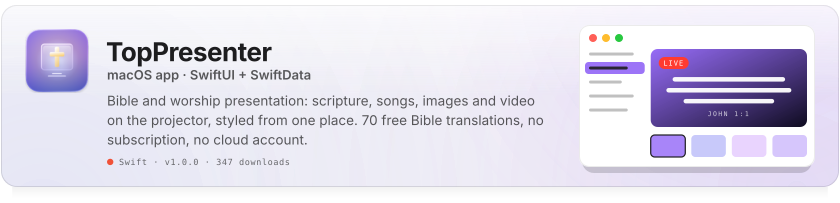

<!-- Generated by .github/profile/build.py from profile.toml. Edit that file, not this one. -->

<a href="https://cosmincalin.es" title="More about me on cosmincalin.es"><picture><source media="(max-width: 600px)" srcset="https://raw.githubusercontent.com/RobyRew/RobyRew/main/img/m/hero-me.svg"><source media="(prefers-color-scheme: dark)" srcset="https://raw.githubusercontent.com/RobyRew/RobyRew/main/img/dark/hero-me.svg"></picture></a><a href="https://robyrew-now.cosmin-calin22.workers.dev/go/play/" title="Play what&#x27;s on the deck"><picture><source media="(max-width: 600px)" srcset="https://robyrew-now.cosmin-calin22.workers.dev/img/m/hero-deck.svg"><source media="(prefers-color-scheme: dark)" srcset="https://robyrew-now.cosmin-calin22.workers.dev/img/dark/hero-deck.svg"></picture></a>
<a href="https://github.com/RobyRew?tab=repositories&amp;sort=stargazers" title="My repositories, most starred first"><picture><source media="(max-width: 600px)" srcset="https://raw.githubusercontent.com/RobyRew/RobyRew/main/img/m/stats-numbers.svg"><source media="(prefers-color-scheme: dark)" srcset="https://raw.githubusercontent.com/RobyRew/RobyRew/main/img/dark/stats-numbers.svg"></picture></a>
<a href="https://github.com/RobyRew?tab=repositories" title="All 47 repos"><picture><source media="(max-width: 600px)" srcset="https://raw.githubusercontent.com/RobyRew/RobyRew/main/img/m/work-head.svg"><source media="(prefers-color-scheme: dark)" srcset="https://raw.githubusercontent.com/RobyRew/RobyRew/main/img/dark/work-head.svg"></picture></a>
<a href="https://github.com/RobyRew/TopPresenter" title="Open TopPresenter on GitHub"><picture><source media="(max-width: 600px)" srcset="https://raw.githubusercontent.com/RobyRew/RobyRew/main/img/m/work-1-toppresenter.svg"><source media="(prefers-color-scheme: dark)" srcset="https://raw.githubusercontent.com/RobyRew/RobyRew/main/img/dark/work-1-toppresenter.svg"></picture></a><a href="https://github.com/RobyRew/chat-converter" title="Open Chat Converter on GitHub"><picture><source media="(max-width: 600px)" srcset="https://raw.githubusercontent.com/RobyRew/RobyRew/main/img/m/work-1-chat-converter.svg"><source media="(prefers-color-scheme: dark)" srcset="https://raw.githubusercontent.com/RobyRew/RobyRew/main/img/dark/work-1-chat-converter.svg"></picture></a>
<a href="https://github.com/RobyRew/mapswitch" title="Open MapSwitch on GitHub"><picture><source media="(max-width: 600px)" srcset="https://raw.githubusercontent.com/RobyRew/RobyRew/main/img/m/work-2-mapswitch.svg"><source media="(prefers-color-scheme: dark)" srcset="https://raw.githubusercontent.com/RobyRew/RobyRew/main/img/dark/work-2-mapswitch.svg"></picture></a><a href="https://github.com/RobyRew/pacetimer" title="Open PeaceTimer on GitHub"><picture><source media="(max-width: 600px)" srcset="https://raw.githubusercontent.com/RobyRew/RobyRew/main/img/m/work-2-pacetimer.svg"><source media="(prefers-color-scheme: dark)" srcset="https://raw.githubusercontent.com/RobyRew/RobyRew/main/img/dark/work-2-pacetimer.svg"></picture></a>
<a href="https://github.com/RobyRew/striker" title="Open Striker on GitHub"><picture><source media="(max-width: 600px)" srcset="https://raw.githubusercontent.com/RobyRew/RobyRew/main/img/m/work-3-striker.svg"><source media="(prefers-color-scheme: dark)" srcset="https://raw.githubusercontent.com/RobyRew/RobyRew/main/img/dark/work-3-striker.svg"></picture></a><a href="https://github.com/RobyRew/spotify-versions-history" title="Open Spotify versions on GitHub"><picture><source media="(max-width: 600px)" srcset="https://raw.githubusercontent.com/RobyRew/RobyRew/main/img/m/work-3-spotify-versions-history.svg"><source media="(prefers-color-scheme: dark)" srcset="https://raw.githubusercontent.com/RobyRew/RobyRew/main/img/dark/work-3-spotify-versions-history.svg"></picture></a>
<a href="https://cosmincalin.es" title="Website: cosmincalin.es"><picture><source media="(max-width: 600px)" srcset="https://raw.githubusercontent.com/RobyRew/RobyRew/main/img/m/contact-website.svg"><source media="(prefers-color-scheme: dark)" srcset="https://raw.githubusercontent.com/RobyRew/RobyRew/main/img/dark/contact-website.svg"></picture></a><a href="https://www.linkedin.com/in/cosmincaliin" title="LinkedIn: in/cosmincaliin"><picture><source media="(max-width: 600px)" srcset="https://raw.githubusercontent.com/RobyRew/RobyRew/main/img/m/contact-linkedin.svg"><source media="(prefers-color-scheme: dark)" srcset="https://raw.githubusercontent.com/RobyRew/RobyRew/main/img/dark/contact-linkedin.svg"></picture></a><a href="https://t.me/RobyRew" title="Telegram: @RobyRew"><picture><source media="(max-width: 600px)" srcset="https://raw.githubusercontent.com/RobyRew/RobyRew/main/img/m/contact-telegram.svg"><source media="(prefers-color-scheme: dark)" srcset="https://raw.githubusercontent.com/RobyRew/RobyRew/main/img/dark/contact-telegram.svg"></picture></a>
<a href="#top" title="Back to the top"><picture><source media="(max-width: 600px)" srcset="https://raw.githubusercontent.com/RobyRew/RobyRew/main/img/m/footer-end.svg"><source media="(prefers-color-scheme: dark)" srcset="https://raw.githubusercontent.com/RobyRew/RobyRew/main/img/dark/footer-end.svg"></picture></a>

