<!-- Generated by .github/profile/build.py from profile.toml. Edit that file, not this one. -->

<picture><source media="(prefers-color-scheme: dark)" srcset="img/dark/hero.svg"></picture>
<a href="https://robyrew.com"><picture><source media="(prefers-color-scheme: dark)" srcset="img/dark/link-1.svg"></picture></a>&nbsp;<a href="https://t.me/RobyRew"><picture><source media="(prefers-color-scheme: dark)" srcset="img/dark/link-2.svg"></picture></a>
<picture><source media="(prefers-color-scheme: dark)" srcset="img/dark/side-a.svg"></picture>
<a href="https://github.com/RobyRew/TopPresenter"><picture><source media="(prefers-color-scheme: dark)" srcset="img/dark/a1.svg">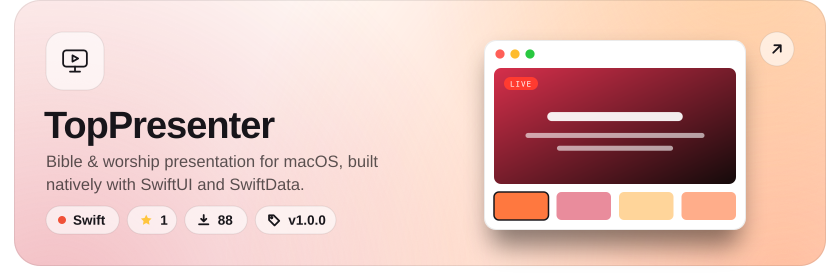</picture></a>
<a href="https://github.com/RobyRew/mapswitch"><picture><source media="(prefers-color-scheme: dark)" srcset="img/dark/a2.svg">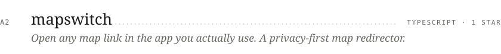</picture></a><a href="https://github.com/RobyRew/chatforge"><picture><source media="(prefers-color-scheme: dark)" srcset="img/dark/a3.svg">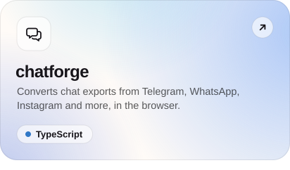</picture></a>
<a href="https://github.com/RobyRew/Download-AI-Chat-PDF"><picture><source media="(prefers-color-scheme: dark)" srcset="img/dark/a4.svg">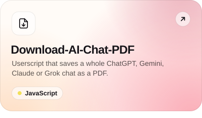</picture></a><a href="https://github.com/RobyRew/spotify-versions-history"><picture><source media="(prefers-color-scheme: dark)" srcset="img/dark/a5.svg">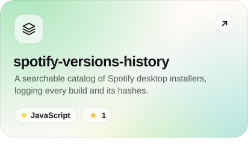</picture></a>
<picture><source media="(prefers-color-scheme: dark)" srcset="img/dark/b-sides.svg"></picture>
<a href="https://github.com/RobyRew/Doorline"><picture><source media="(prefers-color-scheme: dark)" srcset="img/dark/b1.svg">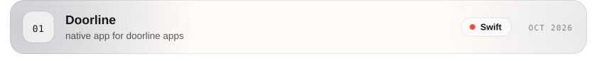</picture></a>
<a href="https://github.com/RobyRew/calendar-event-generator"><picture><source media="(prefers-color-scheme: dark)" srcset="img/dark/b2.svg">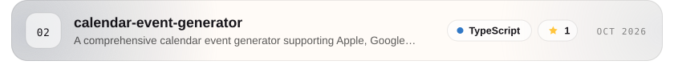</picture></a>
<a href="https://github.com/RobyRew/portfolio"><picture><source media="(prefers-color-scheme: dark)" srcset="img/dark/b3.svg">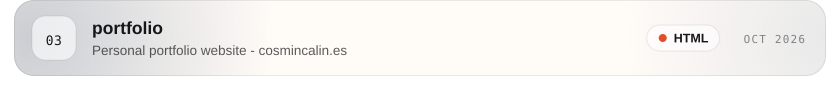</picture></a>
<a href="https://github.com/RobyRew/powerpoint-extractor"><picture><source media="(prefers-color-scheme: dark)" srcset="img/dark/b4.svg">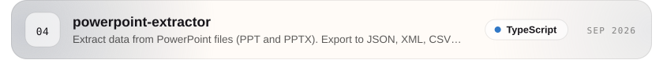</picture></a>
<picture><source media="(prefers-color-scheme: dark)" srcset="img/dark/side-b.svg"></picture>
<picture><source media="(prefers-color-scheme: dark)" srcset="img/dark/highlights.svg">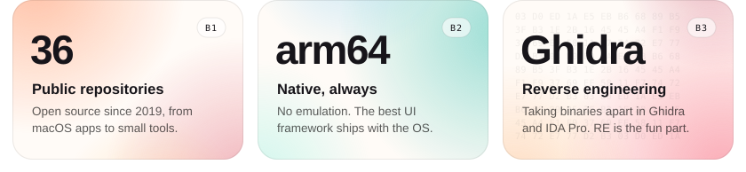</picture>
<picture><source media="(prefers-color-scheme: dark)" srcset="img/dark/stats-head.svg"></picture>
<picture><source media="(prefers-color-scheme: dark)" srcset="img/dark/activity.svg">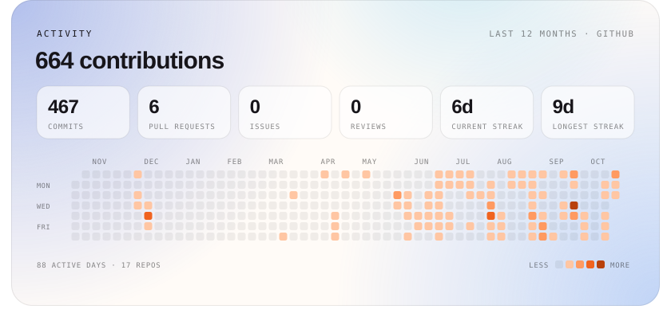</picture>
<picture><source media="(prefers-color-scheme: dark)" srcset="img/dark/popularity.svg">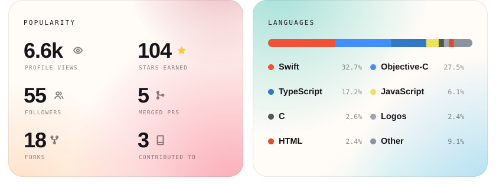</picture>
<picture><source media="(prefers-color-scheme: dark)" srcset="img/dark/facts.svg">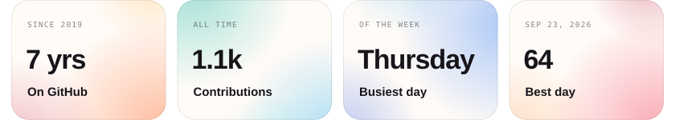</picture>
<picture><source media="(prefers-color-scheme: dark)" srcset="img/dark/rotation.svg"></picture>
<picture><source media="(prefers-color-scheme: dark)" srcset="img/dark/credits.svg">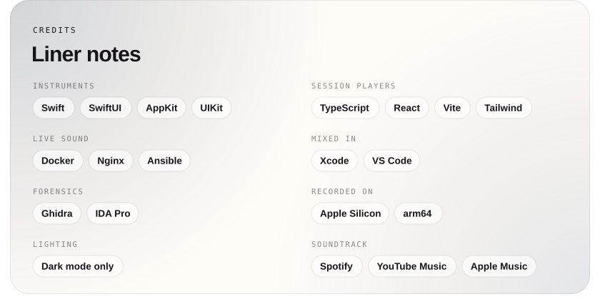</picture>
<picture><source media="(prefers-color-scheme: dark)" srcset="img/dark/colophon.svg">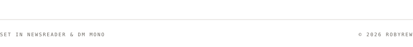</picture>

