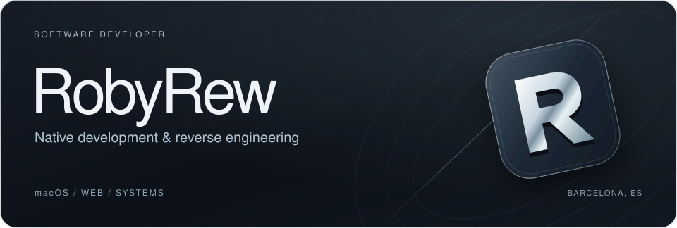

<picture>
  <source media="(max-width: 480px)" srcset="img/header-compact.svg">
  
</picture>

  I spend most of my time building native apps, working on web tools, and taking software apart. 
  I care about the small details: startup time, memory use, and how an interface feels.

  Swift · SwiftUI · AppKit &nbsp; / &nbsp; TypeScript · React &nbsp; / &nbsp; Docker · Ansible

 

<a href="https://github.com/RobyRew?tab=repositories">
  <picture>
    <source media="(max-width: 480px)" srcset="https://raw.githubusercontent.com/RobyRew/RobyRew/profile-assets/stats-compact.svg">
    
  </picture>
</a>

<a href="https://open.spotify.com/user/gwiw7i4a2ha0a8dbldyn94vwl">
  <picture>
    <source media="(max-width: 480px)" srcset="https://raw.githubusercontent.com/RobyRew/RobyRew/profile-assets/spotify-compact.svg">
    
  </picture>
</a>

 

  <a href="https://github.com/RobyRew?tab=repositories">Explore my work ↗</a>
  &nbsp; · &nbsp;
  <a href="https://t.me/RobyRew">Telegram ↗</a>

